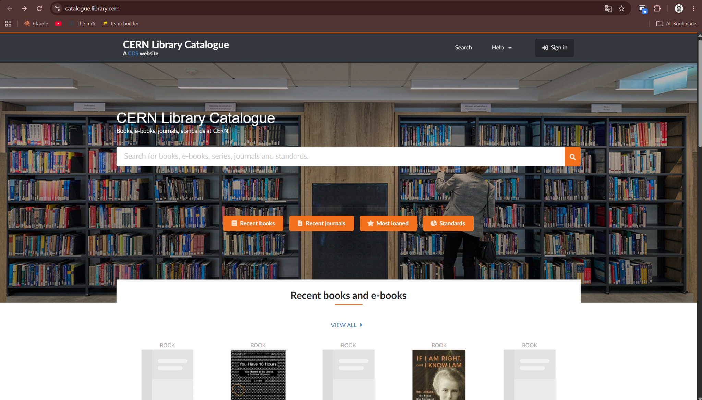
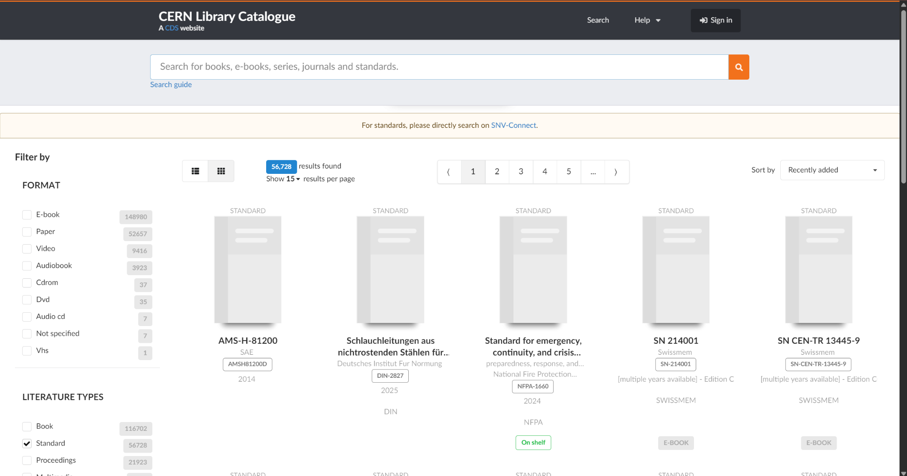
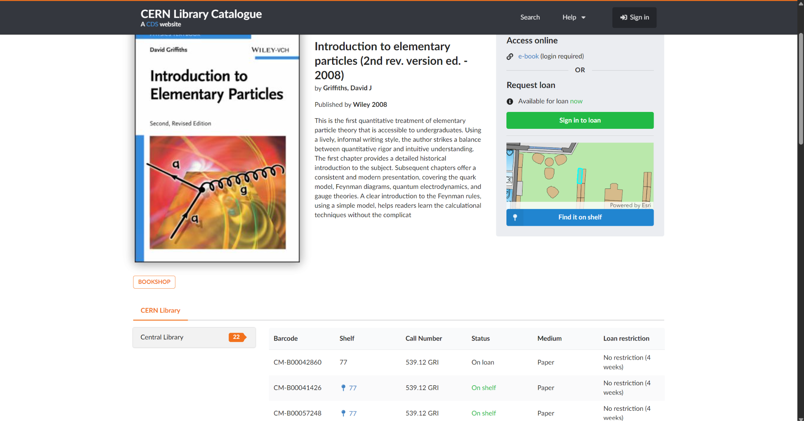

# **App Survey 1 — CERN Library Catalogue**

## **1\. Overview**

CERN Library Catalogue is a web-based library catalogue that allows users to discover books, e-books, journals, and standards. The interface supports searching, filtering, viewing bibliographic information, checking item availability, and accessing borrowing services.

This survey focuses on three main screens: Home, Search Results, and Item Details.

## **2\. Screen Analysis**

### **Screen 1 — Home**

Main functions:

- Search for books, e-books, journals, series, and standards.
- Access shortcuts such as Recent Books, Recent Journals, Most Loaned, and Standards.
- Browse recently added books and e-books.
- Navigate to the search guide, help section, and sign-in page.

UI/UX observations:

- The large search bar is prominently positioned, making the primary action easy to identify.
- Quick-access buttons allow users to explore common categories without entering a query.
- The library background image establishes the website's identity and context.
- The large hero section is visually appealing but occupies considerable screen space.
- The homepage emphasizes discovery rather than displaying detailed account or borrowing information.

Key takeaway: The homepage should make the primary search function immediately accessible while providing shortcuts for common browsing tasks.

### **Screen 2 — Search Results**

Main functions:

- Display the number of results and organize them into pages.
- Filter results by format, such as e-books, paper books, videos, and audiobooks.
- Filter by literature type, such as books and standards.
- Switch between list and grid views.
- Sort results, for example by recently added items.
- Display basic bibliographic information, including titles, publication years, publishers, and availability indicators.

UI/UX observations:

- Filters on the left help users narrow a large collection of results.
- Result counts communicate the size of the current search.
- Pagination and sorting give users control over how results are explored.
- Grid view supports visual browsing, while list view can support information-dense scanning.
- The number of filters and categories may overwhelm first-time users.
- Some result cards contain limited or missing cover images, which can make the grid less visually consistent.
- A clearer visual distinction between active filters and available filters would improve usability.

Key takeaway: Search results should support efficient refinement through clear filters, useful sorting options, and readable item summaries.

### **Screen 3 — Item Details**

Main functions:

- Display the item's title, author, publisher, publication year, and description.
- Provide access to an online version when available and when the user meets access requirements.
- Show loan availability and provide a sign-in option to request a loan.
- Display physical-copy information, including barcode, shelf, call number, status, medium, and loan restrictions.
- Provide a “Find it on shelf” feature to help users locate physical copies.

UI/UX observations:

- The page combines descriptive information with practical borrowing and location details.
- The availability status helps users determine whether a physical copy can be borrowed.
- The shelf-finding map connects catalogue information with the physical library environment.
- The distinction between online access and physical borrowing makes the available options easier to understand.
- The detailed copy table can be difficult to scan because it contains many columns.
- The borrowing action depends on signing in, so users must understand why authentication is required.

Key takeaway: An item details page should help users quickly answer three questions: What is this item? Can I access or borrow it? Where can I find it?

## **3\. UI/UX Pattern Analysis**

| UI/UX Pattern                   | Implementation in CERN Library Catalogue                                                    | Evaluation                                                         |
| ------------------------------- | ------------------------------------------------------------------------------------------- | ------------------------------------------------------------------ |
| Search-First Design             | A prominent search bar appears on the homepage and search page.                             | Makes the primary task easy to discover.                           |
| Quick-Access Shortcuts          | Recent Books, Recent Journals, Most Loaned, and Standards appear on the homepage.           | Reduces the effort needed to explore common categories.            |
| Faceted Filtering               | Search results can be filtered by format and literature type.                               | Helps users narrow large result sets.                              |
| Sorting and Pagination          | Users can sort results and move between result pages.                                       | Supports controlled and structured browsing.                       |
| Grid/List View                  | Search results can be displayed in different layouts.                                       | Accommodates different browsing preferences.                       |
| Status Indicators               | Item records show availability information such as “On shelf” or “On loan.”                 | Helps users make borrowing decisions.                              |
| Contextual Actions              | The item details page provides online access, loan requests, and shelf-location assistance. | Connects information discovery with the next user action.          |
| Progressive Information Display | General information appears alongside detailed physical-copy records.                       | Provides useful context, although the detailed table may be dense. |

## **4\. Overall Strengths and Weaknesses**

### **Strengths**

1. Effective Search Accessibility: The prominent search bar makes the main function easy to locate.
2. Flexible Result Exploration: Filtering, sorting, pagination, and grid/list views support different search needs.
3. Useful Item Information: Users can review bibliographic details, descriptions, publication information, and physical-copy records.
4. Transparent Availability: Status indicators help users distinguish available copies from items currently on loan.
5. Integrated Borrowing and Location Support: The interface connects online access, loan requests, and physical shelf-location assistance.
6. Convenient Discovery Shortcuts: Recent items and popular categories allow users to browse without constructing a search query.

### **Weaknesses**

1. Large Homepage Hero Section: The prominent background image and search area consume substantial vertical space before users reach the catalogue content.
2. Potentially Overwhelming Filters: Numerous filter categories may increase the learning effort for new users.
3. Inconsistent Visual Result Cards: Missing or generic cover images can reduce visual consistency and make items harder to distinguish.
4. Dense Item Details: The physical-copy table contains several columns, which may be difficult to scan, especially on smaller screens.
5. Limited Personalization on the Homepage: The provided screenshot emphasizes general discovery rather than personalized recommendations or a user's current borrowing activity.
6. Authentication Dependency: Users must sign in to request a loan or access restricted online resources, adding a step before completing those actions.

These observations are based on the three provided screenshots. They describe the visible interface and do not necessarily represent every feature available elsewhere in the system.

## **5\. Proposed Improvements for Our Application**

1. **Improve Homepage Efficiency:** Keep the search bar prominent while reducing unnecessary vertical space. Display recently added items and frequently used categories closer to the top of the page.
2. **Simplify Search Filters:** Group related filters into clear sections and make selected filters easy to identify and remove. On smaller screens, provide a collapsible filter panel.
3. **Improve Search Result Readability:** Use consistent cover placeholders and organize each result around the most important information: title, author, publication year, and availability.
4. **Make Item Availability More Actionable:** Use clear status labels and place the relevant next action nearby. For example, available copies could have a clear loan-request action, while unavailable copies could explain their status and show any available alternatives.
5. **Improve the Item Details Layout:** Separate the page into clearly labeled sections, such as Bibliographic Information, Online Access, and Physical Copies. On smaller screens, present copy details as individual cards rather than a wide table.

**Provide Better Borrowing Feedback:** Explain when sign-in is required and provide clear confirmation or error messages after a borrowing request. This helps users understand the system's response and what to do next.

**6\. Conclusion**

The CERN Library Catalogue offers a highly functional, discovery-oriented platform that successfully integrates digital and physical library resources. Its greatest strengths lie in its search-first design, comprehensive filtering tools, and clear availability indicators, which effectively guide users from initial discovery to borrowing. However, there are opportunities to enhance the user experience by optimizing screen space—particularly the homepage hero section—and simplifying dense information layouts like the search filters and detailed copy tables. By applying these insights, our application can adopt CERN's strong foundation in search accessibility while delivering a more streamlined, scannable, and actionable interface for our users.
