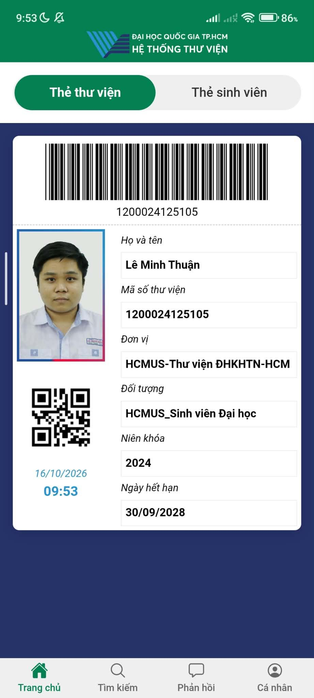
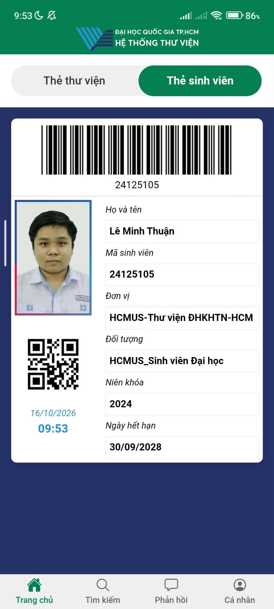
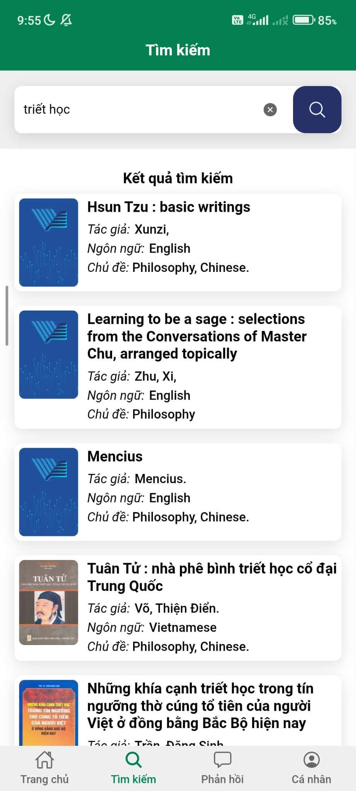
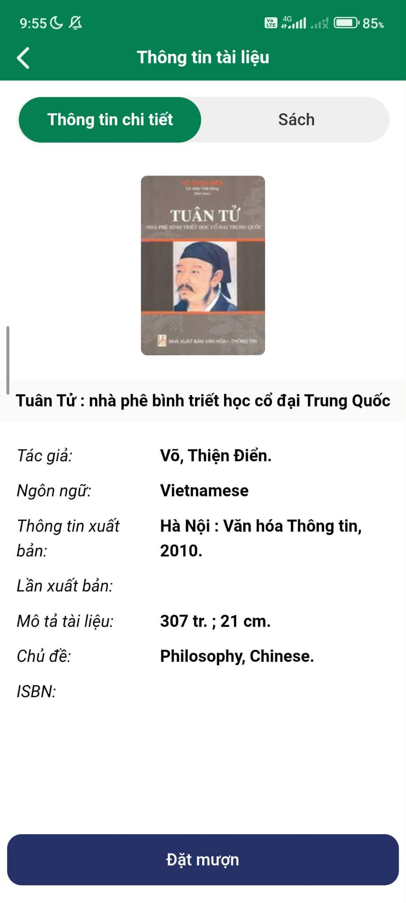
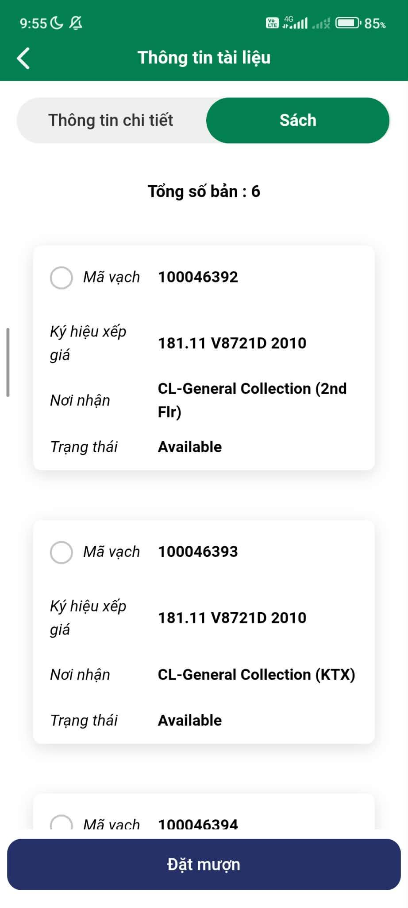
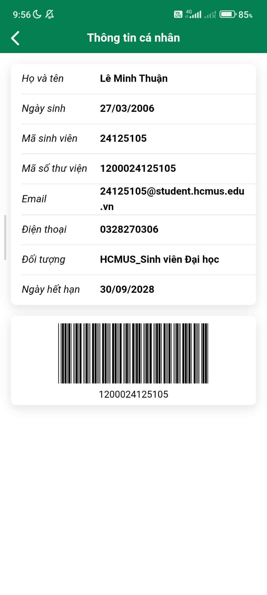
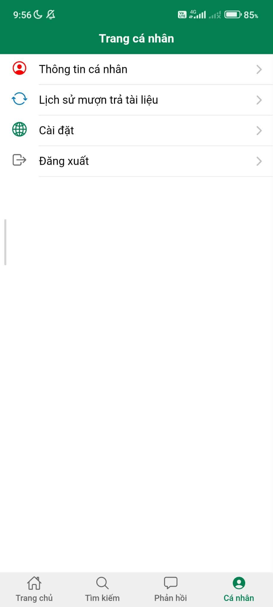
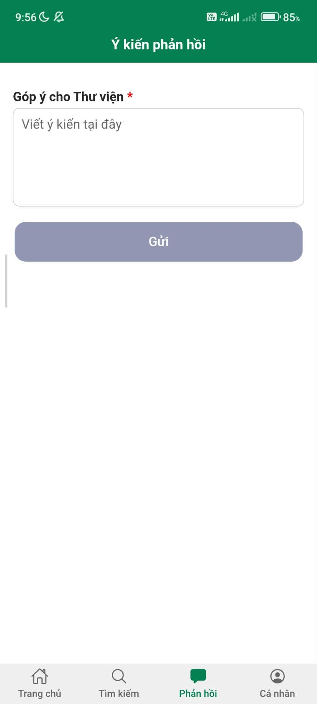

**App Survey 2 \- VNU-HCM Library Application Interface**

## **1\. APPLICATION OVERVIEW**

- **Application:** VNU-HCM Library System Mobile Application (HCMUS Library).
- **Interface:** Mobile User Interface (Student).
- **Purpose:** To explore how the application supports students in managing library cards, searching for documents, checking borrowing status, and performing personalized actions.
- The objective of this survey is to analyze the screen structure, core functions, navigation patterns, and user experience (UX). The findings will be used to identify strengths, weaknesses, and potential improvements.

## **2\. SCREEN SURVEY**

**Screen 1 \- Library Card / Student ID**  
****

- **Main functions:**
  - Provides a digital library card and student ID with barcodes and QR codes for easy scanning at the desk.
  - Displays basic identification information: Avatar, Full name, Student ID, and Card expiration date.
- **UI/UX observations:**
  - The barcode and QR code are large and centrally located, optimizing the scanning process.
  - Uses a convenient tab toggle to switch between "Thẻ thư viện" (Library Card) and "Thẻ sinh viên" (Student Card) at the top of the screen.
- **Key takeaway:** The screen focuses extremely well on its core identification function; however, there is still significant unused space below the card information.

**Screen 2 \- Document Search**  
****

- **Main functions:**
  - Search for books or documents in the system via a search bar (e.g., using the keyword "triết học").
  - Displays a list of results including book cover, title, author, language, and subject.
- **UI/UX observations:**
  - Search results are displayed as cards, making them highly readable on a mobile interface.
  - Information fields have a clear visual hierarchy (the Title is bolded, while secondary information is italicized).
- **Key takeaway:** The search function returns clear visual results but may lack advanced filters (such as filtering by publication year or availability status) on the immediate search results screen.

**Screen 3 \- Document Details and Status**  
****

- **Main functions:**
  - Displays detailed publication information for a specific book.
  - Provides a list of physical copies available in the library, shelving location (e.g., CL-General Collection), individual barcodes, and status (e.g., Available).
  - A "Đặt mượn" (Borrow) action button is located at the bottom of the screen.
- **UI/UX observations:**
  - Information is divided into two tabs: "Thông tin chi tiết" (Details) and "Sách" (Books) for easy user tracking.
  - The "Đặt mượn" (Borrow) button is large, prominently colored, and fixed at the bottom of the screen to facilitate quick user actions.
- **Key takeaway:** The clear presentation helps students easily locate books in the library, though in some instances of data loading errors, the system only shows a blank screen reading "Không có dữ liệu" (No data).

**Screen 4 \- Personal Page & Personal Information**  
****

- **Main functions:**
  - Account management menu includes: Personal Information, Borrowing/Returning History, Settings, and Logout.
  - Displays detailed profile information (Email, Phone, User Category, Expiration Date).
- **UI/UX observations:**
  - Uses a list with illustrative icons for quick recognition of menu items.
- **Key takeaway:** The personal menu is simple and effective, adhering closely to standard mobile app navigation patterns.

**Screen 5 \- Feedback**  
****

- **Main functions:** Allows students to type and send suggestions or feedback directly to the library.
- **UI/UX observations:** A minimalist form utilizing only a text box and a "Gửi" (Send) button.

## **3\. USER FLOW ANALYSIS**

### **Flow A \- Search and Borrow Document**

1. Open the "Tìm kiếm" (Search) tab from the bottom navigation bar.
2. Enter a keyword (e.g., "triết học") \-\> The system returns a list of results.
3. Select a document \-\> View "Thông tin chi tiết" (Details).
4. Switch to the "Sách" (Books) tab to check the status and shelving location.
5. Tap the "Đặt mượn" (Borrow) button at the bottom of the screen.

### **Flow B \- Present Card at the Desk**

1. Open the application, and on the "Trang chủ" (Home) tab, view the digital card.
2. Switch between "Thẻ thư viện" (Library Card) and "Thẻ sinh viên" (Student Card) as needed.
3. Present the barcode or QR code for the scanner to read.

**4\. UI/UX PATTERN ANALYSIS**

| UI/UX Pattern               | Implementation in App                                                                             | Evaluation                                                                          |
| :-------------------------- | :------------------------------------------------------------------------------------------------ | :---------------------------------------------------------------------------------- |
| **Persistent Navigation**   | The Bottom Navigation bar contains Home, Search, Feedback, and Personal Profile.                  | Helps users quickly switch between core features.                                   |
| **Primary Action Emphasis** | The "Đặt mượn" (Borrow) button is dark blue, spans the full width, and is anchored at the bottom. | Guides the user excellently in identifying and completing the borrowing task.       |
| **Card-Based UI**           | Search results and individual book details are grouped into distinct visual content blocks.       | Optimizes the display of complex information within a confined mobile screen space. |

## **5\. OVERALL STRENGTHS AND WEAKNESSES**

**Strengths**

1. **Optimized Mobile Design:** Successfully transitions physical cards into digital formats with sharp, functional barcode/QR codes, which is highly convenient for students.
2. **Transparent Information:** Clearly provides details on the number of copies, shelf marks, and physical book availability.
3. **Coherent Navigation:** The bottom navigation bar makes moving between main functions straightforward and easy.

### **Weaknesses**

1. **Poor Empty State Handling:** The "Không có dữ liệu" (No data) screen lacks follow-up instructions or actionable steps for users to resolve the issue.
2. **Limited Search Filters:** The basic search interface does not surface advanced filtering tools (such as filtering by campus or year) directly on the results page.

## **6\. PROPOSED IMPROVEMENTS FOR OUR APPLICATION**

1. **Improve Warnings and Empty States:** Instead of merely displaying "Không có dữ liệu" (No data), the app should suggest users reload the page or return to the search screen.
2. **Integrate Search Filters:** Incorporate document filtering options directly on the search results screen for better usability.
3. **Optimize Screen Space:** Utilize the empty screen spaces (such as the area below the digital cards) to display library announcements or recent borrowing activity history.

## **7\. CONCLUSION**

The VNU-HCM Library Application provides a highly useful and intuitive interface tailored for university students. The app excels in digitizing student identification and outlining clear structural information regarding documents and books. Although there are opportunities to optimize data filtering capabilities and improve how system error states are handled, it remains an effective platform that seamlessly assists students in completing their daily library operations.
