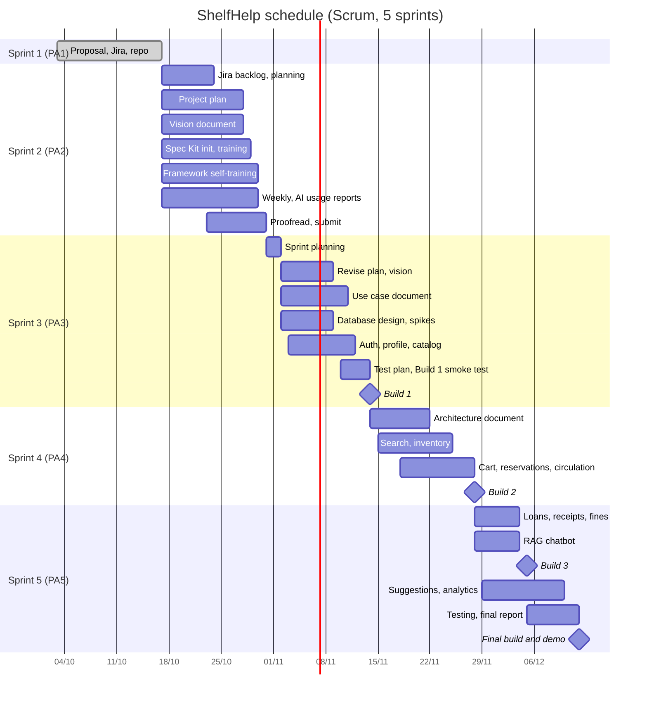

# ShelfHelp: Smart Library Management System

# Software Development Plan (Small Project)

**Version 1.0** (initial draft for PA2-2026)

**Course:** CS300 - CSC13002 - Introduction to Software Engineering | **Team:** HCD (Group 7) | **Process:** Scrum

## Revision History

| Date | Version | Description | Author |
|---|---|---|---|
| 29/10/2026 | 1.0 | Initial draft for PA2-2026 | Team HCD |

## Table of Contents

- 1. Introduction
  - 1.1 Purpose
  - 1.2 Scope
  - 1.3 Overview
- 2. Project Overview
  - 2.1 Project Purpose, Scope, and Objectives
  - 2.2 Assumptions and Constraints
  - 2.3 Project Deliverables
- 3. Project Organization
  - 3.1 Organizational Structure
  - 3.2 Roles and Responsibilities
- 4. Management Process
  - 4.1 Project Estimates
  - 4.2 Project Plan
    - 4.2.1 Phase Plan
    - 4.2.2 Iteration Objectives
    - 4.2.3 Releases
    - 4.2.4 Project Schedule
    - 4.2.5 Project Resourcing
  - 4.3 Project Monitoring and Control
    - 4.3.1 Requirements Management
    - 4.3.2 Reporting and Measurement
    - 4.3.3 Risk Management
    - 4.3.4 Configuration Management

---

## 1. Introduction

**Performed by:** Lê Văn Vĩ | **Reviewed by:** Nguyễn Anh Khôi | **Edited by:** Nguyễn Anh Khôi

### 1.1 Purpose

This document is the initial project plan (PA2-2026). It gathers the information needed to control the project: what we will deliver, who does what, which risks we expect, and when work and builds are planned. The Project Manager uses it to track the schedule, and all members use it to see what they must do, when, and what depends on it. It will be reviewed by the TAs and revised in PA3-2026.

References: PA1-2026 Project Proposal; PA2-2026 assignment; Vision Document (PA2-2026); the team Jira board; Spec Kit `constitution.md` in `/src`.

### 1.2 Scope

ShelfHelp is a web-based library management system for a university library (client: VNUHCM Libraries). It replaces manual borrowing, payment and inventory work with one platform used by **students** (search, borrow, reserve, track loans, buy memberships) and **librarians/administrators** (inventory, circulation, fines, receipts, acquisitions, analytics). It also includes an AI feature: a **RAG-based research book recommendation chatbot** that recommends books actually held by the library from a natural-language description of a student's topic.

This Software Development Plan describes the overall plan to be used by the ShelfHelp project, including deployment of the product. The details of the individual sprints are described in the sprint task tables in Section 4.2.2. The plans in this document are based upon the product requirements defined in the Vision Document.

### 1.3 Overview

This Software Development Plan contains the following information:

- **Project Overview** - describes the project purpose, scope and objectives, the assumptions and constraints, and the deliverables the project is expected to produce.
- **Project Organization** - describes the organizational structure of the team and the role and responsibilities of each member.
- **Management Process** - describes the project estimates, the Scrum plan (phase plan, sprint objectives and detailed tasks, releases/builds, schedule and resourcing), and how the project is monitored and controlled (requirements, reporting, risks and configuration management).

---

## 2. Project Overview

**Performed by:** Lê Văn Vĩ | **Reviewed by:** Nguyễn Anh Khôi | **Edited by:** Nguyễn Anh Khôi

### 2.1 Project Purpose, Scope, and Objectives

**Goals**

- Deliver a working web application covering the 10 functional groups in the proposal (Account, Profile & Membership, Search & Barcode Scan, Cart/Reservations/Payment, Loan Tracking & Fines, Suggestions & Acquisition Batches, Inventory & Circulation, Condition & Write-Off, Receipts, Analytics).
- Deliver the AI recommendation chatbot integrated with search, the cart and the suggestion flow.
- Follow Scrum with 5 sprints, each aligned with one PA, ending with a demo of all features in Sprint 5 (PA5).
- Keep a clear audit trail for stock and money (inventory transactions, receipts).

**Scope**

| In scope | Out of scope |
|---|---|
| Student and admin web apps (responsive, mobile-friendly for camera features) | Native mobile apps |
| Role-based access control, email verification, password reset | Single sign-on with the university identity system |
| Memberships, Premium/Standard collections, configurable plans and limits | Real payment processing (a **simulated** gateway is used) |
| Cart, loan requests, reservation queue, 48-hour pickup holds | Actual procurement/purchasing (only batch lists and CSV/PDF/Excel export) |
| Fines, lost-book handling, reminders (email and in-app) | Integration with external library catalogs |
| Inventory, copy-level tracking, write-off slips, receipts, analytics | Hardware integration (RFID gates, dedicated scanners); phone camera and manual entry only |
| RAG chatbot using a third-party LLM API | Training or fine-tuning our own models |

### 2.2 Assumptions and Constraints

**Assumptions**

1. The team has 5 members with about 10 hours per week each, using Jira, Git and a shared chat channel.
2. Sprint dates follow the course schedule: PA1 due 17/10/2026, PA2 due 31/10/2026, PA3 due 14/11/2026, PA4 due 28/11/2026. The PA5 due date is **assumed to be 12/12/2026** (end of week 11) and will be corrected when it is announced.
3. Technology stack (tentative, to be confirmed in design): React (frontend), Node.js with Express (backend), PostgreSQL (relational DB), a vector store (e.g., pgvector), and one LLM/embedding API. Free tiers are sufficient.
4. Payments are simulated. Email is sent through a free/sandbox SMTP or email API.
5. Sample data (about 300–500 books with metadata) can be generated or imported from open sources.
6. Business rules (loan limits, fees, penalty periods) are configurable settings, as defined in the proposal.
7. Members have not used all tools (Jira, Spec Kit, framework, vector DB) before, so self-training tasks are planned in Sprint 2.
8. Only three sprints (Sprint 3–5) are available for most of the coding, so the backlog is prioritized (Must/Should/Could) and low-priority items may be dropped (see risk R2).

**Constraints**

1. **Schedule:** the PA due dates are fixed; the final demo of all features takes place at the end of Sprint 5 and cannot be moved.
2. **Staff and effort:** 5 members at about 10 hours per week give about 100 hours per 2-week sprint (about 500 hours over the 5 sprints). Planned work is kept at or below 85% of this capacity to leave a buffer.
3. **Budget:** no budget; only free tiers and open-source tools are used.
4. **Technology and data:** no special hardware (phone camera and manual entry only), simulated payments, and an external LLM API only (no own models).
5. **Documentation:** all documents are written in English in Markdown, diagrams use Mermaid, and Spec Kit artifacts are stored in `/src`.

### 2.3 Project Deliverables

| # | Deliverable | Related PA / Sprint | Target date |
|---|---|---|---|
| D1 | Project proposal | PA1 / Sprint 1 | 17/10/2026 (done) |
| D2 | Project plan (this document, then revised) | PA2 / Sprint 2, revised in PA3 / Sprint 3 | 31/10/2026; revision 14/11/2026 |
| D3 | Vision document (initial, then revised) | PA2 / Sprint 2, revised in PA3 / Sprint 3 | 31/10/2026; revision 14/11/2026 |
| D4 | Use case document | PA3 / Sprint 3 | 14/11/2026 |
| D5 | Architecture and database design documents | PA4 / Sprint 4 | 28/11/2026 |
| D6 | Spec Kit artifacts (`constitution.md` and others in `/src`) and Spec Kit training evidence | PA2 / Sprint 2 and continuous | 31/10/2026, then updated each sprint |
| D7 | Testable builds (Build 1–3) and the final build | Sprint 3–5 | 14/11, 28/11, about 05/12 and 12/12/2026 |
| D8 | Test plan, test cases and test reports | Sprint 3–5 | Test plan 14/11/2026; reports 28/11 and 12/12/2026 |
| D9 | Source code in the repository with a README and setup guide, and the Git log | Continuous | Every PA; final 12/12/2026 |
| D10 | Weekly reports (with Jira screenshots) and AI usage reports for each sprint | Every sprint | 31/10, 14/11, 28/11 and 12/12/2026 |
| D11 | Final report, user guide and demo of all features | Sprint 5 / PA5 | 12/12/2026 (assumed) |

---

## 3. Project Organization

**Performed by:** Lê Văn Vĩ | **Reviewed by:** Nguyễn Anh Khôi | **Edited by:** Nguyễn Anh Khôi

### 3.1 Organizational Structure

Team **HCD** (Group 7) has 5 members and applies Scrum. The Scrum Master facilitates the Scrum events, the Product Owner owns the backlog, the Project Manager coordinates schedule, risks and TA communication, and every member also develops code. Each task has one assignee and a different reviewer.

**Working rules**
- Daily check-in asynchronously in chat; a short stand-up twice a week (Tuesday and Friday, 20:00, online).
- Sprint planning at the start and sprint review and retrospective at the end of each sprint; all meetings are documented in the weekly report.
- Every task has **one assignee and one reviewer** (a different member). A task is Done only after review.
- Git: feature branches, pull requests with at least one approval, and merge to `main` only when tests pass.
- Communication: Discord; documents in Google Drive; backlog and schedule in Jira.

### 3.2 Roles and Responsibilities

| Name | Student ID | Role | Responsibilities |
|---|---|---|---|
| Nguyễn Anh Khôi | 24125060 | Scrum Master / Developer | Facilitates sprint planning, daily check-ins, review and retrospective; keeps the Jira board consistent; removes blockers; implements Account, Profile & Membership features |
| Lê Văn Vĩ | 24125050 | Product Owner / Developer / Tester | Owns the product backlog and priorities, writes acceptance criteria and accepts stories; writes and runs test cases and reports defects; implements Cart, Reservations & Payment |
| Lê Minh Thuận | 24125105 | Project Manager / Developer | Manages schedule, risks and deliverables, coordinates with TAs and submits each PA package; implements Inventory & Circulation and Receipts |
| Nguyễn Minh Phú | 24125103 | Developer (Frontend lead and Backend lead) | Leads UI/UX and frontend, and the backend, database design and API contract; implements Search/Browse, barcode scanning and Loan tracking pages |
| Phạm Võ Khang Duy | 24125098 | Developer (AI lead) | Leads the RAG chatbot (embeddings, retrieval, LLM integration) and Spec Kit setup; implements Analytics |

---

## 4. Management Process

**Performed by:** Phạm Võ Khang Duy, Nguyễn Minh Phú | **Reviewed by:** Lê Minh Thuận | **Edited by:** Nguyễn Anh Khôi

### 4.1 Project Estimates

- **Capacity:** 5 members × 10 hours × 2 weeks = about 100 hours per sprint. Planned work is kept at or below 85 hours per sprint (Sprint 2: about 80 hours; Sprint 3: about 85 hours).
- **Estimation method:** document and training tasks are estimated in hours. Feature stories are estimated in story points and converted to hours using the velocity measured in Sprint 3. Estimates are reviewed in every sprint retrospective and re-estimated in the PA3 revision of this plan (see risk R7).

### 4.2 Project Plan

#### 4.2.1 Phase Plan

The project follows **Scrum**. The product backlog is kept in Jira, with epics for the 10 feature groups plus the AI chatbot, infrastructure and documentation. Each sprint corresponds to one PA and lasts 2 weeks. All activities (writing documents, coding, self-training, testing, review) are tracked as Jira tasks. Each task has one assignee and a different reviewer, recorded in Jira and in the task tables below. The schedule below must match the Jira board.

The five sprints below are the project phases. Each sprint ends with a PA submission, and the demo of all features is in Sprint 5.

| Sprint | PA | Dates | Goal |
|---|---|---|---|
| 1 | PA1 | 03/10 – 17/10/2026 | Team formation, project proposal, Jira and repository setup (**done**) |
| 2 | PA2 | 17/10 – 31/10/2026 | Project plan, vision document, Spec Kit initialization and training, tools self-training, weekly/AI usage reports |
| 3 | PA3 | 31/10 – 14/11/2026 | Revised plan and vision, **use case document**, database schema, authentication/profile, catalog basics; **Build 1** |
| 4 | PA4 | 14/11 – 28/11/2026 | **Architecture document**; search/browse, inventory, membership, cart and borrowing flow; **Build 2** |
| 5 | PA5 | 28/11 – 12/12/2026 (assumed) | Remaining features (fines, reminders, receipts, chatbot, suggestions, analytics), hardening; **Build 3** (about 05/12); **Final build**, final report and **demo of all features** (12/12) |

**Major milestones**

| Milestone | Date | Achievement criteria |
|---|---|---|
| PA1 submitted | 17/10/2026 | Proposal, Jira and repository ready |
| PA2 submitted | 31/10/2026 | Project plan, vision document, Spec Kit artifacts, weekly and AI usage reports |
| Build 1 / PA3 | 14/11/2026 | Revised plan and vision, use case document, authentication and catalog basics working |
| Build 2 / PA4 | 28/11/2026 | Architecture document, search, inventory, membership, cart and borrowing flow working |
| Build 3 | about 05/12/2026 | Loans, receipts, fines, reminders and chatbot working |
| Final build and demo / PA5 | 12/12/2026 (assumed) | Demo of all features, final report and user guide |

#### 4.2.2 Iteration Objectives

**Sprint 2 goal (current sprint, 17/10 – 31/10):** submit the PA2 package (project plan, vision document, Spec Kit artifacts, weekly report, AI usage report), and prepare the team for coding in Sprint 3.

Estimates are the assignee's effort in hours. The total is about 80 hours, which is about 80% of the team capacity (100 hours), leaving a buffer.

| ID | Task | Assignee | Reviewer | Est. (h) | Due |
|---|---|---|---|---|---|
| S2-01 | Break the proposal into epics and user stories in Jira, set up the Sprint 2 board | Nguyễn Anh Khôi | Lê Văn Vĩ | 3 | 24/10 |
| S2-02 | Sprint 2 planning meeting and notes (weekly report) | Lê Minh Thuận | Nguyễn Anh Khôi | 1.5 | 24/10 |
| S2-03 | Write project plan: Sections 1–3 (introduction, overview, organization, risks) | Lê Văn Vĩ | Nguyễn Anh Khôi | 4 | 26/10 |
| S2-04 | Write project plan Section 4: process, sprint overview, Sprint 2 and Sprint 3 task tables, later-sprint tasks | Phạm Võ Khang Duy | Lê Minh Thuận | 3 | 27/10 |
| S2-05 | Write project plan Section 4: schedule (Gantt), build plan, estimates, quality rules, monitoring, alignment with Jira | Nguyễn Minh Phú | Lê Minh Thuận | 3 | 28/10 |
| S2-06 | Vision document: Introduction and Positioning (problem and product position tables) | Lê Văn Vĩ | Nguyễn Minh Phú | 3 | 26/10 |
| S2-07 | Vision document: stakeholder and user descriptions, alternatives and competition (update PA1 survey) | Lê Văn Vĩ | Phạm Võ Khang Duy | 4 | 27/10 |
| S2-08 | Vision document: product overview, product features (paragraph per feature) and 1–2 Mermaid workflow diagrams | Nguyễn Minh Phú | Lê Văn Vĩ | 7 | 28/10 |
| S2-09 | Vision document: non-functional requirements (quantified) | Lê Minh Thuận | Phạm Võ Khang Duy | 3 | 27/10 |
| S2-10 | Initialize Spec Kit in `/src`; generate `constitution.md` and other Markdown files | Phạm Võ Khang Duy | Nguyễn Minh Phú | 3 | 27/10 |
| S2-11a | Spec Kit training (official YouTube tutorials) with evidence — Khôi | Nguyễn Anh Khôi | Lê Văn Vĩ | 2 | 29/10 |
| S2-11b | Spec Kit training with evidence — Vĩ | Lê Văn Vĩ | Lê Minh Thuận | 2 | 29/10 |
| S2-11c | Spec Kit training with evidence — Thuận | Lê Minh Thuận | Nguyễn Minh Phú | 2 | 29/10 |
| S2-11d | Spec Kit training with evidence — Phú | Nguyễn Minh Phú | Phạm Võ Khang Duy | 2 | 29/10 |
| S2-11e | Spec Kit training with evidence — Duy | Phạm Võ Khang Duy | Nguyễn Anh Khôi | 2 | 29/10 |
| S2-12a | Self-training: chosen backend/frontend frameworks (small demo app) — Khôi | Nguyễn Anh Khôi | Lê Văn Vĩ | 5 | 30/10 |
| S2-12b | Self-training: frameworks (small demo app) — Vĩ | Lê Văn Vĩ | Lê Minh Thuận | 5 | 30/10 |
| S2-12c | Self-training: frameworks (small demo app) — Thuận | Lê Minh Thuận | Nguyễn Minh Phú | 5 | 30/10 |
| S2-12d | Self-training: frameworks (small demo app) — Phú | Nguyễn Minh Phú | Phạm Võ Khang Duy | 5 | 30/10 |
| S2-12e | Self-training: frameworks (small demo app) — Duy | Phạm Võ Khang Duy | Nguyễn Anh Khôi | 5 | 30/10 |
| S2-13 | Scrum meetings (twice a week) and notes (weekly report) | Nguyễn Anh Khôi | Lê Minh Thuận | 2 | 30/10 |
| S2-14 | AI usage report: declare AI tool usage and keep the detailed log | Phạm Võ Khang Duy | Lê Văn Vĩ | 1.5 | 30/10 |
| S2-15 | Sprint 2 review and retrospective, Jira screenshots for the weekly report | Nguyễn Anh Khôi | Lê Minh Thuận | 1.5 | 30/10 |
| S2-16 | Final proofreading of all documents (English, formatting, Performed/Reviewed/Edited line in every section) | Nguyễn Anh Khôi | Lê Văn Vĩ | 4 | 30/10 |
| S2-17 | Convert Markdown to PDF, export Git log, build `PA2-Group07.zip` and submit | Lê Minh Thuận | Phạm Võ Khang Duy | 2 | 31/10 |

**Sprint 3 (PA3, upcoming sprint, 31/10 – 14/11)**

**Sprint 3 goal:** submit the PA3 package (revised plan and vision, use case document), design the database, implement authentication, profile and catalog basics, and release **Build 1**.

Estimates are the assignee's effort in hours. The total is about 85 hours, which is about 85% of the team capacity (100 hours). Assignments follow the feature ownership in Section 3.2 and are confirmed at the Sprint 3 planning meeting (S3-01).

| ID | Task | Assignee | Reviewer | Est. (h) | Due |
|---|---|---|---|---|---|
| S3-01 | Sprint 3 planning meeting; refine the Jira backlog using TA feedback on PA2 | Nguyễn Anh Khôi | Lê Văn Vĩ | 2 | 02/11 |
| S3-02 | Revise the project plan after TA feedback | Lê Minh Thuận | Nguyễn Anh Khôi | 3 | 09/11 |
| S3-03 | Revise the vision document after TA feedback | Lê Văn Vĩ | Nguyễn Minh Phú | 3 | 09/11 |
| S3-04 | Use cases: Account, Profile & Membership | Nguyễn Anh Khôi | Lê Văn Vĩ | 3 | 10/11 |
| S3-05 | Use cases: Search & Barcode Scan, Loan Tracking & Fines | Nguyễn Minh Phú | Lê Minh Thuận | 3 | 10/11 |
| S3-06 | Use cases: Cart/Reservations/Payment, Suggestions & Acquisition Batches | Lê Văn Vĩ | Phạm Võ Khang Duy | 3 | 10/11 |
| S3-07 | Use cases: Inventory & Circulation, Condition & Write-Off, Receipts | Lê Minh Thuận | Nguyễn Anh Khôi | 3 | 10/11 |
| S3-08 | Use cases: Analytics and chatbot; assemble and format the use case document | Phạm Võ Khang Duy | Nguyễn Minh Phú | 3 | 11/11 |
| S3-09 | Database schema (ERD) and state diagrams (loan request, reservation, copy, account) | Nguyễn Minh Phú | Lê Minh Thuận | 6 | 06/11 |
| S3-10 | Project skeleton (frontend and backend) and CI pipeline | Lê Minh Thuận | Nguyễn Minh Phú | 4 | 05/11 |
| S3-11 | Spike: browser barcode scanning (camera) | Nguyễn Minh Phú | Phạm Võ Khang Duy | 3 | 07/11 |
| S3-12 | Spike: embeddings and vector search on 50 sample books | Phạm Võ Khang Duy | Nguyễn Anh Khôi | 5 | 09/11 |
| S3-13 | Prepare seed data (sample books, copies, test accounts) | Lê Văn Vĩ | Lê Minh Thuận | 3 | 09/11 |
| S3-14 | Implement registration, email verification, login/logout, password reset and role-based access control (3.1) | Nguyễn Anh Khôi | Nguyễn Minh Phú | 8 | 11/11 |
| S3-15 | Implement profile view/edit and change password (3.2) | Nguyễn Anh Khôi | Lê Văn Vĩ | 3 | 12/11 |
| S3-16 | Implement book catalog basics: add one book, copy records, shelf locations (3.7) | Lê Minh Thuận | Nguyễn Minh Phú | 7 | 12/11 |
| S3-17 | Frontend shell: routing, layout, login and profile pages | Nguyễn Minh Phú | Nguyễn Anh Khôi | 4 | 10/11 |
| S3-18 | Write the test plan and authentication test cases | Lê Văn Vĩ | Phạm Võ Khang Duy | 5 | 12/11 |
| S3-19 | Spec Kit specify/plan/tasks for the authentication feature | Phạm Võ Khang Duy | Nguyễn Minh Phú | 3 | 06/11 |
| S3-20 | Build 1: integration, smoke test and tag | Lê Văn Vĩ | Lê Minh Thuận | 3 | 14/11 |
| S3-21 | Scrum meetings, notes, weekly report and AI usage report | Phạm Võ Khang Duy | Nguyễn Anh Khôi | 4 | 13/11 |
| S3-22 | Sprint 3 review and retrospective, Jira screenshots | Nguyễn Anh Khôi | Lê Minh Thuận | 1.5 | 13/11 |
| S3-23 | Proofread PA3 documents, convert to PDF, export Git log, build the PA3 zip and submit | Phạm Võ Khang Duy | Lê Minh Thuận | 3 | 14/11 |

**Sprint 4 (PA4) — 14/11 – 28/11**
- Write the architecture document (high-level architecture, component and deployment views, API contract).
- Bulk CSV import, barcode labels, search, filters, sorting, browse views, book detail page, wishlist, ISBN barcode scan (3.3, 3.7).
- Membership plans, purchase/renewal, privilege snapshot, expiry status, configurable settings (3.2).
- Cart, loan requests, 48-hour pickup holds, simulated payment gateway, refund marking (3.4).
- Reservation queue and expiry job (3.4).
- Circulation: handover and return confirmation with condition recording (3.7, 3.8).
- Test cases and unit/integration tests for the above; **Build 2**.
- Weekly report, AI usage report, sprint review and retrospective.

**Sprint 5 (PA5) — 28/11 – 12/12 (assumed)**
- My Loans page, renewal, ratings and reviews (3.5).
- Receipts: automatic generation, receipt log, reversal receipts, manual receipts (3.9).
- RAG chatbot: embedding pipeline, retrieval with filters, LLM prompt, chat UI, add-to-cart link (4).
- Fines, lost-book rule, Restricted account restoration, email and in-app reminders, scheduled jobs (3.5, 3.7).
- **Build 3** (about 05/12).
- Book suggestions, acquisition batches, write-off slips, inventory history (3.6, 3.8) and analytics dashboard (3.10), prioritized as Should/Could.
- Bug fixing, regression/system testing, performance and security checks, usability polish; user acceptance test.
- Final report, user guide, demo script; rehearsal; **Final build and demo of all features** (12/12).
- Weekly report, AI usage report, sprint review and retrospective.

#### 4.2.3 Releases

| Build | When | Content | Testing |
|---|---|---|---|
| Build 1 | End of Sprint 3 (14/11) | Registration, verification, login, password reset, RBAC, profile, basic catalog and seed data | Authentication and authorization tests; smoke test |
| Build 2 | End of Sprint 4 (28/11) | Build 1 + search/browse/barcode scan, inventory, membership, cart, reservations, circulation | Functional tests of search, inventory, membership and borrowing rules |
| Build 3 | Early Sprint 5 (about 05/12) | Build 2 + loans, receipts, fines, reminders, chatbot, and as many of the suggestion/write-off/analytics features as are ready | Full regression, scheduled jobs, role and permission checks, chatbot quality check |
| Final build | End of Sprint 5 (12/12, assumed) | Build 3 + bug fixes and polish | Acceptance test and **demo of all features** |

In total, 4 builds are produced (3 testing builds and the final demo build). No build is planned in Sprint 2, which is documentation and training focused. An additional hotfix build is made only if a critical bug is found.

#### 4.2.4 Project Schedule

**Consistency with Jira.** The Jira board contains epics for each feature group, one sprint per PA with matching dates, and story/task issues with assignee, reviewer, estimate, and due date. Sprint 2 tasks S2-01 to S2-17 and Sprint 3 tasks S3-01 to S3-23 above are created as Jira issues, and later issues are created as the backlog is refined. A screenshot of the Sprint 2 board is attached to the weekly report.

#### 4.2.5 Project Resourcing

- **Staff and skills:** the 5 team members are the only resources. Needed skills are web frontend (React), backend and database (Node.js, PostgreSQL), AI/RAG, Scrum/Jira, and Spec Kit.
- **Training:** Spec Kit training (S2-11) by 29/10; framework self-training (S2-12) by 30/10; spikes on barcode scanning and vector search (S3-11, S3-12) by 09/11.

### 4.3 Project Monitoring and Control

#### 4.3.1 Requirements Management

The requirements for this system are captured in the Vision Document and the Jira product backlog. A requested change needs Product Owner approval, is recorded in Jira as a change request, and is reflected in the next revision of the Vision Document.

#### 4.3.2 Reporting and Measurement

A weekly report is written for each sprint (Sprint Planning, Scrum meetings, Sprint Review, Jira screenshots), and an AI usage report is submitted for each sprint. The team tracks planned versus completed work per sprint (burndown), velocity from Sprint 3, open and closed defects, and the number of passing test cases per build.

**Quality and review**

- Each task is performed by one member and reviewed by another (code review through pull requests, document review by checklist).
- A task is Done when it is implemented, reviewed, merged, tested, and its Jira status is updated.
- Test cases are written alongside stories; defects are logged in Jira and fixed before the next build.

#### 4.3.3 Risk Management

Risks are identified during Sprint 2 and reviewed at least once per sprint (in the sprint retrospective). Each risk has an owner, is tracked in Jira, and the table below is updated in every revision of this plan. The plan identifies more than the required three risks.

| # | Risk | Likelihood | Impact | Mitigation | Owner |
|---|---|---|---|---|---|
| R1 | **Member unavailability** (illness, exams, other courses) | Medium | High | Each module has a primary and a backup member; tasks are small (≤ 2 days); knowledge is shared through code review; a 15–20% time buffer is kept in each sprint | Scrum Master |
| R2 | **Scope creep**: 10 functional groups plus an AI feature is large, with only three coding sprints | High | High | Features are prioritized (Must/Should/Could) in the backlog; changes need Product Owner approval; Could-have items (e.g., bulk "Remind all", multi-format export, avatar camera capture) are dropped first; a minimum viable demo scenario is defined in Sprint 3 | Product Owner |
| R3 | **Technology issues**: team is new to the framework, Spec Kit, browser barcode scanning, or vector search | Medium | Medium | Time-boxed self-training in Sprint 2 and spikes at the start of Sprint 3; prototypes built early; fall back to manual ISBN entry and plain keyword search if needed | Backend/Frontend leads |
| R4 | **LLM/API problems**: rate limits, cost, latency, or poor recommendations | Medium | Medium | Use free tiers and cache embeddings; retrieve before generating so output is limited to catalog books; keep a cached/mock response mode for demos; the chatbot is isolated behind one service interface so providers can be swapped | AI lead |
| R5 | **Complex business rules** (reservation queue, expiry jobs, fines, Restricted status) cause defects | High | High | Model status transitions as state diagrams before coding; write unit tests for every transition; seed realistic test data; scheduled jobs can be triggered manually for testing | Tester |
| R6 | **Integration problems** when merging features late | Medium | High | Continuous integration on every pull request; at least one integrated build per sprint from Sprint 3; shared API contract agreed early | Backend lead |
| R7 | **Poor effort estimates** lead to unfinished sprints | Medium | Medium | Use story points and track velocity; carry unfinished work over transparently; adjust the plan at each retrospective and in PA3 | Scrum Master |
| R8 | **Data loss or environment failure** (DB, hosting) | Low | High | Regular backups, seed scripts to rebuild data, deployment documented in the README | Backend lead |
| R9 | **Overlapping deadlines** between PA documents and coding work | Medium | Medium | Document tasks are scheduled first in each sprint; coding tasks fill the remaining capacity; the PO re-prioritizes at each sprint planning | Project Manager |

#### 4.3.4 Configuration Management

All source code, Spec Kit artifacts and documents are kept in the Git repository on feature branches with pull requests, and commit messages reference the Jira issue ID. Each build is tagged (`build-1`, `build-2`, `build-3`, `final`). Documents are written in Markdown, carry a version number, and each PA package is named `PA<n>-Group07`. Backups are the remote repository, Google Drive and database seed scripts.

**Project close-out.** After the demo in Sprint 5, the team publishes the final report and user guide, tags the final build, archives the repository and Jira board, and holds a final retrospective.
