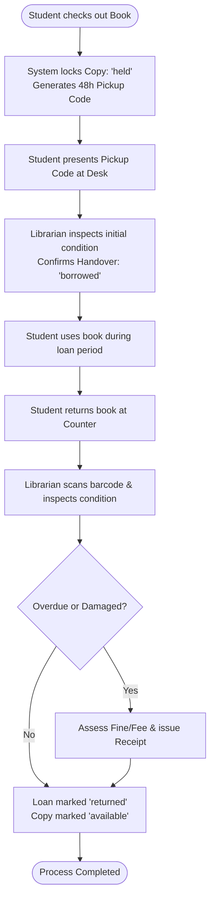
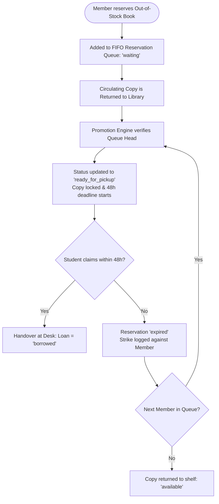

# ShelfHelp: Smart Library Management System
# Vision Document

**Version:** 1.0

---

## Revision History

| Date | Version | Description | Author |
| :--- | :--- | :--- | :--- |
| 28/Oct/2026 | 1.0 | Combined sections 1-3 and 4-6 | Le Van Vi |

---

## Table of Contents

- [1. Introduction](#1-introduction)
  - [1.1 References](#11-references)
- [2. Positioning](#2-positioning)
  - [2.1 Problem Statement](#21-problem-statement)
  - [2.2 Product Position Statement](#22-product-position-statement)
- [3. Stakeholder and User Descriptions](#3-stakeholder-and-user-descriptions)
  - [3.1 Stakeholder Summary](#31-stakeholder-summary)
  - [3.2 User Summary](#32-user-summary)
  - [3.3 User Environment](#33-user-environment)
  - [3.4 Summary of Key Stakeholder or User Needs](#34-summary-of-key-stakeholder-or-user-needs)
  - [3.5 Alternatives and Competition](#35-alternatives-and-competition)
- [4. Product Overview](#4-product-overview)
  - [4.1 Product Perspective](#41-product-perspective)
  - [4.2 Assumptions and Dependencies](#42-assumptions-and-dependencies)
- [5. Product Features](#5-product-features)
  - [5.1 Feature Summary Table](#51-feature-summary-table)
  - [5.2 Account and Identity Management Features](#52-account-and-identity-management-features)
  - [5.3 Membership Management Features](#53-membership-management-features)
  - [5.4 Catalog Discovery and Access Features](#54-catalog-discovery-and-access-features)
  - [5.5 Borrowing Cart and Checkout Features](#55-borrowing-cart-and-checkout-features)
  - [5.6 Loan Tracking, Fines, and Reminders Features](#56-loan-tracking-fines-and-reminders-features)
  - [5.7 Member Reservation Queue Features](#57-member-reservation-queue-features)
  - [5.8 Book Suggestions and Batch Acquisition Features](#58-book-suggestions-and-batch-acquisition-features)
  - [5.9 Desk Circulation and Shelf Inventory Features](#59-desk-circulation-and-shelf-inventory-features)
  - [5.10 Condition Tracking and Write-Off Features](#510-condition-tracking-and-write-off-features)
  - [5.11 Financial Receipts and Ledger Features](#511-financial-receipts-and-ledger-features)
  - [5.12 Analytics and Reporting Features](#512-analytics-and-reporting-features)
  - [5.13 AI Research Assistant Features](#513-ai-research-assistant-features)
  - [5.14 Key Application Workflows](#514-key-application-workflows)
- [6. Non-Functional Requirements](#6-non-functional-requirements)
  - [6.1 Applicable Standards](#61-applicable-standards)
  - [6.2 Performance Requirements](#62-performance-requirements)
  - [6.3 Security Requirements](#63-security-requirements)
  - [6.4 Platform and Environmental Requirements](#64-platform-and-environmental-requirements)
  - [6.5 Quality Attributes: Reliability, Usability, and Auditability](#65-quality-attributes-reliability-usability-and-auditability)
---

## 1. Introduction

**Performed by:** Lê Minh Thuận | **Reviewed by:** Nguyễn Anh Khôi | **Edited by:** Lê Minh Thuận

The purpose of this document is to collect, analyze, and define high-level needs and features of the ShelfHelp Smart Library Management System. It focuses on the capabilities needed by the stakeholders and the target users, and why these needs exist.

### 1.1 References

- Project Assignment 1 (PA1-2026): Project Proposal.
- Project Assignment 2 (PA2-2026): Guidelines and Requirements.

## 2. Positioning

**Performed by:** Lê Minh Thuận | **Reviewed by:** Nguyễn Anh Khôi | **Edited by:** Lê Minh Thuận

### 2.1 Problem Statement

|                                    |                                                                                                                                                                                                                            |
| ---------------------------------- | -------------------------------------------------------------------------------------------------------------------------------------------------------------------------------------------------------------------------- |
| **The problem of**                 | inefficient, manual university library management using spreadsheets, paper cards, or outdated systems                                                                                                                     |
| **affects**                        | university students and librarians                                                                                                                                                                                         |
| **the impact of which is**         | students struggling to discover relevant reading materials based on research topics and missing due dates, while librarians waste significant time on manual record-keeping, chasing overdue books, and compiling reports. |
| **a successful solution would be** | digitizing the whole lending cycle with automated reminders, real-time inventory tracking, and integrating an AI research assistant to help students find books using natural language.                                    |

### 2.2 Product Position Statement

|                        |                                                                                                                                                                                                                                                            |
| ---------------------- | ---------------------------------------------------------------------------------------------------------------------------------------------------------------------------------------------------------------------------------------------------------- |
| **For**                | university students and librarians                                                                                                                                                                                                                         |
| **Who**                | need an efficient, automated, and smart way to borrow, discover, and manage library resources                                                                                                                                                              |
| **The (product name)** | ShelfHelp                                                                                                                                                                                                                                                  |
| **That**               | provides a comprehensive responsive web application that digitizes the lending cycle, introduces a sustainable membership model, and offers AI-powered book recommendations                                                                                |
| **Unlike**             | traditional paper-based workflows, spreadsheets, or legacy library catalog systems                                                                                                                                                                         |
| **Our product**        | bridges the gap between digital requests and physical counter handovers, automates fee/fine calculations, and features a Retrieval-Augmented Generation (RAG) chatbot that recommends books actually held by the library based on natural-language topics. |

## 3. Stakeholder and User Descriptions

**Performed by:** Lê Minh Thuận | **Reviewed by:** Nguyễn Anh Khôi | **Edited by:** Lê Minh Thuận

### 3.1 Stakeholder Summary

| Name                               | Description                                                              | Responsibilities                                                                                                                                    |
| ---------------------------------- | ------------------------------------------------------------------------ | --------------------------------------------------------------------------------------------------------------------------------------------------- |
| **University Institution / Board** | The governing body of the university providing the budget and oversight. | Ensures the library operates efficiently; monitors lost assets and overall revenue from memberships/fines; requires accurate statistical reporting. |
| **IT Department**                  | The technical staff of the university.                                   | Ensures system uptime, security, and maintenance of the web application and database environment.                                                   |

### 3.2 User Summary

| Name                  | Description                                                                 | Responsibilities                                                                                                                                                     | Stakeholder            |
| --------------------- | --------------------------------------------------------------------------- | -------------------------------------------------------------------------------------------------------------------------------------------------------------------- | ---------------------- |
| **Student (Reader)**  | University students with a university-issued email and student ID.          | Searches for books, requests/returns loans, manages memberships, pays fees/fines, writes reviews, and interacts with the AI chatbot.                                 | University Institution |
| **Librarian (Admin)** | Library staff managing daily operations at the library counter and shelves. | Manages catalog/inventory, hands over and receives books, records physical book conditions, processes in-person payments, plans acquisitions, and generates reports. | University Institution |

### 3.3 User Environment

- **Platform:** Responsive web application accessible on Windows, macOS, Android, and iOS.
- **Usage Context:**
  - **Students:** Designed mobile-first. They mostly use smartphones between classes (e.g., scanning a book's barcode at a shelf, checking due dates, chatting with AI) and laptops when studying or writing a thesis.
  - **Librarians:** Designed desktop-first. They mainly work on desktop computers at the library counter, with occasional tablet or phone use on the shelves for barcode scanning and inventory checks.
- **Hardware Interfacing:** The device's camera is utilized for avatar capture and scanning physical book barcodes.

### 3.4 Summary of Key Stakeholder or User Needs

| Need                            | Priority | Concerns                                                                            | Current Solution                                                 | Proposed Solutions                                                                                        |
| ------------------------------- | -------- | ----------------------------------------------------------------------------------- | ---------------------------------------------------------------- | --------------------------------------------------------------------------------------------------------- |
| **Semantic Discovery**          | High     | Keyword search fails when students only know a research topic, not specific titles. | Wandering physical shelves or using inaccurate keyword catalogs. | A RAG-based AI chatbot that understands natural language and recommends relevant library books.           |
| **Automated Reminders & Fines** | High     | Students forget due dates; librarians spend too much time calculating fines.        | Manual tracking and chasing via phone calls or manual emails.    | Automated email and in-app notifications for due dates; automatic daily fine calculation.                 |
| **Accurate Asset Tracking**     | High     | Books get lost or damaged without clear accountability.                             | Spreadsheets and paper condition notes.                          | Strict handover/return workflows requiring librarians to log copy conditions; integrated Write-Off Slips. |

### 3.5 Alternatives and Competition

- **Manual Workflows (Spreadsheets & Paper Cards):** Still used by many universities. Highly prone to human error, lacks real-time updates, and offers no self-service discovery for students.
- **Legacy Library Systems:** Outdated desktop-bound software that lacks mobile responsiveness, membership revenue models, and modern AI recommendation capabilities.

# 4. Product Overview

**Performed by:** Lê Văn Vĩ | **Reviewed by:** Nguyễn Anh Khôi | **Edited by:** Lê Văn Vĩ

## 4.1 Product Perspective
ShelfHelp is an independent, responsive web-based library management platform designed specifically for university academic environments, digitizing the complete lending cycle. The system operates in two synchronized modes: a mobile-first **Reader Mode** enabling students to search catalog records, reserve books, manage loans and a desktop-first **Admin Mode** empowering library staff to conduct counter handovers, condition audits, acquisition batching, and financial receipt ledgering.

ShelfHelp connects students, counter librarians, and library administrators to a unified backend built on **Supabase (PostgreSQL, Supabase Auth, Storage, and Edge Functions)**. Direct client-side mutations on sensitive tables (copies, loans, receipts, charges, reservations) are denied by default; all business state transitions execute within server-side ACID transactions protected by PostgreSQL Row-Level Security (RLS). External interfaces include an abstract **PaymentProvider** adapter running a local payment gateway simulator (e.g., simulating MoMo or VNPay), an external LLM API for contextual semantic recommendations, and standard browser hardware APIs for device-camera barcode scanning.

## 4.2 Assumptions and Dependencies

1. **Physical Handover Dependency:** Online checkout only reserves the book. The loan period officially starts when the librarian physically hands over the book at the desk. 

2. **User Identity & Single-Institution Scope:** The application assumes all student users possess valid university email accounts and active student IDs, with administrative accounts pre-provisioned via secure database seeding.  
3. **Camera & Optical Hardware Support:** The client device (smartphone or counter workstation) is assumed to possess a functional camera for client-side barcode scanning.  
4. **Simulated Financial Gateway:** The system separates real bank integrations from core logic using an adapter interface. Testing relies on an internal simulator that can reliably trigger success, failure, or timeout responses.   
5. **AI Cloud Availability:** The AI recommendation feature relies on third-party APIs. If external services or network connections fail, it smoothly reverts to catalog keyword search. 

# 5. Product Features

**Performed by:** Lê Văn Vĩ | **Reviewed by:** Nguyễn Anh Khôi | **Edited by:** Lê Văn Vĩ

   To manage system complexity and maintain traceability into use-case modeling, the system's capabilities are broken down into 26 features. Each feature represents a distinct service that delivers direct business value to users, operators, or institutional stakeholders.

## 5.1 Feature Summary Table

| No. | Feature Name | Summary Description | Priority |
| :---- | :---- | :---- | :---- |
| FEAT-01 | Student Registration, Authentication & Credential Recovery | Self-service account creation with institutional email verification, secure login/logout, and emailed password resets. | High |
| FEAT-02 | User Profile & Camera Avatar Upload | Self-service profile updates, password changes, and camera-based avatar cropping. | Medium |
| FEAT-03 | Membership Subscription & Privilege Enforcement | Self-service plan purchase with automatic enforcement of tier-based quotas, durations, and renewal allowances. | High |
| FEAT-04 | Catalog Search, Filtering & Sorting | Diacritic-insensitive full-text search with multi-faceted filtering by category, year, language, and collection tier. | High |
| FEAT-05 | Detailed Book Records & Physical Shelf Mapping | Comprehensive book synopses, peer reviews, real-time availability, and exact physical shelf coordinates. | High |
| FEAT-06 | Mobile Optical Barcode Scanning | Smartphone camera scanning of physical ISBN barcodes for instant catalog record lookup. | High |
| FEAT-07 | Book Wishlist & Stock Replenishment Alerts | Personal "Notify me when available" subscriptions that alert students when out-of-stock titles return to the shelf. | Medium |
| FEAT-08 | Multi-Item Borrowing Cart | Bundling available books, selecting individualized loan durations, and reviewing itemized fee breakdowns. | High |
| FEAT-09 | Checkout Fulfillment & Payment Handling | Free-path immediate Ready for Pickup (48h window) and paid-path online/counter payment processing with auto-refund on expiry. | High |
| FEAT-10 | Centralized "My Loans" Dashboard | Ongoing and historical loan tracking with real-time statuses, pickup countdowns, and due dates. | High |
| FEAT-11 | One-Click Online Due Date Renewal | Self-service loan extension for unreserved, non-overdue books within tier-specific renewal limits. | High |
| FEAT-12 | Post-Return Ratings & Reviews | Submission of 1-5 star ratings and optional reviews that feed catalog popularity and recommendation algorithms. | Medium |
| FEAT-13 | Automated Overdue Fine Accrual & Caps | Progressive daily late fine calculation (e.g., 2,000 VND/day) strictly capped at item replacement cost. | High |
| FEAT-14 | Chronic Overdue Lost Conversion & Account Restriction | 2-month threshold auto-converting loans to Lost, applying replacement fees, and restricting borrower accounts. | High |
| FEAT-15 | Multi-Channel Progressive Reminders | Due-date and overdue notices via email (weekly, max 2 weeks) and in-app alerts, plus a desk "Remind All" bulk button. | High |
| FEAT-16 | Reservation Queue & Automated Stock Promotion | FIFO member waitlists for out-of-stock titles with instant automatic reallocation of returned copies to the next eligible member. | High |
| FEAT-17 | Anti-Hoarding Strike & Reservation Penalty | Formal warning on first expired hold and automated 30-day reservation ban on second expiry within 180 days. | High |
| FEAT-18 | Student Book Suggestion Portal | Submission of acquisition requests with automatic clustering of duplicate suggestions to demonstrate campus demand. | Medium |
| FEAT-19 | Batch Procurement Planning & PO Export | Compilation of approved suggestions into named acquisition batches with CSV/Excel/PDF purchase order export. | Medium |
| FEAT-20 | Batch Shipment Import & Auto-Cataloging | Receiving shipments against batch lines, auto-generating catalog records and barcodes, and notifying student requesters. | Medium |
| FEAT-21 | Service Desk Handover & Return Processing | Barcode/pickup-code verification, initial and returned condition grading, overdue fine and damage fee assessment at counter. | High |
| FEAT-22 | Comprehensive Inventory Audit Log | Immutable, append-only transaction log of every physical copy status change with operator IDs, timestamps, and references.	 | High |
| FEAT-23 | Condition Assessment, Damage Fees & Write-Off Slips | Baseline condition comparison, standardized damage charges, and formal write-offs with photo evidence. | High |
| FEAT-24 | Immutable Financial Receipt Ledger & Reversals | Sequential receipt issuance linked negative reversal receipts for refunds, and manual desk receipts with notes. | High |
| FEAT-25 | Institutional Analytics & Executive Dashboard | Real-time visual KPIs on utilization, turnover, fine recovery, and demand signals, exportable to CSV/Excel/PDF. | Medium |
| FEAT-26 | AI Research Recommendation Assistant | Conversational RAG chatbot interpreting research topics and recommending catalog books with reading orders and one-click carting. | High |

## 5.2 Account and Identity Management Features

### FEAT-01: Student Registration, Authentication & Credential Recovery (Priority: High)

Students register for library access by supplying their full name, institutional email address, and student identification number. Upon verification, students authenticate through encrypted sessions enforcing role-based access control, with self-service password recovery available via emailed reset links. This self-service identity flow eliminates manual paper-based patron registration while protecting confidential borrowing histories and financial records against unauthorized access. Students gain immediate, secure self-service library access, while staff ensure that sensitive circulation tools remain restricted to authorized personnel.

### FEAT-02: User Profile & Camera Avatar Upload (Priority: Medium)

Students can update personal contact details (such as phone numbers), change login passwords, and capture or upload profile avatars with client-side image cropping. Profile management ensures that library contact channels remain accurate and up-to-date for automated notifications and overdue notices. Students enjoy personal account customization, while counter librarians benefit from visual patron verification during in-person counter handovers.

## 5.3 Membership Management Features

### FEAT-03: Membership Subscription & Privilege Enforcement (Priority: High)

Students can browse, purchase, and renew prepaid academic membership plans, with each purchase creating an immutable record of subscribed terms. The system dynamically enforces tier-based borrowing entitlements: active members receive free access to Premium collections, higher borrowing limits, longer loan durations, and extra renewals, while non-members retain free access to Standard books and can rent Premium titles for a nominal per-book fee. This dual-tier model ensures equitable campus-wide textbook access while creating a sustainable library revenue stream. Students enjoy transparent borrowing rules tailored to their study needs, while staff avoid manual enforcement of borrowing policies.

## 5.4 Catalog Discovery and Access Features

### FEAT-04: Catalog Search, Filtering & Sorting (Priority: High)

Students can search the library catalog across titles, authors, ISBNs, and keywords using diacritic-insensitive full-text search that tolerates Vietnamese accent variations (e.g., "giai tich" matching "Giải tích"). The search interface supports multi-dimensional filtering including subject category, academic field, publication year, language, and collection tier (Standard vs. Premium) with sorting by relevance, recency, ratings, or borrowing popularity. Students locate required academic textbooks in seconds without keyboard frustrations, while faculty can be confident that students easily discover supplemental syllabus readings.

### FEAT-05: Detailed Book Records & Physical Shelf Mapping (Priority: High)

Every catalog title provides a comprehensive detail page displaying bibliographic metadata, book synopses, peer reviews, total stock availability, and exact physical shelf coordinates (Area, Classification Genre, Shelf Number, and Tier). Displaying precise physical coordinates guides students straight to the correct bookcase in the library stacks. Students eliminate time wasted wandering library aisles searching for books, while circulation staff spend less time physically directing patrons.

### FEAT-06: Mobile Optical Barcode Scanning (Priority: High)

Students can activate their smartphone camera within the web application to scan physical book ISBN barcodes found on covers or title pages, instantly opening the digital catalog record. This bridge between physical stacks and digital records lets students view peer ratings, check loan terms, or add copies to their digital cart while browsing shelves. Students enjoy a modern, touchless browsing experience, while the library enhances physical stack engagement.

### FEAT-07: Book Wishlist & Stock Replenishment Alerts (Priority: Medium)

Students can add out-of-stock books to a personal in-app Wishlist ("Notify me when available"), which automatically alerts them the moment a copy is returned or added and has no waiting reservation queue. Wishlisting gives students an effortless way to monitor book availability without constantly re-checking the catalog. Students receive timely notifications to borrow desired titles, while librarians gain visibility into which out-of-stock titles experience high student demand.

## 5.5 Borrowing Cart and Checkout Features

### FEAT-08: Multi-Item Borrowing Cart (Priority: High)

Students can collect multiple available books into a unified digital cart, select individualized loan durations for each item, and review an itemized summary of any applicable fees before submission. The cart validates borrowing quotas, checks for duplicate active loans of the same book, and flags lines whose copies have become unavailable since they were added. Students retain complete control over their borrowing selections, while circulation librarians receive pre-structured, error-free loan requests.

### FEAT-09: Checkout Fulfillment & Payment Handling (Priority: High)

Checkouts that incur zero fees (Standard books, or Premium books for members) bypass payment and immediately transition to Ready for Pickup with a 48-hour pickup code, while fee-bearing loans enter an Awaiting Payment state supporting online simulated gateway payment (30-minute timer) or counter payment (48 hours). If a paid request expires or is cancelled, the system automatically records a refund via a reversal receipt and releases the held copies back to stock or to the next reservation queue member. Non-member students gain flexible payment options, while the library guarantees that fees are securely collected before physical books leave the building.

## 5.6 Loan Tracking, Fines, and Reminders Features

### FEAT-10: Centralized "My Loans" Dashboard (Priority: High)

The "My Loans" interface splits student borrowing records into Ongoing and History views, displaying real-time statuses (Awaiting Payment, Ready for Pickup, Borrowed, Overdue, Returned, Lost) alongside pickup countdowns, due dates, accrued fines, and applicable actions. Real-time status transparency keeps students fully aware of their borrowing commitments and impending deadlines. Students manage their active academic loans without confusion, while desk librarians field fewer status inquiries.

### FEAT-11: One-Click Online Due Date Renewal (Priority: High)

Students can extend the due date of active, borrowed books directly from the online dashboard with a single click, provided the book has no active reservation queue, the loan is not overdue, and tier-specific renewal limits have not been reached. Self-service renewals eliminate the need for students to physically visit the library counter just to request an extension. Students gain flexible study time during heavy exam weeks, while desk staff experience shorter counter queues.

### FEAT-12: Post-Return Ratings & Reviews (Priority: Medium)

Upon returning a borrowed book, students are invited to submit a 1-to-5 star rating and an optional written review evaluating the text's academic usefulness. Aggregated student ratings feed directly into catalog sorting algorithms, recommendation engines, and the AI research assistant. Students help their peers discover the most helpful study guides, while librarians identify high-value titles to preserve or replicate during future acquisitions.

### FEAT-13: Automated Overdue Fine Accrual & Caps (Priority: High)

The system automatically calculates daily overdue fines (e.g., 2,000 VND per day) for late books via a nightly scheduled job, strictly capping the maximum accruable fine at the book's official replacement price. If a student pays a partial fine while the book is still overdue, a new charge is created for subsequent days at the current rate, ensuring rate changes never reprice already-accrued days. Students are treated fairly without unbounded compounding debt, while the library maintains consistent, transparent discipline regarding return deadlines.

### FEAT-14: Chronic Overdue Lost Conversion & Account Restriction (Priority: High)

If a loaned book remains unreturned past a critical threshold, the system automatically flags the loan and copy as Lost, applies a replacement fee equal to the book's price, and restricts the student's account from all borrowing and reservation services. Resolution follows two paths: the student returns the book (replacement fee waived, accrued fine retained) or pays the replacement in full (accrued fine waived). The library safeguards its circulating collection against permanent loss, while delinquent borrowers are held accountable through structured, transparent restoration procedures requiring admin verification.

### FEAT-15: Multi-Channel Progressive Reminders (Priority: High)

The notification engine dispatches progressive alerts across email and in-app channels: sending emails on due dates and weekly for up to two weeks, alongside in-app alerts two days prior to due dates, with a desk dashboard "Remind All" bulk in-app button for overdue loans grouped by day and week. Multi-stage alerting ensures students receive timely warnings without being overwhelmed by excessive email spam. Students avoid accidental late fees through proactive notices, while librarians reduce the time spent manually pursuing overdue items.

## 5.7 Member Reservation Queue Features

### FEAT-16: Reservation Queue & Automated Stock Promotion (Priority: High)

Active members can place reservations on circulating books that currently have zero available copies, joining a strictly ordered first-in-first-out (FIFO) waiting list. Whenever a copy returns to circulation through desk returns, inventory additions, or hold cancellations, the promotion engine automatically evaluates the queue head for eligibility (active account, no debt, within borrowing limits), locks the copy, and issues a 48-hour pickup window with a unique pickup code and automated notification. Structured automated queueing and instant reallocation maximize the circulation velocity of scarce titles. Dedicated members gain predictable, guaranteed access to high-demand curriculum texts without constant manual catalog checking.

### FEAT-17: Anti-Hoarding Strike & Reservation Penalty (Priority: High)

To prevent members from placing speculative holds and neglecting to collect them, the system issues a formal warning on a member's first expired hold and enforces an automated 30-day reservation ban if a second hold expires uncollected within 180 days. This anti-hoarding mechanism ensures that physical books held behind the counter are not wasted while other students wait. Serious student borrowers enjoy shorter waiting times, while library staff minimize dead inventory sitting at circulation desks.

## 5.8 Book Suggestions and Batch Acquisition Features

### FEAT-18: Student Book Suggestion Portal (Priority: Medium)

Students can suggest books not currently in the catalog by submitting titles, authors, ISBNs, and academic rationales, with the system automatically clustering duplicate requests to demonstrate aggregate campus demand. Crowdsourcing book recommendations gives students a direct voice in library collection development. Students feel engaged in expanding library resources, while acquisition librarians identify genuine curriculum needs backed by empirical student interest.

### FEAT-19: Batch Procurement Planning & PO Export (Priority: Medium)

Librarians review the suggestion queue, approve justified titles, and organize them into named acquisition batches (e.g., "Semester 2, 2026 Batch"), generating formal purchase orders exportable to CSV, Excel, or PDF formats for the university purchasing department. Structured batching replaces ad-hoc purchasing with organized, seasonal procurement cycles. Acquisition librarians save hours of manual paperwork, while university procurement officials receive clean, standardized purchase orders.

### FEAT-20: Batch Shipment Import & Auto-Cataloging (Priority: Medium)

When book shipments arrive, librarians import them against the batch lines, which automatically creates catalog records, assigns unique barcodes, updates inventory counts, and notifies the students who originally suggested the titles. Automated import eliminates repetitive manual catalog data entry upon shipment delivery. Cataloging staff complete intake procedures rapidly, while eager student requesters are notified the moment their suggested books hit the shelf.

## 5.9 Desk Circulation and Shelf Inventory Features

### FEAT-21: Service Desk Handover & Return Processing (Priority: High)

Librarians at the circulation counter scan a student's pickup code or student ID to locate the pending request, inspect the book's physical condition, record its initial condition grade, and confirm handover to start the active loan. On return, staff scan the physical copy barcode, inspect the returned condition against the recorded baseline, automatically assess any applicable overdue fines or damage fees, and confirm the return, which immediately updates stock availability and triggers reservation queue promotions. This single-scan desk workflow enables librarians to process both handovers and returns in seconds. Desk librarians maintain rapid, queue-free operations, while students receive instant confirmation of their borrowing obligations.

### FEAT-22: Comprehensive Inventory Audit Log (Priority: High)

Every change in physical copy counts and states (available, held, borrowed, damaged, under repair, lost, retired) is recorded in an immutable, append-only inventory transaction log with operator IDs, timestamps, transaction types, and reference links. Maintaining a comprehensive transaction log ensures that every stock fluctuation can be explained during institutional inventory audits. Library administrators maintain complete oversight of institutional assets, while campus auditors obtain transparent, tamper-proof inventory records.

## 5.10 Condition Tracking and Write-Off Features

### FEAT-23: Condition Assessment, Damage Fees & Write-Off Slips (Priority: High)

The system compares a book's returned condition against its recorded checkout baseline, enabling librarians to charge standardized damage fees or replacement costs directly to the borrower's debt ledger when significant wear or vandalism occurs. For copies that become permanently lost, irreparable, or obsolete, librarians execute a formal Write-Off Slip that consolidates multiple physical copies, documents operational justifications, and attaches photographic evidence before retiring the items without deleting historical statistics. Establishing clear borrower liability based on documented baselines eliminates subjective disputes, while formal write-offs ensure university property is disposed of strictly according to institutional asset regulations. The library protects physical book investments and satisfies auditing requirements, while students are held to fair, evidence-based accountability.

## 5.11 Financial Receipts and Ledger Features

### FEAT-24: Immutable Financial Receipt Ledger & Reversals (Priority: High)

Every monetary transaction including membership subscriptions, premium rental fees, overdue fines, and damage fees automatically generates an immutable, sequentially numbered receipt (RC-YYYY-XXXXXX), with receipt records that cannot be altered or deleted. Refunds and corrections are handled strictly through linked negative reversal receipts that preserve original transaction histories, alongside a manual receipt issuance form with mandatory justification notes for extraordinary counter settlements. Immutable receipt generation guarantees complete financial traceability while reversal entries maintain strict double-entry ledger compliance. Library cashiers maintain balanced daily tills, while university financial auditors obtain a complete, unalterable accounting ledger.

## 5.12 Analytics and Reporting Features

### FEAT-25: Institutional Analytics & Executive Dashboard (Priority: Medium)

An administrative analytics dashboard synthesizes real-time metrics on collection utilization rates, category borrowing turnover, fine recovery efficiency, membership revenue streams, and unmet student demand signals from suggestion tallies, reservation queues, and wishlist counts. The system ranks most and least borrowed titles over customizable date ranges and supports export directly to CSV, Excel, or PDF for institutional review. Comprehensive analytics replace guesswork with empirical data when formulating collection budgets and operational policies. Library directors make data-backed purchasing and collection weeding decisions, while university executives receive clear reports on library impact.

## 5.13 AI Research Assistant Features

### FEAT-26: AI Research Recommendation Assistant (Priority: High)

The AI Research Assistant provides a conversational chatbot that interprets students' natural-language research topics or thesis descriptions and recommends relevant physical books held in the catalog using vector embeddings and semantic similarity matching. The assistant generates reasoned recommendations with pedagogical reading orders (from introductory texts to advanced monographs), displaying live availability, exact shelf coordinates, and one-click buttons to add items to the borrowing cart or reserve them. Contextual topic matching helps students who do not know specific book titles discover authoritative library resources for their research papers. Students save hours of literature review searching, while the university sees higher circulation across specialized academic collections.

## 5.14 Key Application Workflows

### Workflow 1: End-to-End Book Borrowing, Handover, and Return Lifecycle
This diagram illustrates the primary user journey from digital checkout through counter collection, active borrowing, and return settlement.

### Workflow 2: Reservation Queue and Stock Promotion Flow
This diagram illustrates how out-of-stock titles are queued and automatically allocated to waiting members once inventory returns.

---

# 6. Non-Functional Requirements

**Performed by:** Lê Văn Vĩ | **Reviewed by:** Nguyễn Anh Khôi | **Edited by:** Lê Văn Vĩ

## 6.1 Applicable Standards

* **RESTful API Standards:** All web service endpoints and Supabase Edge Functions SHALL adhere to HTTP/1.1 and HTTP/2 transport specifications (RFC 9110, RFC 9112), returning standard JSON structures and semantic status codes (e.g., 200 OK, 201 Created, 400 Bad Request, 403 Forbidden, 409 Conflict).  
* **Bibliographic Metadata Standards:** Catalog records SHALL support international bibliographic identifier formats conforming to ISO 2108 (ISBN-10, ISBN-13) and Dublin Core metadata naming conventions.  
* **Data Exchange Formats:** Exported data across batch procurements, receipts, and inventory audit logs SHALL conform to standardized MIME types: RFC 4180 for CSV, ISO/IEC 29500-1 for Microsoft Excel (XLSX), and ISO 32000-1 for PDF documents.  
* **Temporal & Currency Standards:** All server-persisted and exchanged timestamps SHALL comply with the ISO 8601 UTC extended standard (YYYY-MM-DDTHH:mm:ss.sssZ). Monetary figures SHALL be stored as integer values in Vietnamese Đồng (VND), completely eliminating binary floating-point rounding errors.  
* **Accessibility Standards:** The web user interface SHALL comply with the Web Content Accessibility Guidelines (**WCAG 2.1 Level AA**), maintaining a visual contrast ratio of at least 4.5:1 for standard text, full keyboard navigability for modal forms, and ARIA labels on all interactive controls.

## 6.2 Performance Requirements

* **Page Load Response Time:** Over a typical mobile or broadband connection (≥ 10 Mbps, latency ≤ 100 ms), the web application's First Contentful Paint (FCP) should occur within 2.0 seconds, and the Largest Contentful Paint (LCP) should complete within 3.0 seconds under the defined test conditions.  
* **Catalog Search Latency:** Full-text, diacritic-insensitive catalog searches across an indexed dataset of up to 50,000 book records should return paginated results within 500 ms under normal operating conditions.  
* **Concurrent User Capacity:** The system should support at least 50 concurrent active users browsing and interacting with the application, while maintaining an average API response time of no more than 800 ms for common operations during load testing.  
* **Checkout Concurrency Safety:** The checkout process should correctly handle concurrent requests for the same high-demand book, ensuring that no physical copy is allocated to more than one active loan and that inventory quantities never become negative. This requirement should be verified through concurrent transaction tests.  
* **AI Recommendation Latency:** The AI research assistant should begin streaming its response within 3.0 seconds and complete a typical recommendation list within 8.0 seconds under normal network and AI provider conditions.  
* **Optical Barcode Decoding Time:** Client-side camera scanning should identify and decode standard 1D Code-128 and EAN-13 barcodes within 500 ms after a barcode is clearly visible and aligned, under adequate indoor lighting conditions (approximately 300 lux or higher) on supported devices.

## 6.3 Security Requirements

* **Authentication & Session Management:** User authentication SHALL use a secure authentication provider with appropriate password hashing, token expiration, and session refresh mechanisms.  
* **Row-Level Security (RLS):** RLS SHALL protect database tables containing sensitive user and operational data. Access SHALL be restricted according to user roles, with administrative privileges verified server-side.  
* **Server-Side Transaction Protection:** Modifications to loans, copies, charges, payments, and receipts SHALL be validated by trusted server-side logic. Unauthorized direct client modifications SHALL be prohibited.  
* **Vulnerability Mitigation:** The application SHALL use parameterized database queries, validate user input, apply appropriate XSS protections, and restrict cross-origin requests to approved origins.

## 6.4 Platform and Environmental Requirements

* **Browser Compatibility:** The application SHALL support recent stable versions of Google Chrome, Apple Safari, Mozilla Firefox, and Microsoft Edge.  
* **Responsive Viewport Support:** The interface SHALL remain usable across viewport widths from 360 px to 1920 px, covering mobile, tablet, and desktop devices.  
* **Backend Infrastructure:** The backend SHALL use PostgreSQL 15 or later and a supported Deno runtime for Supabase Edge Functions. Database extensions, including `unaccent`, `pg_trgm`, and `pgvector`, SHALL be enabled only when required by implemented features.

## 6.5 Quality Attributes: Reliability, Usability, and Auditability

* **Backup and Recovery:** The system SHALL use available database backup and recovery mechanisms appropriate to the deployment environment.  
* **Financial Record Integrity:** Receipt records SHALL be protected against unauthorized modification or deletion. Corrections and refunds SHALL preserve the original transaction history and include a reason.  
* **Inventory Traceability:** Changes to a physical copy's status SHALL be logged with the timestamp, acting user or system process, previous status, and new status.  
* **Error Handling & Idempotency:** Critical operations, including checkout, fee payment, and handover confirmation, SHALL prevent duplicate transactions caused by repeated requests. Error messages SHALL provide clear guidance without exposing internal errors or sensitive information.
