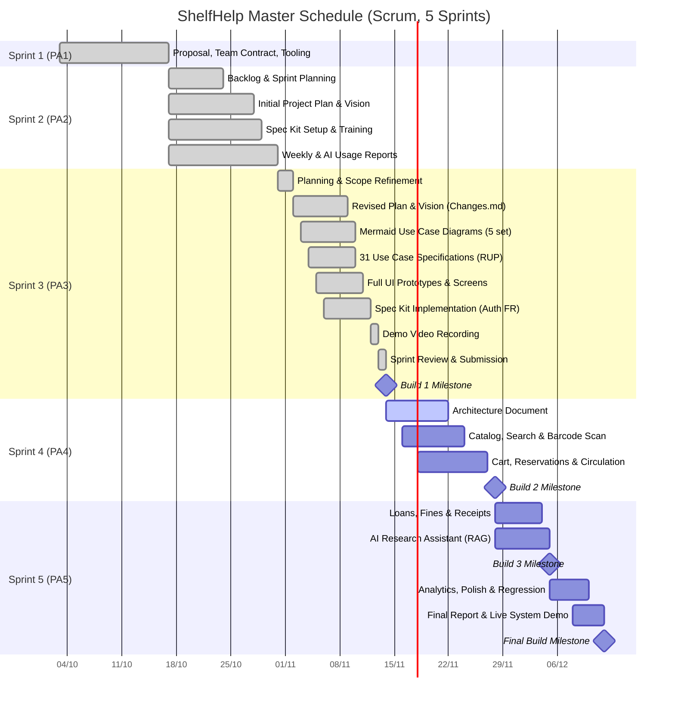

# ShelfHelp: Smart Library Management System

# Software Development Plan (Small Project)

**Version:** 2.0  
**Date:** 13/Nov/2026  
**Document Identifier:** SH-SDP-PA3  
**Course:** CS300 - CSC13002 - Introduction to Software Engineering | **Team:** HCD (Group 7) | **Process:** Scrum  

---

## Revision History

| Date | Version | Description | Author |
| :--- | :--- | :--- | :--- |
| 29/10/2026 | 1.0 | Initial draft for PA2-2026 | Team HCD |
| 13/11/2026 | 2.0 | Revised for PA3-2026: address TA feedback on document formatting unification, update completed Sprint 2 tasks, update Sprint 3 schedule and backlog, refine admin scope, and add Changes.md | Nguyễn Minh Phú, Phạm Võ Khang Duy |

---

## Table of Contents

- [1. Introduction](#1-introduction)
  - [1.1 Purpose](#11-purpose)
  - [1.2 Scope](#12-scope)
  - [1.3 Overview](#13-overview)
- [2. Project Overview](#2-project-overview)
  - [2.1 Project Purpose, Scope, and Objectives](#21-project-purpose-scope-and-objectives)
  - [2.2 Assumptions and Constraints](#22-assumptions-and-constraints)
  - [2.3 Project Deliverables](#23-project-deliverables)
- [3. Project Organization](#3-project-organization)
  - [3.1 Organizational Structure](#31-organizational-structure)
  - [3.2 Roles and Responsibilities](#32-roles-and-responsibilities)
- [4. Management Process](#4-management-process)
  - [4.1 Project Estimates](#41-project-estimates)
  - [4.2 Project Plan](#42-project-plan)
    - [4.2.1 Phase Plan](#421-phase-plan)
    - [4.2.2 Iteration Objectives](#422-iteration-objectives)
    - [4.2.3 Releases](#423-releases)
    - [4.2.4 Project Schedule](#424-project-schedule)
    - [4.2.5 Project Resourcing](#425-project-resourcing)
  - [4.3 Project Monitoring and Control](#43-project-monitoring-and-control)
    - [4.3.1 Requirements Management](#431-requirements-management)
    - [4.3.2 Reporting and Measurement](#432-reporting-and-measurement)
    - [4.3.3 Risk Management](#433-risk-management)
    - [4.3.4 Configuration Management](#434-configuration-management)

---

## 1. Introduction

**Performed by:** Nguyễn Minh Phú | **Reviewed by:** Phạm Võ Khang Duy | **Edited by:** Nguyễn Minh Phú

### 1.1 Purpose

This document is the revised Software Development Plan (Small Project) for PA3-2026. It gathers the project management information needed to guide and control the ShelfHelp project: what we will deliver, who performs and reviews each work item, which risks are anticipated and tracked, and how sprints, builds, and releases are scheduled. 

The Project Manager uses this plan to track milestone progression, while all team members use it to identify assigned deliverables, inter-task dependencies, and review responsibilities. This second submission incorporates TA feedback received after PA2-2026—specifically unifying documentation and metadata formatting across all team deliverables—and reflects updated schedules, refined administration scope, and actual task execution up through Sprint 3.

References:
- PA1-2026 Project Proposal and Team Contract
- PA2-2026 and PA3-2026 Course Assignment Guidelines
- ShelfHelp Vision Document (Version 2.0, PA3-2026)
- ShelfHelp Full Specification (`SHELFHELP_FULLSPEC.md`)
- Team Jira Board and Spec Kit `constitution.md`

### 1.2 Scope

ShelfHelp is a smart, web-based library management system engineered for university libraries (client context: VNUHCM Libraries). It replaces fragmented paper-based and manual borrowing, fee payment, and inventory management workflows with a unified digital platform serving two primary human actors:
- **Student (Reader):** Catalog discovery, barcode scanning, borrowing cart, reservation queue, online/desk charge payment, loan renewals, personal notifications, and research recommendations.
- **Librarian (Admin):** Inventory condition tracking, physical handover/check-in desk circulation, acquisition batches, financial receipts/reversals, reservation queue oversight, and operational analytics.

The system also integrates an AI-powered research assistant utilizing Retrieval-Augmented Generation (RAG) to provide contextual book recommendations grounded strictly in the library's physical collection.

This document covers the management and execution roadmap across all five sprints (PA1 through PA5), detailing phase milestones, iteration work breakdowns, resourcing, quality gates, and risk mitigations.

### 1.3 Overview

This document is organized into four main sections:
- **Project Overview:** High-level project purpose, objectives, constraints, assumptions, and life-cycle deliverables.
- **Project Organization:** Team structure, Scrum governance, and individual member roles and responsibilities.
- **Management Process:** Estimates, phase plan, sprint objectives, build releases, Gantt schedule, resource allocation, and project monitoring (including quality control, unified document standards, and risk tracking).

---

## 2. Project Overview

**Performed by:** Phạm Võ Khang Duy | **Reviewed by:** Nguyễn Minh Phú | **Edited by:** Phạm Võ Khang Duy

### 2.1 Project Purpose, Scope, and Objectives

**Goals**
- Deliver a robust, full-stack web application covering the 10 core functional groups defined in the project baseline (Authentication, Profile & Membership, Catalog Search & Barcode Scan, Cart/Checkout/Reservations, Loan Tracking & Fines, Suggestions & Acquisitions, Inventory & Circulation, Condition & Write-Off, Receipts, Analytics).
- Deliver the embedded AI Research Assistant feature integrated with search and borrowing recommendations.
- Follow Scrum methodology across 5 consecutive iterations aligned with course Project Assignments (PA1–PA5), concluding with a full system live demonstration in Sprint 5.

### 2.2 Assumptions and Constraints

**Assumptions**
- All 5 team members maintain an active workload of 10 hours per week throughout the project lifecycle.
- Free-tier cloud infrastructure (Supabase for PostgreSQL database, authentication, and object storage; Vercel for hosting) remains available and sufficient for academic demonstration scale.
- Students and library staff access the web application via modern desktop and mobile web browsers (Chrome, Edge, Safari, Firefox).

**Constraints**
- Development duration is constrained to a fixed 10-week academic window spanning October through December 2026.
- Strict adherence to course engineering standards: Spec Kit spec-driven workflow, RUP specification templates, unified section-level author attribution headers, and comprehensive Git commit traceability matching Jira issue keys.

### 2.3 Project Deliverables

| Deliverable ID | Deliverable Item | Phase / Milestone | Target Date |
| :--- | :--- | :--- | :--- |
| D1 | Project Proposal & Team Contract | PA1 / Sprint 1 | 17/10/2026 (**Completed**) |
| D2 | Software Development Plan (Project Plan) | PA2 / Sprint 2 (v1.0), revised PA3 (v2.0) | 31/10/2026; revision 14/11/2026 |
| D3 | Vision Document | PA2 / Sprint 2 (v1.0), revised PA3 (v2.0) | 31/10/2026; revision 14/11/2026 |
| D4 | Use-Case Model (Mermaid) & Use-Case Specifications | PA3 / Sprint 3 | 14/11/2026 |
| D5 | UI Prototypes for all Use Cases | PA3 / Sprint 3 | 14/11/2026 |
| D6 | End-to-End Functional Group Implementation & Demo Video | PA3 / Sprint 3 | 14/11/2026 |
| D7 | Architecture and Component Design Document | PA4 / Sprint 4 | 28/11/2026 |
| D8 | Testable Builds (Build 1 to Build 3) and Final Release Build | Sprints 3 to 5 | 14/11, 28/11, 05/12, and 12/12/2026 |
| D9 | Weekly Meeting Minutes (Planning, Scrum, Review) & AI Usage Reports | Every Sprint | 31/10, 14/11, 28/11, and 12/12/2026 |
| D10 | Final Comprehensive Project Report, User Guide, and Live Demo | PA5 / Sprint 5 | 12/12/2026 (assumed) |

---

## 3. Project Organization

**Performed by:** Nguyễn Minh Phú | **Reviewed by:** Phạm Võ Khang Duy | **Edited by:** Nguyễn Minh Phú

### 3.1 Organizational Structure

Team **HCD** (Group 7) operates under the Scrum framework. Each member serves as a full-stack software engineer while leading designated organizational domains:
- **Scrum Master:** Facilitates ceremonies, tracks sprint burndown, and removes obstacles.
- **Product Owner:** Curates the Jira product backlog, sets user story priorities, and accepts deliverable criteria.
- **Project Manager:** Monitors cross-sprint milestones, risk registers, and course submission deadlines.
- **Developers / Leads:** Lead architectural design, Spec Kit specifications, frontend/backend modules, and AI RAG integration.

**Team Governance & Working Rules**
- Stand-up check-ins conducted asynchronously in team communication channels, supplemented by two weekly Scrum syncs (Tuesday and Friday).
- Formal Sprint Planning at iteration launch and Sprint Review / Retrospective at conclusion.
- **Four-Eyes Quality Principle:** Every deliverable section and code commit must have **one assigned author/performer and one distinct reviewer**.
- **Unified Document Header Standard:** Every document section must display the standardized attribution line immediately below the H2 header:  
  `**Performed by:** <Name> | **Reviewed by:** <Name> | **Edited by:** <Name>`
- Git workflow: Feature branches with descriptive Jira tags (e.g., `feat/SCRUM-65-use-case-specs`), reviewed via Pull Request before merging to `main`.

### 3.2 Roles and Responsibilities

| Member Name | Student ID | Primary Project Roles | Specific Responsibilities |
| :--- | :--- | :--- | :--- |
| **Nguyễn Anh Khôi** | 24125060 | Scrum Master / Leader / UI Designer | Coordinates sprint ceremonies; leads UI/UX prototype design; maintains Jira backlog integrity; develops Account & Authentication module. |
| **Lê Văn Vĩ** | 24125050 | Product Owner / QA & Tester | Owns requirements backlog and acceptance criteria; drafts Vision Document; designs test plans; develops Cart, Checkout, and Reservations. |
| **Lê Minh Thuận** | 24125105 | Project Manager / Developer | Oversees master schedule, deliverable packaging, and submission; develops Circulation, Inventory, and Financial Receipt management. |
| **Nguyễn Minh Phú** | 24125103 | Frontend & Backend Lead | Leads architecture, database schema, and API contracts; develops Catalog Search, Barcode Scanning, and Loan Tracking; implements PA3 demo FR. |
| **Phạm Võ Khang Duy** | 24125098 | AI Lead / Developer | Leads Spec Kit setup and AI Research Assistant (RAG embeddings/retrieval); develops Membership, Analytics, and Use-Case specifications. |

---

## 4. Management Process

**Performed by:** Phạm Võ Khang Duy, Nguyễn Minh Phú | **Reviewed by:** Nguyễn Minh Phú | **Edited by:** Phạm Võ Khang Duy

### 4.1 Project Estimates

- **Team Capacity:** 5 members × 10 hours/week × 2 weeks = 100 person-hours per sprint. Planned sprint workload is capped at 80–85 hours (80–85% nominal capacity) to maintain a healthy 15–20% buffer for unexpected academic conflicts, review revisions, and bug fixes.
- **Estimation Methodology:** Documentation, design, and Spike tasks are estimated directly in person-hours. Implementation stories are estimated in Fibonacci story points and calibrated with measured sprint velocity.

### 4.2 Project Plan

#### 4.2.1 Phase Plan

The project lifecycle spans five 2-week iterations corresponding to the course Project Assignments:

| Sprint | Phase / PA | Timeline | Main Iteration Goals | Status |
| :--- | :--- | :--- | :--- | :--- |
| 1 | PA1 | 03/10 – 17/10/2026 | Team formation, project proposal, tooling setup, Jira board setup | **Completed** |
| 2 | PA2 | 17/10 – 31/10/2026 | Initial Project Plan, Vision Document, Spec Kit setup & training | **Completed** |
| 3 | PA3 | 31/10 – 14/11/2026 | Revised Project Plan & Vision Document (with `Changes.md`), Use-Case Model (Mermaid), Use-Case Specifications, UI Prototypes, Spec Kit End-to-End Implementation of 1 FR, **Build 1** | **Completed** |
| 4 | PA4 | 14/11 – 28/11/2026 | Software Architecture Document, Catalog & Inventory core, Borrowing & Circulation workflows, **Build 2** | Planned |
| 5 | PA5 | 28/11 – 12/12/2026 | RAG AI Chatbot, Receipts, Reminders, Fines, Analytics dashboard, Final Comprehensive Report, System Demo, **Final Release** | Planned |

**Project Milestones**

| Milestone | Target Date | Success & Verification Criteria |
| :--- | :--- | :--- |
| **PA1 Submission** | 17/10/2026 | Proposal accepted, Git repository and Jira workspace initialized. |
| **PA2 Submission** | 31/10/2026 | Project Plan v1.0, Vision Document v1.0, Spec Kit constitution generated. |
| **PA3 Submission (Build 1)** | 14/11/2026 | Unified format plan/vision, 31 use-case specs, Mermaid diagrams, UI prototypes, implemented auth FR with narrated demo video. |
| **PA4 Submission (Build 2)** | 28/11/2026 | Architecture document submitted, working circulation and catalog modules. |
| **PA5 Final Release & Demo** | 12/12/2026 | All functional groups operational, RAG assistant integrated, final live presentation delivered. |

#### 4.2.2 Iteration Objectives

**Sprint 2 Execution Record (PA2, 17/10 – 31/10/2026) — Completed**
Total planned effort was 80 hours. All 17 planned tasks were completed and verified:

| Task ID | Task Description | Assignee | Reviewer | Planned (h) | Actual (h) | Status |
| :--- | :--- | :--- | :--- | :--- | :--- | :--- |
| S2-01 | Decompose proposal into Jira epics and stories | Nguyễn Anh Khôi | Lê Văn Vĩ | 3.0 | 3.0 | Done |
| S2-02 | Sprint 2 planning ceremony and documentation | Lê Minh Thuận | Nguyễn Anh Khôi | 1.5 | 1.5 | Done |
| S2-03 | Draft Project Plan: Sections 1–3 | Lê Văn Vĩ | Nguyễn Anh Khôi | 4.0 | 4.0 | Done |
| S2-04 | Draft Project Plan: Section 4 process & sprint schedules | Phạm Võ Khang Duy | Lê Minh Thuận | 3.0 | 3.0 | Done |
| S2-05 | Draft Project Plan: Section 4 Gantt, estimates & monitoring | Nguyễn Minh Phú | Lê Minh Thuận | 3.0 | 3.0 | Done |
| S2-06 | Vision Document: Introduction and Problem/Product Positioning | Lê Văn Vĩ | Nguyễn Minh Phú | 3.0 | 3.0 | Done |
| S2-07 | Vision Document: Stakeholder analysis & competitive survey | Lê Văn Vĩ | Phạm Võ Khang Duy | 4.0 | 4.0 | Done |
| S2-08 | Vision Document: Feature breakdown & workflow diagrams | Nguyễn Minh Phú | Lê Văn Vĩ | 7.0 | 7.0 | Done |
| S2-09 | Vision Document: Non-functional requirements | Lê Minh Thuận | Phạm Võ Khang Duy | 3.0 | 3.0 | Done |
| S2-10 | Initialize Spec Kit and generate `constitution.md` | Phạm Võ Khang Duy | Nguyễn Minh Phú | 3.0 | 3.0 | Done |
| S2-11 | Complete Spec Kit training with evidence (all 5 members) | Team HCD | Peer Review | 10.0 | 10.0 | Done |
| S2-12 | Framework self-training and tech stack spikes | Team HCD | Peer Review | 25.0 | 25.0 | Done |
| S2-13 | Bi-weekly Scrum ceremonies and minutes | Nguyễn Anh Khôi | Lê Minh Thuận | 2.0 | 2.0 | Done |
| S2-14 | Individual AI Usage Reports compilation | Phạm Võ Khang Duy | Lê Văn Vĩ | 1.5 | 1.5 | Done |
| S2-15 | Sprint 2 Review and Retrospective | Nguyễn Anh Khôi | Lê Minh Thuận | 1.5 | 1.5 | Done |
| S2-16 | Document proofreading and QA review | Nguyễn Anh Khôi | Lê Văn Vĩ | 4.0 | 4.0 | Done |
| S2-17 | PDF conversion, Git export, PA2 package assembly | Lê Minh Thuận | Phạm Võ Khang Duy | 2.0 | 2.0 | Done |

**Sprint 3 Work Breakdown (PA3, 31/10 – 14/11/2026) — Final Results**
Total planned effort was 85 hours. Work items were organized to address PA2 TA feedback (document formatting unification), deliver complete RUP use-case specifications, build interactive UI prototypes, and implement 1 functional group end-to-end:

| Jira Key | Task Description | Assignee | Reviewer | Est. (h) | Actual (h) | Status |
| :--- | :--- | :--- | :--- | :--- | :--- | :--- |
| SCRUM-62 | **(A) Revised Project Plan v2.0** with TA format unification + `Changes.md` | Nguyễn Minh Phú | Phạm Võ Khang Duy | 4.0 | 4.0 | Done |
| SCRUM-63 | **(B) Detailed Vision Document v2.0** + `Changes.md` | Lê Văn Vĩ, Lê Minh Thuận | Nguyễn Anh Khôi | 3.0 | 3.0 | Done |
| SCRUM-71 | **(C) Define master Use-Case catalog** & scope boundaries | Nguyễn Anh Khôi | Lê Văn Vĩ | 3.0 | 3.0 | Done |
| SCRUM-64 | **(C) Use Case Diagrams in Mermaid** (5 modular diagrams covering all FRs) | Lê Văn Vĩ | Nguyễn Anh Khôi | 6.0 | 6.5 | Done |
| SCRUM-65 | **(D-01) Use-Case Specifications** (31 use cases in RUP format) | Lê Minh Thuận, Phạm Võ Khang Duy | Phạm Võ Khang Duy, Lê Minh Thuận, Nguyễn Anh Khôi | 24.0 | 24.0 | Done |
| SCRUM-66 | **(D-02) UI Prototypes for all use cases** with full screenshot set | Nguyễn Anh Khôi | Lê Văn Vĩ | 16.0 | 18.0 | Done |
| SCRUM-67 | **(E-01) Implement 1 FR end-to-end with Spec Kit** (Auth: Login/Logout/Signup) | Nguyễn Minh Phú | Nguyễn Anh Khôi | 12.0 | 12.0 | Done |
| SCRUM-68 | **(E-02) Recorded demo video with narration** (YouTube upload) | Nguyễn Minh Phú | Nguyễn Anh Khôi | 4.0 | 4.0 | Done |
| SCRUM-69 | **(F) Compile individual AI Usage Reports** | Team HCD | Nguyễn Anh Khôi | 3.0 | 3.0 | Done |
| SCRUM-70 | **(F) Commit Weekly Reports** (Planning, Scrum x2, Review) + Jira progress | Nguyễn Anh Khôi | Lê Văn Vĩ | 4.0 | 4.0 | Done |
| SCRUM-72 | Packaging: markdown to PDF conversion, Git log export, zip archive | Nguyễn Anh Khôi | Lê Văn Vĩ | 2.0 | 2.0 | Done |

**Sprint 4 Outline (PA4, 14/11 – 28/11/2026)**
- Produce Software Architecture Document (system decomposition, component view, database ERD, physical deployment, and REST API contracts).
- Implement core Catalog Search, dynamic filter facets, barcode scanning spike integration, and inventory condition logging.
- Implement Borrowing Cart, 48-hour pickup reservation hold mechanics, and simulated payment gateway.
- Conduct continuous unit and integration testing; deliver **Build 2**.

**Sprint 5 Outline (PA5, 28/11 – 12/12/2026)**
- Implement Loan Lifecycle management, overdue fine accrual, lost-book dispute resolution, and in-app/email reminder dispatchers.
- Integrate RAG AI Research Assistant (embedding index pipeline, similarity retrieval, and interactive chat interface).
- Implement financial ledger, receipt generation, and administrative analytics dashboards.
- System hardening, regression testing, user acceptance testing, final report, and live demo presentation (**Final Release**).

#### 4.2.3 Releases

| Release Tag | Milestone | Key Deliverables & Included Features | Quality Assurance Gates |
| :--- | :--- | :--- | :--- |
| **Build 1** | End of Sprint 3 (14/11/2026) | Full RUP Use-Case model, UI prototypes, End-to-end working Authentication (Signup, Verification, Login/Logout, Role enforcement) with database persistence | Manual smoke tests, schema migration validation, automated auth unit tests. |
| **Build 2** | End of Sprint 4 (28/11/2026) | Build 1 + Catalog browsing, book details, barcode lookup, cart management, checkout hold creation, physical copy circulation | Integration testing of loan request flow, state transition integrity. |
| **Build 3** | Early Sprint 5 (05/12/2026) | Build 2 + Fines calculation, automated reminders, receipt generation, and initial AI RAG recommendation query engine | Concurrency testing, scheduled job execution tests, RAG response accuracy check. |
| **Final Release** | End of Sprint 5 (12/12/2026) | Comprehensive system build: all 10 feature groups + AI assistant, refined admin UI, performance and security audit applied | End-to-end user acceptance testing, zero critical/high defect backlog. |

#### 4.2.4 Project Schedule

#### 4.2.5 Project Resourcing

- **Human Resources:** 5 undergraduate software engineers providing 50 person-hours per week of development and quality engineering effort.
- **Hardware & Tooling:** Personal development workstations, Git / GitHub repository with branch protection, Jira Software for backlog management, Docker for local environment parity, Supabase PostgreSQL cloud instances, and Google Antigravity / Gemini for AI-assisted engineering.

### 4.3 Project Monitoring and Control

#### 4.3.1 Requirements Management

System requirements originate from the Vision Document and are maintained in the Jira backlog as Epics, User Stories, and Technical Tasks. Any scope adjustment—such as the admin-side simplification executed in Sprint 3—requires approval by the Product Owner (Lê Văn Vĩ), must be logged in Jira, and is documented in the central `Changes.md` file.

#### 4.3.2 Reporting, Quality, and Formatting Standards

To address specific TA feedback regarding inconsistent documentation formatting in PA2, the team has enforced the following quality conventions across all deliverables:
1. **Unified Attribution Header:** Every H2 section across all markdown deliverables begins with the strict attribution line:  
   `**Performed by:** <Name> | **Reviewed by:** <Name> | **Edited by:** <Name>`
2. **Standard Document Identifiers:** All engineering specifications utilize standardized project identifiers (e.g., `SH-SDP-PA3` for Software Development Plan, `SH-VD-PA3` for Vision Document, `SH-UCS-UCxx` for Use-Case Specifications).
3. **Traceability Matrix:** Every user story and use-case specification explicitly traces back to functional requirements (`FEAT-xx`, `FR-xx`) and architectural policies (`POL-xx`).
4. **Scrum Monitoring:** Two Scrum meetings are held per sprint with formal minutes; individual AI tool usage is tracked in compliant AI Usage Reports; sprint retrospectives capture lessons learned and carry-over backlog items.

#### 4.3.3 Risk Management

The project risk register is reviewed during every Sprint Retrospective and updated for each revised submission:

| Risk ID | Identified Risk Description | Likelihood | Impact | Concrete Mitigation Strategy | Assigned Owner |
| :--- | :--- | :--- | :--- | :--- | :--- |
| **R1** | **Team Member Unavailability** (exams, illness, coursework) | Medium | High | Maintain 15–20% capacity buffer; cross-train members across modules; enforce code reviews so at least two members understand every component. | Scrum Master (Khôi) |
| **R2** | **Scope Creep in Administrative Functions** | High | High | Successfully mitigated in Sprint 3 by streamlining admin workflows; non-critical administrative luxuries (bulk remind all, camera avatar capture) marked as optional. | Product Owner (Vĩ) |
| **R3** | **Technology Stack & Spec Kit Adoption Curve** | Medium | Medium | Completed hands-on Spec Kit training in Sprint 2; successfully executed end-to-end auth feature spike in Sprint 3 to solidify team proficiency. | Lead Developer (Phú) |
| **R4** | **LLM API Latency, Cost, or Quota Restrictions** | Medium | Medium | Implement local caching for book embedding vectors; isolate AI provider behind a modular service adapter; prepare offline mock dataset for demonstrations. | AI Lead (Duy) |
| **R5** | **Business Rule & State Machine Inconsistencies** | High | High | Modeled all state lifecycles in the 31 RUP use-case specifications; automated PostgreSQL constraints and Row-Level Security enforce valid state transitions. | QA / Tester (Vĩ) |
| **R6** | **Late Feature Branch Integration Breakage** | Medium | High | Continuous integration on GitHub Actions for every pull request; compulsory code reviews and smoke testing on tagged builds. | Lead Developer (Phú) |
| **R7** | **Inaccurate Effort Estimation** | Medium | Medium | Calibrated task estimates against Sprint 2 and 3 velocity; backlog tracked via Jira burn-down charts. | Project Manager (Thuận) |
| **R8** | **Document Format Inconsistency (Addressed)** | Low | Medium | Established strict document formatting checklist and review gates directly addressing PA2 TA feedback. | Project Manager (Thuận) |

#### 4.3.4 Configuration Management

All project artifacts are managed in the team's Git repository under version control:
- **Branching Strategy:** Main branch (`main`) is protected. Feature branches follow `feat/<jira-id>-description` naming conventions.
- **Tagging Strategy:** Builds are tagged sequentially (`build-1`, `build-2`, `build-3`, `final-release`).
- **Submission Packaging:** All markdown deliverables are mirrored as cleanly formatted PDFs, accompanied by the exported Git commit log, and packaged into `PA3-Group07.zip`.
