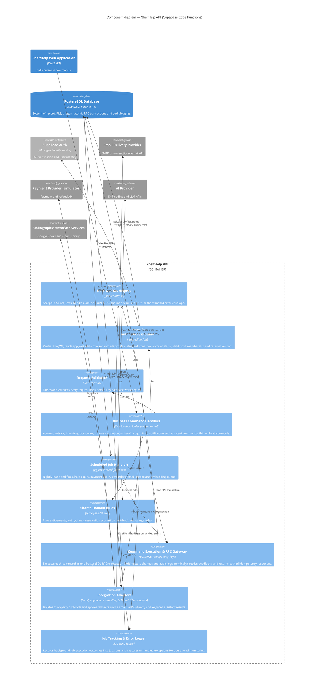

# ShelfHelp: Smart Library Management System

## PA4 Software Architecture — C4 Level 3 (Component Diagrams)

### Revision history

| Date | Version | Description | Author |
| :--- | :--- | :--- | :--- |
| 24/Nov/2026 | 1.0 | Initial component views for the Web Application and ShelfHelp API | Nguyễn Anh Khôi |
| 24/Nov/2026 | 1.1 | Split reader components, merged transaction and persistence, aligned external containers | Nguyễn Anh Khôi |
| 24/Nov/2026 | 1.2 | Aligned container types, removed L3 Sentry, documented TypeScript/SQL rule parity and test strategy, and clarified atomic audit logging | Nguyễn Anh Khôi |

### Table of contents

- [1. Introduction](#1-introduction)
- [2. Why these two containers](#2-why-these-two-containers)
- [3. Web Application — component diagram](#3-web-application--component-diagram)
- [4. Web Application — component catalogue](#4-web-application--component-catalogue)
- [5. Web Application — design notes](#5-web-application--design-notes)
- [6. ShelfHelp API — component diagram](#6-shelfhelp-api--component-diagram)
- [7. ShelfHelp API — component catalogue](#7-shelfhelp-api--component-catalogue)
- [8. ShelfHelp API — business command map](#8-shelfhelp-api--business-command-map)
- [9. ShelfHelp API — interactions and design notes](#9-shelfhelp-api--interactions-and-design-notes)
- [10. Shared code and cross-cutting concerns](#10-shared-code-and-cross-cutting-concerns)
- [11. Traceability](#11-traceability)
- [12. Deliberate omissions](#12-deliberate-omissions)

---

## 1. Introduction

This document is the **C4 Level 3 (Component) view** of ShelfHelp. It opens the two core application
containers from the [Container view](../container/Container.md) and shows the modules inside them,
their responsibilities, and their collaborations.

A *component* is a group of related code with a clear responsibility inside its container. Components
are not separately deployed: they are compiled into the React bundle or the Edge Function bundle.

| ID | Document | Use in this document |
| :--- | :--- | :--- |
| R1 | [`Container.md`](../container/Container.md) | Container responsibilities and runtime flows |
| R2 | [`System-Context.md`](../system-context/System-Context.md) | Actors, external systems, and platform description |
| R3 | [`SHELFHELP_FULLSPEC.md`](../../../../../src/speckit/specs/SHELFHELP_FULLSPEC.md) | Screens, functions, RPCs, and data model |
| R4 | [`Use-Case-Diagrams.md`](../../../PA3/use-case-diagrams/Use-Case-Diagrams.md) | UC-01 to UC-31 |

---

## 2. Why these two containers

The Web Application and the ShelfHelp API carry almost all product behaviour. The Web Application is
where Reader and Admin experiences differ; the API is where every command, job, and provider adapter
runs.

PostgreSQL is not decomposed here because its components are tables, constraints, indexes, policies,
triggers, and RPCs, which are documented in the specification and migrations. Auth, Storage, and
Realtime are managed services with no team-owned internal modules.

---

## 3. Web Application — component diagram

```mermaid
C4Component
    title Component diagram — ShelfHelp Web Application (React SPA)

    Person(student, "Student (Reader)", "Uses Reader Mode on a phone or laptop.")
    Person(librarian, "Librarian (Admin)", "Uses Admin Mode on a desktop.")

    Container_Boundary(spa, "ShelfHelp Web Application") {
        Component(appShell, "App Shell & Access Guard", "React Router", "Bootstraps the application, selects the Reader or Admin shell and enforces session, role and account-status guards.")
        Component(authProfile, "Authentication & Profile", "React", "Registration, OTP verification, login/logout, password reset, profile editing and avatar cropping.")
        Component(catalogDiscovery, "Catalog & Discovery", "React, TanStack Query", "Home, search with filters and sorting, book detail, barcode scan, reviews and wishlist.")
        Component(cartCheckout, "Cart & Checkout", "React, TanStack Query", "Borrowing cart, checkout, pickup window and simulated payment.")
        Component(myLibrary, "My Library", "React, TanStack Query", "Loans, renewals, reservations, charges and membership.")
        Component(notificationsAssistant, "Notifications & Assistant", "React, Realtime", "Notifications, suggestions and the grounded AI assistant.")
        Component(adminCirculation, "Admin Circulation & Queues", "React, TanStack Query", "Desk handover, returns, due/overdue groups, reservation queues and reminders.")
        Component(adminCatalog, "Admin Catalog & Inventory", "React", "Books, copies, ISBN lookup, bulk import, inventory history and write-off slips.")
        Component(adminMoney, "Admin Money & Reporting", "React, Recharts", "Receipts and reversals, dashboard KPIs and report exports.")
        Component(adminAcquisitions, "Admin Acquisitions & Students", "React", "Suggestion review, acquisition batches, shipment receipt and student accounts.")
        Component(dataAccess, "Data Access & Realtime Client", "supabase-js, TanStack Query", "PostgREST reads, Realtime subscriptions, Storage uploads and Edge Function invocation with the JWT and standard error envelope.")
    }

    ContainerDb(db, "PostgreSQL Database", "Supabase Postgres 15", "Catalog and own-row data exposed through PostgREST under RLS.")
    Container(api, "ShelfHelp API", "Supabase Edge Functions", "Business commands and scheduled jobs.")
    Container_Ext(auth, "Supabase Auth", "Managed identity service", "Sessions, JWT and credential recovery.")
    Container_Ext(storage, "Supabase Storage", "Managed object storage", "Covers, avatars, evidence and imports.")
    Container_Ext(realtime, "Supabase Realtime", "Managed change-data service", "Live counters, notifications and own loan changes.")

    Rel(student, appShell, "Uses Reader Mode", "HTTPS")
    Rel(librarian, appShell, "Uses Admin Mode", "HTTPS")

    Rel(appShell, dataAccess, "Session state")
    Rel(appShell, authProfile, "Routes auth flows")
    Rel(appShell, catalogDiscovery, "Renders")
    Rel(appShell, cartCheckout, "Renders")
    Rel(appShell, myLibrary, "Renders")
    Rel(appShell, notificationsAssistant, "Renders")
    Rel(appShell, adminCirculation, "Renders")
    Rel(appShell, adminCatalog, "Renders")
    Rel(appShell, adminMoney, "Renders")
    Rel(appShell, adminAcquisitions, "Renders")

    Rel(catalogDiscovery, dataAccess, "Queries/commands")
    Rel(cartCheckout, dataAccess, "Queries/commands")
    Rel(myLibrary, dataAccess, "Queries/commands")
    Rel(notificationsAssistant, dataAccess, "Queries/commands")
    Rel(adminCirculation, dataAccess, "Queries/commands")
    Rel(adminCatalog, dataAccess, "Queries/commands")
    Rel(adminMoney, dataAccess, "Queries/commands")
    Rel(adminAcquisitions, dataAccess, "Queries/commands")
    Rel(authProfile, dataAccess, "Authenticates")

    Rel(dataAccess, auth, "Signs in/verifies OTP", "HTTPS, PKCE")
    Rel(dataAccess, db, "Reads; writes own profile/cart", "PostgREST, RLS")
    Rel(dataAccess, api, "Invokes commands", "HTTPS, JWT")
    Rel(dataAccess, storage, "Files", "HTTPS, signed URLs")
    Rel(dataAccess, realtime, "Subscribes", "WebSocket, RLS")

    UpdateLayoutConfig($c4ShapeInRow="3", $c4BoundaryInRow="1")
```

Source: [`mermaid/component-web-app.mmd`](mermaid/component-web-app.mmd).

All feature components use the shared presentation kit and the shared validation contracts. These are
cross-cutting libraries rather than collaborating components, so they are omitted from the diagram.

---

## 4. Web Application — component catalogue

| Component | Responsibilities & services | Relationships & collaborations | Key source | Main use cases |
| :--- | :--- | :--- | :--- | :--- |
| **App Shell & Access Guard** | Bootstraps the application; inspects authenticated user session and role (`student` vs `admin`) to render Reader Mode or Admin Mode; enforces status checks (`pending_verification`, `restricted`, `inactive`). | Mounts and conditionally routes to **Authentication & Profile** and feature sub-shells (**Catalog & Discovery**, **Cart & Checkout**, **My Library**, **Admin Circulation**, etc.); subscribes to auth state from **Data Access Client**. | `src/frontend/src/app/`, feature layouts | All |
| **Authentication & Profile** | User self-registration, email OTP verification, password login/logout, password reset request and completion, profile editing, and avatar cropping. | Rendered by **App Shell**; invokes auth actions (sign-in, OTP verification) and avatar upload via **Data Access Client** to Supabase Auth and Storage. | `src/frontend/src/features/auth/` | UC-01–UC-04, UC-31 |
| **Catalog & Discovery** | Catalog browsing, diacritic-insensitive search, genre/department filtering, book detail view, ISBN camera barcode scanning, reading wishlist, and community review display. | Rendered by **App Shell**; queries catalog and book reviews via **Data Access Client** (PostgREST); issues wishlist mutations via API (`toggle-wishlist`). | `src/frontend/src/features/reader/` | UC-06–UC-08, UC-15 |
| **Cart & Checkout** | Borrowing cart persistence in `cart_items` table (own rows under RLS), copy availability check, checkout review, pickup window confirmation (48 hours), and simulated payment for fees. | Rendered by **App Shell**; sends checkout and payment commands through **Data Access Client** to ShelfHelp API functions (`checkout-cart`, `create-payment`). | `src/frontend/src/features/reader/` | UC-09, UC-10 |
| **My Library** | Active loans display, self-service loan renewal, reservation queue tracking/cancellation, outstanding fines/charges ledger, and membership tier upgrade. | Rendered by **App Shell**; queries own rows and invokes loan renewal, reservation cancellation, and fee payment via **Data Access Client** to API (`cancel-reservation`, `renew-loan`). | `src/frontend/src/features/reader/` | UC-05, UC-11–UC-14, UC-18 |
| **Notifications & Assistant** | In-app notification centre, book acquisition suggestions submission, and grounded conversational AI assistant with citation links. | Rendered by **App Shell**; listens to real-time notification events and sends suggestion/assistant requests via **Data Access Client** to API (`chat-send`, `submit-suggestion`). | `src/frontend/src/features/reader/` | UC-16, UC-17, UC-28 |
| **Admin Circulation & Queues** | Circulation desk pickup handover, book returns with condition grading and damage tier fee assessment, due/overdue loans monitoring, and reservation queue management. | Rendered by **App Shell**; sends physical circulation commands via **Data Access Client** to ShelfHelp API (`handover-items`, `return-loan`, `record-counter-payment`). | `src/frontend/src/features/admin/circulation/`, `queues/` | UC-20, UC-21, UC-29, UC-30 |
| **Admin Catalog & Inventory** | Book cataloguing, physical copy barcode generation and tracking, bulk CSV import, inventory condition history, and write-off slip creation with photo evidence. | Rendered by **App Shell**; uploads evidence to Storage and issues catalog management commands via **Data Access Client** to API and PostgREST. | `src/frontend/src/features/admin/` | UC-07, UC-19, UC-22, UC-26 |
| **Admin Money & Reporting** | Financial ledger inspection, receipt generation, counter payments recording, payment reversals, KPI summary cards, and Excel/CSV report exports. | Rendered by **App Shell**; invokes counter payment and reversal commands, and fetches aggregate statistics via **Data Access Client** (`get_dashboard_kpis`). | `src/frontend/src/features/admin/ledger/` | UC-13, UC-23, UC-27 |
| **Admin Acquisitions & Students** | Student suggestion triage, batch purchasing order management, shipment check-in, student account status controls, and debt hold management. | Rendered by **App Shell**; invokes batch lifecycle and student account modification commands via **Data Access Client** to ShelfHelp API. | `src/frontend/src/features/admin/` | UC-24, UC-25, UC-31 |
| **Data Access & Realtime Client** | Central gateway wrapping `supabase-js` and TanStack Query; handles session-aware PostgREST reads, Realtime change subscriptions, Storage file transfers, and HTTPS Edge Function command invocations with standard error envelopes. | Collaborates with all feature components as their sole interface to external containers: **PostgreSQL Database** (PostgREST under RLS), **ShelfHelp API** (commands), **Supabase Auth**, **Supabase Storage**, and **Supabase Realtime**. | `src/frontend/src/lib/` | All |

### 4.1 Reader and Admin Mode in one container

Reader and Admin Mode share the App Shell, the Data Access client, and the shared contracts, but their
route bundles are separate so a student never downloads admin code. The App Shell chooses the mode
from the authenticated profile:

- `role = student` → Reader shell and reader routes;
- `role = admin` → Admin shell and admin routes;
- `status = pending_verification` → verification screen;
- no session → authentication routes.

Route guards improve the experience; RLS and Edge Functions enforce the actual rule.

---

## 5. Web Application — design notes

- **Feature isolation.** Features do not import each other's internals. Shared behaviour moves to
  `@shelfhelp/shared` or a shared presentation component.
- **Server state.** TanStack Query owns server state; component state owns transient UI state. This
  avoids stale loan or availability data.
- **Validation.** Client validation is a usability feature; the same schema and domain rules run on the
  server.
- **Bundles.** Admin-only code stays out of the student bundle.
- **Failure.** The API client preserves `reason`, `message`, and `details`, so screens can show a
  specific recovery action.

---

## 6. ShelfHelp API — component diagram

Source: [`mermaid/component-api.mmd`](mermaid/component-api.mmd).

HTTP, auth, validation, and error logging are shared `_shared/` helpers called by each function, not a central
router. The arrows show that use. `pg_cron` inside PostgreSQL calls the job handlers through
`pg_net` with a secret header.

---

## 7. ShelfHelp API — component catalogue

| Component | Responsibilities & services | Relationships & collaborations | Key source |
| :--- | :--- | :--- | :--- |
| **HTTP & CORS Helpers** | Accept incoming HTTP POST requests, handle preflight OPTIONS, inject standard CORS headers, format success JSON responses, and serialize standard error envelopes (`{ error: { reason, message, details } }`). | Invoked by **Business Command Handlers** and **Scheduled Job Handlers** at the start and completion of every function execution. | `src/supabase/functions/_shared/http.ts` |
| **Auth & Access Guard** | Extract and verify JWT bearer tokens; look up caller role in `app_metadata.role`; query and reload current `profiles.status`; enforce status gates (`active`, `restricted`, `inactive`), debt holds, active membership requirements, and reservation suspension bans. | Used by **Business Command Handlers**; communicates with **Supabase Auth** for token verification and queries **PostgreSQL Database** for real-time profile status. | `src/supabase/functions/_shared/auth.ts` |
| **Request Validation** | Parse and strictly validate incoming request payloads against strongly-typed Zod schemas before any database connection or domain rule execution occurs. | Used by **Business Command Handlers**; shares schema contracts with the Web Application from `@shelfhelp/shared`. | `src/shared/src/` schemas |
| **Business Command Handlers** | Serverless function endpoints for user actions. Provides thin orchestration: invokes HTTP/Auth/Validation helpers, applies shared domain calculations, triggers third-party adapters if required, and executes the business mutation via the RPC gateway. | Invoked by **ShelfHelp Web Application** via HTTPS; collaborates with **HTTP Helpers**, **Auth Guard**, **Validation**, **Shared Domain Rules**, **Integration Adapters**, **Command Execution & RPC Gateway**, and **Job Tracking & Error Logger**. | `src/supabase/functions/<command>/index.ts` |
| **Scheduled Job Handlers** | Serverless endpoints invoked by scheduled background crons (`pg_cron`) for batch tasks: overdue loan fines assessment, hold reservation expiry, unpaid checkout cleanup, membership renewal notices, and email outbox dispatch. | Invoked by **PostgreSQL Database** (`pg_net` with `x-job-secret` header, bypassing user JWT Auth Guard); collaborates with **HTTP Helpers**, **Shared Domain Rules**, **Command Gateway**, **Adapters**, and **Job Tracking & Error Logger**. | `src/supabase/functions/job-*/index.ts` |
| **Shared Domain Rules** | Pure business logic calculations: borrowing entitlements, gating policies, fine rules, and damage tiers. Reused across frontend preview, Edge Function validation, and mirrored in transactional SQL RPCs validated by parity tests. | Called by **Business Command Handlers** and **Scheduled Job Handlers**; shared between browser and Edge Functions. | `src/shared/src/domain/` |
| **Command Execution & RPC Gateway** | Manages invocation of PostgreSQL transactional stored procedures (RPCs); checks and enforces idempotency keys (returning cached responses for duplicated keys); retries serialization failures and deadlocks up to 3 times; ensures all state changes, `copy_events`, and `audit_logs` commit atomically within one database transaction. | Invoked by **Command Handlers** and **Job Handlers**; communicates with **PostgreSQL Database** via PostgREST HTTPS using `service_role` credentials. | `src/supabase/migrations/` RPCs |
| **Integration Adapters** | Encapsulates third-party external integrations behind stable, testable interfaces: `EmailProvider` (SMTP/Resend), `PaymentProvider` (simulated gateway), `Embedder` and `LlmClient` (AI Provider), and `IsbnLookup` (Google Books / Open Library); provides fallback mechanisms (e.g. keyword search fallback when AI fails). | Called by **Command Handlers** and **Job Handlers**; communicates over HTTPS / SMTP with external systems (**Email Provider**, **Payment Provider**, **AI Provider**, **Bibliographic Services**). | `_shared/adapters/` |
| **Job Tracking & Error Logger** | Persists background job execution status, elapsed runtimes, and failure diagnostics into `job_runs`; captures unexpected runtime exceptions across commands and jobs for operational monitoring (Sentry). | Invoked by **Job Handlers** and **Command Handlers**; writes job history to **PostgreSQL Database** via PostgREST HTTPS; forwards unhandled runtime errors to Sentry (supporting service). | `job_runs`, logger |

### 7.1 Existing transactional procedures

| RPC | Purpose |
| :--- | :--- |
| `rpc_confirm_handover` | Confirms a desk handover and moves the copy and loan item to borrowed in one transaction. |
| `rpc_process_return` | Processes physical return, assesses condition, calculates and records fine/damage charges, updates copy status, and auto-promotes the next reservation in one atomic transaction. |
| `rpc_settle_counter_charge` | Records counter cash payment and marks the associated charge settled. |
| `rpc_cancel_reservation_staff` | Cancels a reservation from the admin queue and promotes the next waiting student. |
| `rpc_renew_loan` | Applies renewal entitlement rules and extends loan due date atomically. |
| `rpc_pay_reader_charges` | Settles reader charges and records the immutable receipt. |
| `rpc_submit_book_review` | Validates loan history and stores book rating and review text. |

*Note on test data and circulation slice:* In the PA4 circulation desk slice, loan requests and items for handover testing are provided via deterministic database seeds (`src/supabase/seed.sql`) and direct staff counter operations, prior to the student self-service `checkout-cart` flow planned for PA5.

---

## 8. ShelfHelp API — business command map

Target map. Implemented so far: the five functions listed in [System-Context §2.4](../system-context/System-Context.md#24-delivery-across-pa1pa4).

| Family | Functions | Main data touched | Use cases |
| :--- | :--- | :--- | :--- |
| **Account** | `register-student`, `set-account-inactive`, `reactivate-account`, `restore-account`, `request-restore-review` | `auth.users`, `profiles`, `audit_logs` | UC-01–UC-04, UC-31 |
| **Catalog** | `lookup-isbn`, `save-book`, `import-books`, `add-copies`, `change-copy-status`, `set-books-collection`, `submit-review` | `books`, `copies`, `copy_events`, `reviews` | UC-06, UC-07, UC-15, UC-19 |
| **Borrowing** | `checkout-cart`, `cancel-loan-item`, `switch-to-counter-payment`, `renew-loan`, `reserve-book`, `cancel-reservation`, `toggle-wishlist` | `loan_requests`, `loan_items`, `reservations`, `wishlist` | UC-08–UC-10, UC-12, UC-14 |
| **Money** | `create-payment`, `complete-simulated-payment`, `purchase-membership`, `record-counter-payment`, `create-manual-receipt`, `reverse-receipt` | `payments`, `payment_lines`, `memberships`, `receipts`, `charges` | UC-05, UC-10, UC-13, UC-18, UC-23 |
| **Circulation** | `handover-items`, `return-loan`, `mark-loan-lost` | `loan_items`, `copies`, `copy_events`, `charges` | UC-18, UC-20, UC-21 |
| **Write-off** | `save-writeoff-slip`, `complete-writeoff-slip`, `cancel-writeoff-slip` | `writeoff_slips`, `writeoff_slip_copies`, `copies`, `inventory_transactions` | UC-22 |
| **Acquisition** | `submit-suggestion`, `withdraw-suggestion`, `reject-suggestion`, `add-suggestion-to-batch`, `save-batch`, `mark-batch-ordered`, `mark-batch-line-received` | `suggestions`, `suggestion_groups`, `batches`, `batch_lines`, `batch_activity` | UC-16, UC-24, UC-25 |
| **Notification** | `send-bulk-reminder` | `notifications`, `email_outbox` | UC-30 |
| **Assistant** | `chat-send` | `chats`, `chat_messages`, `books.embedding` | UC-17 |
| **Scheduled jobs** | `job-nightly-loans`, `job-due-notifications`, `job-hold-expiry`, `job-payment-expiry`, `job-membership-reminders`, `job-pickup-warnings`, `job-email-outbox`, `job-embed-queue` | `loan_items`, `charges`, `reservations`, `payments`, `notifications`, `email_outbox`, `books.embedding` | UC-12, UC-14, UC-18, UC-28, UC-30 |

---

## 9. ShelfHelp API — interactions and design notes

### 9.1 Command sequence

1. The Web Application invokes a command Edge Function over HTTPS POST with the user's JWT.
2. The function executes the HTTP/CORS helper, verifies the caller via the auth guard, and parses the request payload using Zod validation schemas.
3. The handler evaluates business parameters using the shared domain rules (`@shelfhelp/shared`) and passes validated inputs to the RPC gateway.
4. The RPC gateway executes the target PostgreSQL stored procedure (RPC) via PostgREST HTTPS under a service-role transaction. All entity state mutations, inventory event records (`copy_events`), and audit entries (`audit_logs`) commit **atomically** in this single transaction. Idempotency keys are checked and persisted in the same transaction to guarantee exactly-once processing; database deadlocks are retried up to three times.
5. If the command involves external systems (e.g. simulated payment processing or dispatching notification emails), the handler communicates with the provider through the integration adapters. Unexpected runtime exceptions are caught by the error logger.
6. The function returns the committed result payload or the standardized error envelope (`{ error: { reason, message, details } }`) to the browser.

### 9.2 Scheduled job sequence

1. `pg_cron` triggers a scheduled job according to its UTC cron expression and calls the corresponding job Edge Function through `pg_net` with an internal authorization secret header (`x-job-secret`).
2. The job handler loads domain parameters and invokes the designated PostgreSQL batch RPCs via the command gateway.
3. The execution result (status, duration, items processed, error messages) is recorded in `job_runs` by the job tracker component. Unexpected failures are forwarded to operational monitoring.

### 9.3 Design notes

- **Domain rule distribution and test parity:**
  Pure business calculation logic (fine rates, damage tier percentages, borrowing limits) exists in both TypeScript (`@shelfhelp/shared`) for frontend preview/validation and in PostgreSQL stored procedures (`rpc_process_return`, etc.) for atomic transactional execution. To ensure that rules never drift between TypeScript and SQL, continuous integration executes pgTAP database tests (`src/supabase/tests/circulation_test.sql`) and Vitest unit tests against the same shared test vectors.
- **Server-authoritative RPC execution:**
  All transactional mutation RPCs are defined as `SECURITY DEFINER` in PostgreSQL, with `EXECUTE` privileges revoked from `PUBLIC`, `anon`, and `authenticated`, and granted strictly to `service_role`. Clients cannot invoke mutation RPCs directly through PostgREST; all write operations must originate from authorized Edge Functions.
- **Atomic audit logging vs operational reporting:**
  `audit_logs`, `copy_events`, and `inventory_transactions` are written inside the SQL RPC transaction, ensuring audit rows commit atomically with business data. Operational monitoring and background cron outcomes (`job_runs`) run outside the database transaction at the function handler level.
- **Thin handlers:** Handlers focus on request validation, authorization checks, and orchestrating the database RPC; domain rules are maintained in `@shelfhelp/shared` for application code and in transactional SQL RPCs for atomic database execution.
- **One transaction per command:** The transaction lives in a SQL RPC. The gateway adds idempotency and retry; it does not hold an open multi-statement client transaction itself.
- **Fixed lock order:** `profiles` → `books` → `copies` in ascending id; checkout selects copies with `FOR UPDATE SKIP LOCKED`.
- **Idempotency:** A repeated request with the same user and idempotency key returns the previously stored response without duplicate side effects.
- **Adapters:** A provider change changes only the adapter implementation, keeping domain rules unaffected.
- **Error contract:** Failures use `{ error: { reason, message, details } }`; `STATUS_CHANGED` carries the current status.
- **No secrets in the client:** The service-role key, database URL, and provider keys exist only in function secrets and CI.

---

## 10. Shared code and cross-cutting concerns

`@shelfhelp/shared` is compiled into both containers and is the main defence against drift.

| Shared area | Used by | Purpose |
| :--- | :--- | :--- |
| **Types and state enums** | Web App, API, tests | Loan item, reservation, copy, account, payment and charge states that match database `CHECK` constraints. |
| **Reason codes** | Web App, API, tests | The single error vocabulary and HTTP status mapping. |
| **Settings and domain rules** | Web App, API, tests | Defaults, entitlements, gating, fines, promotion, loss, and charge rules. |
| **Validation schemas** | Web App, API | The same field rules on both sides of the network. |
| **Presentation kit** | Web App | Shared layouts, accessible primitives, charts, and browser-side scanner, import/export, barcode and PDF helpers. |

---

## 11. Traceability

| View element | Feature groups | Use cases |
| :--- | :--- | :--- |
| App Shell & Access Guard | All | All |
| Authentication & Profile | Accounts, identity, profile | UC-01–UC-04, UC-31 |
| Catalog & Discovery | Catalog, search, barcode, wishlist | UC-06–UC-08, UC-15 |
| Cart & Checkout | Cart, checkout, payment | UC-09, UC-10 |
| My Library | Membership, loans, renewals, reservations, charges | UC-05, UC-11–UC-14, UC-18 |
| Notifications & Assistant | Notifications, suggestions, assistant | UC-16, UC-17, UC-28 |
| Admin Circulation & Queues | Desk circulation, queues, reminders | UC-20, UC-21, UC-29, UC-30 |
| Admin Catalog & Inventory | Catalog, copies, barcode, import, inventory, write-off | UC-07, UC-19, UC-22, UC-26 |
| Admin Money & Reporting | Receipts, ledger, analytics | UC-13, UC-23, UC-27 |
| Admin Acquisitions & Students | Acquisitions, student accounts | UC-24, UC-25, UC-31 |
| Data Access & Realtime Client | All read and command paths | All |
| API command families | See §8 | UC-01–UC-31 |
| API job handlers | Fines, holds, payments, reminders, embeddings | UC-12, UC-14, UC-18, UC-28, UC-30 |
| API adapters | Email, payment, AI, ISBN | UC-01, UC-03, UC-05, UC-10, UC-13, UC-17, UC-19, UC-24, UC-25, UC-28, UC-30 |
| API job tracking & error logger | Background jobs, operational error tracking | UC-12, UC-14, UC-18, UC-28, UC-30 |

---

## 12. Deliberate omissions

- **Individual pages and dialogs.** Each feature component contains several routes and modals.
- **Individual function folders.** The API diagram groups functions into command and job families; §8
  lists every function.
- **Database objects.** Tables, policies, triggers, and RPCs are documented in the specification and
  migrations.
- **Managed service internals.** Auth, Storage, and Realtime are black boxes by design.
- **Shared UI and validation libraries.** They are used by every feature component and are noted in §3
  and §10 rather than drawn as collaborating components.

Source diagrams: [`mermaid/component-web-app.mmd`](mermaid/component-web-app.mmd),
[`mermaid/component-api.mmd`](mermaid/component-api.mmd).
