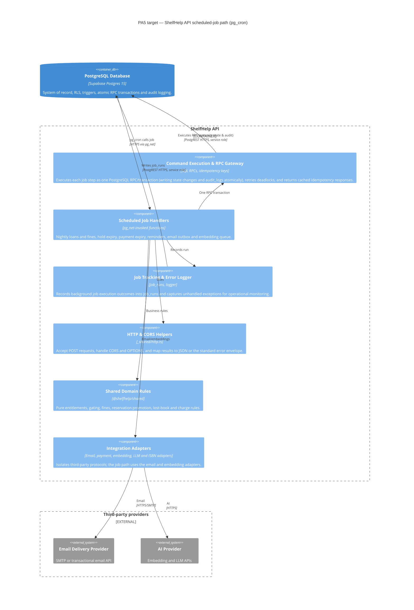

# ShelfHelp: Smart Library Management System
# PA4 Software Architecture — C4 Level 3 (Component Diagrams)

**Version:** 1.7

---

## Revision History

| Date | Version | Description | Author |
| :--- | :--- | :--- | :--- |
| 24/Nov/2026 | 1.0 | Initial component views for the Web Application and ShelfHelp API | Nguyễn Anh Khôi |
| 24/Nov/2026 | 1.1 | Split reader components, merged transaction and persistence, aligned external containers | Nguyễn Anh Khôi |
| 24/Nov/2026 | 1.2 | Aligned container types, removed L3 Sentry, documented TypeScript/SQL rule parity and test strategy, and clarified atomic audit logging | Nguyễn Anh Khôi |
| 24/Nov/2026 | 1.3 | Component diagrams rendered as two panels each (Web Application by mode; ShelfHelp API by entry path) so the C4 layout stays readable | Nguyễn Anh Khôi |
| 24/Nov/2026 | 1.4 | Catalogues gained a Panel column so each component maps to its diagram panel | Nguyễn Anh Khôi |
| 27/Nov/2026 | 1.5 | Aligned Web App and API components, command map (`list-sessions`, `revoke-session`, `revoke-other-sessions`), and traceability (UC-01–UC-32) with PA4 UC-02 and UC-32 | Nguyễn Anh Khôi |
| 28/Nov/2026 | 1.6 | Updated Edge Function count to 24, corrected command names (`send-reminders`, `submit-book-review`, `inventory-history`), and aligned §7.1/§8 with `src/supabase/functions/` | Nguyễn Anh Khôi |
| 28/Nov/2026 | 1.7 | Clarified §4.1 and §5 — reader/admin code-splitting is a PA5 target; routes are currently separate trees but share one bundle | Nguyễn Anh Khôi |

---

## Table of Contents

- [1. Introduction](#1-introduction)
- [2. Why these two containers](#2-why-these-two-containers)
- [3. Web Application — component diagram](#3-web-application--component-diagram)
  - [3.1 Reader Mode](#31-reader-mode)
  - [3.2 Admin Mode](#32-admin-mode)
- [4. Web Application — component catalogue](#4-web-application--component-catalogue)
- [5. Web Application — design notes](#5-web-application--design-notes)
- [6. ShelfHelp API — component diagram](#6-shelfhelp-api--component-diagram)
  - [6.1 Request path (business commands)](#61-request-path-business-commands)
  - [6.2 Scheduled-job path (pg_cron) — PA5 target](#62-scheduled-job-path-pg_cron--pa5-target)
- [7. ShelfHelp API — component catalogue](#7-shelfhelp-api--component-catalogue)
- [8. ShelfHelp API — business command map](#8-shelfhelp-api--business-command-map)
- [9. ShelfHelp API — interactions and design notes](#9-shelfhelp-api--interactions-and-design-notes)
- [10. Shared code and cross-cutting concerns](#10-shared-code-and-cross-cutting-concerns)
- [11. Traceability](#11-traceability)
- [12. Deliberate omissions](#12-deliberate-omissions)

---

## 1. Introduction

**Performed by:** Nguyễn Anh Khôi | **Reviewed by:** Lê Văn Vĩ | **Edited by:** Nguyễn Anh Khôi

### 1.1 Purpose

This document is the **C4 Level 3 (Component) view** of ShelfHelp. It opens the two core application containers from the [Container view](../container/Container.md) and shows the modules inside them, their responsibilities, and their collaborations.

A *component* is a group of related code with a clear responsibility inside its container. Components are not separately deployed: they are compiled into the React bundle or the Edge Function bundle.

### 1.2 Scope

The view covers the two core application containers and includes the planned PA5 architecture. The diagrams are target views: components and relationships labelled **PA5 target** are not implemented. Some diagram elements group related functions conceptually rather than corresponding to a single module. Current status below refers to repository code through migration `0018`, not a verified deployment.

The inline Mermaid diagrams and linked `.mmd` files are authoritative. Existing `.png` exports are historical and have not been regenerated for this reconciliation.

### 1.3 References

| ID | Document | Use in this document |
| :--- | :--- | :--- |
| R1 | [`Container.md`](../container/Container.md) | Container responsibilities and runtime flows |
| R2 | [`System-Context.md`](../system-context/System-Context.md) | Actors, external systems, and platform description |
| R3 | [`SHELFHELP_FULLSPEC.md`](../../../../../src/speckit/specs/SHELFHELP_FULLSPEC.md) | Screens, functions, RPCs, and data model |
| R4 | [`Use-Case-Diagrams.md`](../../use-case/Use-Case-Diagrams.md) | UC-01 to UC-32 |

---

## 2. Why these two containers

**Performed by:** Nguyễn Anh Khôi | **Reviewed by:** Lê Văn Vĩ | **Edited by:** Nguyễn Anh Khôi

The Web Application and the ShelfHelp API carry most implemented product behaviour. The Web Application separates Reader and Admin experiences; the API contains business handlers. Scheduled jobs and a generic provider adapter layer are planned.

PostgreSQL is not decomposed here because its components are tables, constraints, indexes, policies, triggers, and RPCs, which are documented in the specification and migrations. Auth, Storage, and
Realtime are managed services with no team-owned internal modules.

---

## 3. Web Application — component diagram

**Performed by:** Nguyễn Anh Khôi | **Reviewed by:** Lê Văn Vĩ | **Edited by:** Nguyễn Anh Khôi

The view is drawn as two panels, one per operating mode. Reader Mode and Admin Mode share the same
App Shell, the same Data Access & Realtime Client, and the same backend services, so each panel shows
the implemented feature groups alongside explicitly marked targets. The data-access box groups direct `supabase-js` calls and the API helper conceptually; it is not a single gateway used by every feature.

### 3.1 Reader Mode

```mermaid
C4Component
    title Component diagram — ShelfHelp Web Application (Reader Mode)

    Person(student, "Student (Reader)", "Uses Reader Mode on a phone or laptop.")

    Container_Boundary(spa, "ShelfHelp Web Application") {
        Component(authProfile, "Authentication & Profile", "React", "Registration, verification, login/logout and reset. Active sessions are a PA5 target.")
        Component(appShell, "App Shell & Access Guard", "React state, browser history", "Selects Reader or Admin shell and checks session, role and account status.")
        Component(catalogDiscovery, "Catalog & Discovery", "React", "Catalog, book detail, barcode scan, reviews and wishlist.")

        Component(cartCheckout, "Cart & Checkout", "React", "Borrowing cart, checkout, pickup window and simulated payment.")
        Component(dataAccess, "Data Access & Realtime Client", "supabase-js", "Direct PostgREST reads, copies subscription, Storage and Edge Function calls.")
        Component(myLibrary, "My Library", "React", "Loans, renewals, reservations and charges. Membership upgrade is a PA5 target.")

        Component(notificationsAssistant, "Notifications & Assistant", "React", "Reservations; notifications, suggestions and assistant are target capabilities.")
    }

    Boundary(backend, "Backend services", "SUPABASE") {
        Container(api, "ShelfHelp API", "Supabase Edge Functions", "Business commands; scheduled jobs are planned.")
        ContainerDb(db, "PostgreSQL Database", "Supabase Postgres 15", "Catalog and own-row data exposed through PostgREST under RLS.")
        Container_Ext(auth, "Supabase Auth", "Managed identity service", "Sessions, JWT and credential recovery.")
        Container_Ext(storage, "Supabase Storage", "Managed object storage", "Covers, avatars, evidence and imports.")
        Container_Ext(realtime, "Supabase Realtime", "Managed change-data service", "Book-detail copies subscription.")
    }

    Rel(student, appShell, "Uses Reader Mode", "HTTPS")

    Rel(appShell, dataAccess, "Session state")
    Rel(appShell, authProfile, "Routes auth flows")
    Rel(appShell, catalogDiscovery, "Renders")
    Rel(appShell, cartCheckout, "Renders")
    Rel(appShell, myLibrary, "Renders")
    Rel(appShell, notificationsAssistant, "Renders")

    Rel(catalogDiscovery, dataAccess, "Queries/commands")
    Rel(cartCheckout, dataAccess, "Queries/commands")
    Rel(myLibrary, dataAccess, "Queries/commands")
    Rel(notificationsAssistant, dataAccess, "Queries/commands")
    Rel(authProfile, dataAccess, "Authenticates")

    Rel(dataAccess, auth, "Signs in/verifies OTP", "HTTPS, PKCE")
    Rel(dataAccess, db, "Reads; permitted own-row writes", "PostgREST, RLS")
    Rel(dataAccess, api, "Invokes commands", "HTTPS, JWT")
    Rel(dataAccess, storage, "(Data → Supabase Storage) <br/>Files", "HTTPS, signed URLs")
    Rel(dataAccess, realtime, "Subscribes", "WebSocket, RLS")

    UpdateRelStyle(student, appShell, $offsetX="-30", $offsetY="-50")

    UpdateRelStyle(appShell, dataAccess, $offsetX="10", $offsetY="0")
    UpdateRelStyle(appShell, authProfile, $offsetX="-40", $offsetY="10")
    UpdateRelStyle(appShell, catalogDiscovery, $offsetX="-30", $offsetY="10")
    UpdateRelStyle(appShell, cartCheckout, $offsetX="-80", $offsetY="20")
    UpdateRelStyle(appShell, myLibrary, $offsetX="30", $offsetY="15")
    UpdateRelStyle(appShell, notificationsAssistant, $offsetX="-70", $offsetY="50")

    UpdateRelStyle(catalogDiscovery, dataAccess, $offsetX="50", $offsetY="-20")
    UpdateRelStyle(cartCheckout, dataAccess, $offsetX="-40", $offsetY="-15")
    UpdateRelStyle(myLibrary, dataAccess, $offsetX="-40", $offsetY="-20")
    UpdateRelStyle(notificationsAssistant, dataAccess, $offsetX="0", $offsetY="0")
    UpdateRelStyle(authProfile, dataAccess, $offsetX="-45", $offsetY="-40")

    UpdateRelStyle(dataAccess, auth, $offsetX="-90", $offsetY="300")
    UpdateRelStyle(dataAccess, db, $offsetX="20", $offsetY="-30")
    UpdateRelStyle(dataAccess, api, $offsetX="-200", $offsetY="160")
    UpdateRelStyle(dataAccess, storage, $offsetX="20", $offsetY="300")
    UpdateRelStyle(dataAccess, realtime, $offsetX="60", $offsetY="150")

    UpdateLayoutConfig($c4ShapeInRow="3", $c4BoundaryInRow="1")
```

The data-access box is a conceptual grouping, not a mandatory central gateway.

### 3.2 Admin Mode

```mermaid
C4Component
    title Component diagram — ShelfHelp Web Application (Admin Mode)

    Person(librarian, "Librarian (Admin)", "Uses Admin Mode on a desktop.")

    Container_Boundary(spa, "ShelfHelp Web Application") {
        Component(adminCirculation, "Admin Circulation & Queues", "React", "Desk handover, returns, due/overdue groups, reservation queues and reminders.")
        Component(appShell, "App Shell & Access Guard", "React state, browser history", "Selects Reader or Admin shell and checks session, role and account status.")
        Component(adminCatalog, "Admin Catalog & Inventory", "React", "Books, copies, ISBN lookup, bulk import, inventory history and write-off slips.")

        Component(adminMoney, "Admin Money & Reporting", "React", "Financial ledger and counter payments; reporting and reversals are targets.")
        Component(dataAccess, "Data Access & Realtime Client", "supabase-js", "Direct PostgREST reads, Storage and Edge Function calls.")
        Component(adminAcquisitions, "Admin Acquisitions & Students (PA5 target)", "React", "Suggestion review, acquisition batches, shipment receipt and student accounts.")

        Component(authProfile, "Authentication & Profile", "React", "Sign-in/out and password reset; active sessions are a PA5 target.")
    }

    Boundary(backend, "Backend services", "SUPABASE") {
        Container(api, "ShelfHelp API", "Supabase Edge Functions", "Business commands; scheduled jobs are planned.")
        ContainerDb(db, "PostgreSQL Database", "Supabase Postgres 15", "Catalog and own-row data exposed through PostgREST under RLS.")
        Container_Ext(auth, "Supabase Auth", "Managed identity service", "Sessions, JWT and credential recovery.")
        Container_Ext(storage, "Supabase Storage", "Managed object storage", "Covers, avatars, evidence and imports.")
    }

    Rel(librarian, appShell, "Uses Admin Mode", "HTTPS")

    Rel(appShell, dataAccess, "Session state")
    Rel(appShell, adminCirculation, "Renders")
    Rel(appShell, adminCatalog, "Renders")
    Rel(appShell, adminMoney, "Renders")
    Rel(appShell, adminAcquisitions, "Target")
    Rel(appShell, authProfile, "Routes auth/session flows")

    Rel(adminCirculation, dataAccess, "Queries/commands")
    Rel(adminCatalog, dataAccess, "Queries/commands")
    Rel(adminMoney, dataAccess, "Queries/commands")
    Rel(adminAcquisitions, dataAccess, "Queries/commands")
    Rel(authProfile, dataAccess, "Auth & sessions")

    Rel(dataAccess, auth, "Verifies session", "HTTPS, PKCE")
    Rel(dataAccess, db, "Reads; updates own notification state", "PostgREST, RLS")
    Rel(dataAccess, api, "Invokes commands", "HTTPS, JWT")
    Rel(dataAccess, storage, "(Data → Storage) <br/>Files", "HTTPS, signed URLs")

    UpdateRelStyle(librarian, appShell, $offsetX="-20", $offsetY="-50")

    UpdateRelStyle(appShell, dataAccess, $offsetX="10", $offsetY="0")
    UpdateRelStyle(appShell, adminCirculation, $offsetX="-20", $offsetY="10")
    UpdateRelStyle(appShell, adminCatalog, $offsetX="-20", $offsetY="10")
    UpdateRelStyle(appShell, adminMoney, $offsetX="-80", $offsetY="20")
    UpdateRelStyle(appShell, adminAcquisitions, $offsetX="-30", $offsetY="-20")
    UpdateRelStyle(appShell, authProfile, $offsetX="-165", $offsetY="65")

    UpdateRelStyle(adminCirculation, dataAccess, $offsetX="-35", $offsetY="-30")
    UpdateRelStyle(adminCatalog, dataAccess, $offsetX="60", $offsetY="-20")
    UpdateRelStyle(adminMoney, dataAccess, $offsetX="-50", $offsetY="10")
    UpdateRelStyle(adminAcquisitions, dataAccess, $offsetX="-50", $offsetY="10")
    UpdateRelStyle(authProfile, dataAccess, $offsetX="-18", $offsetY="10")

    UpdateRelStyle(dataAccess, auth, $offsetX="-90", $offsetY="300")
    UpdateRelStyle(dataAccess, db, $offsetX="20", $offsetY="-30")
    UpdateRelStyle(dataAccess, api, $offsetX="-200", $offsetY="160")
    UpdateRelStyle(dataAccess, storage, $offsetX="20", $offsetY="300")

    UpdateLayoutConfig($c4ShapeInRow="3", $c4BoundaryInRow="1")
```

Acquisitions and student-management screens remain targets or placeholders.

Some features reuse presentation components and shared helpers; a universal shared presentation kit and validation contract are not implemented.

Source: [`mermaid/component-webapp-reader.mmd`](mermaid/component-webapp-reader.mmd) and
[`mermaid/component-webapp-admin.mmd`](mermaid/component-webapp-admin.mmd).

---

## 4. Web Application — component catalogue

**Performed by:** Nguyễn Anh Khôi | **Reviewed by:** Lê Văn Vĩ | **Edited by:** Nguyễn Anh Khôi

The **Panel** column names the diagram panel in which each component appears: *Reader* (§3.1), *Admin*
(§3.2), or *Both* for the App Shell, Authentication & Profile, the Data Access & Realtime Client, and the shared backend.

| Component | Panel | Responsibilities & services | Relationships & collaborations | Key source | Main use cases |
| :--- | :--- | :--- | :--- | :--- | :--- |
| **App Shell & Access Guard** | Both | Bootstraps the application; inspects authenticated user session and role (`student` vs `admin`) to render Reader Mode or Admin Mode; enforces status checks (`pending_verification`, `restricted`, `inactive`). | Mounts and conditionally routes to **Authentication & Profile** and feature sub-shells (**Catalog & Discovery**, **Cart & Checkout**, **My Library**, **Admin Circulation**, etc.); subscribes to auth state from **Data Access Client**. | `src/frontend/src/app/`, feature layouts | All |
| **Authentication & Profile** | Both | Registration, verification, login/logout and password reset. **PA5 target:** server lockout, selectable session persistence and active-session inventory and revocation. | Uses Supabase Auth and the implemented `register-student` Edge Function; session-management endpoints are targets. | `src/frontend/src/features/auth/` | UC-01–UC-04, UC-32 |
| **Catalog & Discovery** | Reader | Catalog browsing, diacritic-insensitive search, genre/department filtering, book detail view, ISBN camera barcode scanning, reading wishlist, and community review display. | Rendered by **App Shell**; queries catalog and book reviews via **Data Access Client** (PostgREST); issues wishlist mutations via API (`toggle-wishlist`). | `src/frontend/src/features/reader/` | UC-06–UC-08, UC-15 |
| **Cart & Checkout** | Reader | Cart persistence, checkout, pickup and simulated payment. | Uses `checkout-cart` and `complete-simulated-payment`. | `src/frontend/src/features/reader/catalog/` | UC-09, UC-10 |
| **My Library** | Reader | Loans, renewals, reservations, reviews and fines. Membership upgrade is a target. | Uses `renew-loan`, `cancel-reservation`, `pay-reader-charges`, and `submit-book-review`. | `src/frontend/src/features/reader/` | UC-05, UC-11–UC-15, UC-18 |
| **Notifications & Assistant** | Reader | Reservation screen exists; suggestion submission and AI assistant are targets. | No current reader notification Realtime subscription or `chat-send` handler. | `src/frontend/src/features/reader/reservations/` | UC-16, UC-17, UC-28 |
| **Admin Circulation & Queues** | Admin | Circulation desk pickup handover, book returns with condition grading and damage tier fee assessment, due/overdue loans monitoring, and reservation queue management. | Rendered by **App Shell**; sends physical circulation commands via **Data Access Client** to ShelfHelp API (`handover-items`, `return-loan`, `record-counter-payment`). | `src/frontend/src/features/admin/circulation/`, `queues/` | UC-20, UC-21, UC-29, UC-30 |
| **Admin Catalog & Inventory** | Admin | Book cataloguing, physical copy barcode generation and tracking, bulk CSV import, inventory condition history, and write-off slip creation with photo evidence. | Rendered by **App Shell**; uploads evidence to Storage and issues catalog management commands via **Data Access Client** to API and PostgREST. | `src/frontend/src/features/admin/` | UC-07, UC-19, UC-22, UC-26 |
| **Admin Money & Reporting** | Admin | Financial ledger and counter payments exist; reversals and analytics/reporting are targets. | Uses direct queries and `record-counter-payment`. | `src/frontend/src/features/admin/ledger/`, `circulation/` | UC-13, UC-23, UC-27 |
| **Admin Acquisitions & Students** | Admin | Planned; corresponding Admin sections are placeholders. | Future API integration. | `src/frontend/src/app/App.jsx` | UC-24, UC-25, UC-31 |
| **Data Access & Realtime Client** | Both | Conceptual grouping of `supabase-js`, direct queries and the API helper; book detail subscribes to copy changes. TanStack Query is planned. | Features use these facilities directly; there is no universal central gateway. | `src/frontend/src/lib/` | All |

### 4.1 Reader and Admin Mode in one container

Reader and Admin Mode share the App Shell, the Data Access client, and the shared contracts. Their routes are structured as separate route trees, with route-level `React.lazy` / `Suspense` code-splitting planned for PA5 so that admin code is never downloaded by students. The App Shell chooses the mode from the authenticated profile:

- `role = student` → Reader shell and reader routes;
- `role = admin` → Admin shell and admin routes;
- `status = pending_verification` → verification screen;
- no session → authentication routes.

Route guards improve the experience; RLS and Edge Functions enforce the actual rule.

---

## 5. Web Application — design notes

**Performed by:** Nguyễn Anh Khôi | **Reviewed by:** Lê Văn Vĩ | **Edited by:** Nguyễn Anh Khôi

- **Feature isolation.** Features are grouped by domain, but some import other feature components or icons directly.
- **Server state.** TanStack Query is planned to own server state; until it is added, component state
  and direct Supabase queries own transient and server data. This change should avoid stale loan or
  availability data after implementation.
- **Validation.** Client validation supports usability; server handlers and SQL validate independently. A universal shared schema is a target.
- **Bundles.** Route-level `React.lazy` / `Suspense` splitting is planned for PA5; until then, reader and admin routes are separate route trees but ship in the same bundle.
- **Failure.** The API client preserves `reason`, `message`, and `details`, so screens can show a
  specific recovery action.

---

## 6. ShelfHelp API — component diagram

**Performed by:** Nguyễn Anh Khôi | **Reviewed by:** Lê Văn Vĩ | **Edited by:** Nguyễn Anh Khôi

The view is drawn as two panels. The request panel combines current handlers and conceptual or planned components; the scheduled-job panel is entirely a PA5 target. There is currently no central RPC gateway, general adapter layer, job tracker, or scheduled job handler.

### 6.1 Request path (business commands)

```mermaid
C4Component
    title Component diagram — ShelfHelp API: request path (business commands)
    Container_Ext(auth, "Supabase Auth", "Managed identity service", "JWT verification, user identity and session management.")
    Container(webapp, "ShelfHelp Web Application", "React SPA", "Calls business commands.")
    ContainerDb(db, "PostgreSQL Database", "Supabase Postgres 15", "System of record, RLS, triggers and atomic RPC transactions; general audit logging is planned.")

    Container_Boundary(api, "ShelfHelp API") {
        Component(authGuard, "Auth & Access Guard", "_shared/auth.ts", "Verifies the caller and checks role and profile status for protected handlers.")
        Component(commandGateway, "RPC invocation", "PostgREST, SQL RPCs", "Handlers call transactional RPCs directly; a general retry gateway is a target.")
        Component(jobLogger, "Job Tracking & Error Logger (PA5 target)", "job_runs, logger", "Planned operational monitoring.")

        Component(validation, "Request Validation", "Handler-specific validation", "Handlers parse and validate requests; some shared helpers exist.")
        Component(commandHandlers, "Business Command Handlers", "One function folder per command", "Implemented account, catalog, inventory, borrowing, money, circulation, write-off and reminder handlers.")
        Component(httpHelpers, "HTTP & CORS Helpers", "_shared/http.ts", "Accept POST requests, handle CORS and OPTIONS, and map results to JSON or the standard error envelope.")

        Component(domainRules, "Shared Helpers", "@shelfhelp/shared", "Types, reason codes, auth and catalog helpers; business rules also live in SQL.")
        Component(adapters, "Integration Adapters (PA5 target)", "Provider interfaces", "Planned adapters; current ISBN lookup calls providers directly.")
    }

    Boundary(providers, "Third-party providers", "EXTERNAL") {
        System_Ext(email, "Email Delivery Provider", "SMTP or transactional email API")
        System_Ext(payment, "Payment Provider (simulator)", "Payment and refund API")
        System_Ext(ai, "AI Provider", "Embedding and LLM APIs")
        System_Ext(isbn, "Bibliographic Metadata Services", "Google Books and Open Library")
    }

    Rel(webapp, commandHandlers, "Calls command", "HTTPS, JWT")

    Rel(commandHandlers, authGuard, "Uses")
    Rel(commandHandlers, validation, "Uses")
    Rel(commandHandlers, httpHelpers, "Uses")
    Rel(commandHandlers, domainRules, "Business rules")
    Rel(commandHandlers, commandGateway, "One RPC transaction")
    Rel(commandHandlers, adapters, "Target provider adapters")
    Rel(commandHandlers, jobLogger, "Target")

    Rel(authGuard, auth, "Verifies JWT", "HTTPS")
    Rel(commandHandlers, auth, "Registers users", "HTTPS, service role")
    Rel(authGuard, db, "Reloads profiles.status", "PostgREST HTTPS, service role")
    Rel(commandGateway, db, "Executes RPC", "PostgREST HTTPS, service role")
    Rel(jobLogger, db, "Target error records", "PostgREST HTTPS, service role")

    Rel(adapters, email, "Target email", "HTTPS/SMTP")
    Rel(adapters, payment, "Target payment provider", "HTTPS")
    Rel(adapters, ai, "Target AI", "HTTPS")
    Rel(commandHandlers, isbn, "Direct ISBN lookup", "HTTPS")

    UpdateLayoutConfig($c4ShapeInRow="3", $c4BoundaryInRow="1")
    UpdateRelStyle(commandHandlers, authGuard, $offsetX="0", $offsetY="-30")
    UpdateRelStyle(commandHandlers, validation, $offsetX="-10", $offsetY="-15")
    UpdateRelStyle(commandHandlers, httpHelpers, $offsetX="-10", $offsetY="-15")
    UpdateRelStyle(commandHandlers, domainRules, $offsetX="-60", $offsetY="-10")
    UpdateRelStyle(commandHandlers, commandGateway, $offsetX="10", $offsetY="0")
    UpdateRelStyle(commandHandlers, adapters, $offsetX="10", $offsetY="0")

    UpdateRelStyle(authGuard, auth, $offsetX="10", $offsetY="0")
    UpdateRelStyle(commandHandlers, auth, $offsetX="-65", $offsetY="-195")
    UpdateRelStyle(authGuard, db, $offsetX="10", $offsetY="-25")
    UpdateRelStyle(commandGateway, db, $offsetX="-40", $offsetY="50")
    UpdateRelStyle(jobLogger, db, $offsetX="20", $offsetY="-30")

    UpdateRelStyle(webapp, commandHandlers, $offsetX="0", $offsetY="-250")
    
    UpdateRelStyle(adapters, email, $offsetX="-140", $offsetY="50")
    UpdateRelStyle(adapters, payment, $offsetX="40", $offsetY="0")
    UpdateRelStyle(adapters, ai, $offsetX="10", $offsetY="0")
    UpdateRelStyle(commandHandlers, isbn, $offsetX="0", $offsetY="0")
```

The RPC box represents direct handler calls, not a separately implemented gateway.

### 6.2 Scheduled-job path (pg_cron) — PA5 target

This entire scheduled-job diagram is a target; extensions exist, but no corresponding schedules or `job-*` handlers are implemented. The current `_shared/` directory contains auth, HTTP and inventory RPC helpers.

Source: [`mermaid/component-api-request.mmd`](mermaid/component-api-request.mmd) and
[`mermaid/component-api-scheduled-job.mmd`](mermaid/component-api-scheduled-job.mmd).

---

## 7. ShelfHelp API — component catalogue

**Performed by:** Nguyễn Anh Khôi | **Reviewed by:** Lê Văn Vĩ | **Edited by:** Nguyễn Anh Khôi

The **Panel** column names the diagram panel in which each component appears: *Request* (§6.1),
*Scheduled job* (§6.2), or *Both* for the shared rule engine, RPC gateway, adapters, and job tracker.

| Component | Panel | Responsibilities & services | Relationships & collaborations | Key source |
| :--- | :--- | :--- | :--- | :--- |
| **HTTP & CORS Helpers** | Request | Handle CORS and format JSON/error responses. | Used by business handlers. | `src/supabase/functions/_shared/http.ts` |
| **Auth & Access Guard** | Request | Verify caller, compare both role values, and reload profile status; allowed statuses depend on the handler. Additional business gates are enforced elsewhere. | Used by protected handlers; registration is a separate flow. | `src/supabase/functions/_shared/auth.ts` |
| **Request Validation** | Request | Payload validation is performed by individual handlers, with some shared helpers. | Not a universal shared schema or a guarantee of validation before every database read. | `src/supabase/functions/<command>/index.ts` |
| **Business Command Handlers** | Request | Implement account registration, catalog, circulation, reader mutations, inventory and reminders. | Protected handlers call RPCs directly; `register-student` calls Auth Admin API and `lookup-isbn` calls metadata providers directly. | `src/supabase/functions/<command>/index.ts` |
| **Scheduled Job Handlers** | Scheduled job | **PA5 target:** cron-invoked batch handlers and job tracking. | No `job-*` functions or schedules are currently implemented. | Planned |
| **Shared Helpers** | Request | Types, reason codes, auth and catalog helpers; transactional business rules are also in SQL. | No complete shared fines/entitlements engine or demonstrated shared-vector parity suite. | `src/shared/src/` |
| **RPC invocation** | Request | Handlers invoke transactional RPCs directly with `service_role`; checkout has an optional idempotency key. | General automatic deadlock retry and exactly-once gateway are targets. | `src/supabase/functions/`, `src/supabase/migrations/` |
| **Integration Adapters** | Both | **PA5 target:** common provider interfaces. | Current ISBN lookup uses direct HTTP and payment is simulated locally. | `src/supabase/functions/lookup-isbn/` |
| **Job Tracking & Error Logger** | Both | **PA5 target:** `job_runs` and Sentry integration. | Not implemented as the component shown. | Planned |

### 7.1 Existing transactional procedures

| RPC | Purpose |
| :--- | :--- |
| `rpc_confirm_handover_for_admin` | Confirms a desk handover and moves the copy and loan item to borrowed in one transaction. |
| `rpc_process_return_with_evidence_for_admin` | Processes physical return with condition evidence and related database updates in one transaction. |
| `rpc_settle_counter_charge` | Records counter cash payment and marks the associated charge settled. |
| `rpc_cancel_reservation_staff` | Cancels a reservation from the admin queue and promotes the next waiting student. |
| `rpc_renew_loan_for_user` | Applies renewal rules and extends the due date; another reader waiting blocks renewal. |
| `rpc_pay_reader_charges_for_user` | Settles reader charges and records a simulated-payment receipt. |
| `rpc_submit_book_review_for_user` | Validates loan history and stores book rating and review text. |

*Implementation status:* Twenty-four business Edge Function directories are currently present, excluding `_shared` and the `hello` health-check function. The implemented set includes `add-copies`, `cancel-reservation`, `cancel-writeoff-slip`, `change-copy-status`, `checkout-cart`, `complete-simulated-payment`, `complete-writeoff-slip`, `handover-items`, `import-books`, `inventory-history`, `lookup-isbn`, `mark-loan-lost`, `pay-reader-charges`, `record-counter-payment`, `register-student`, `renew-loan`, `reserve-book`, `return-loan`, `save-book`, `save-writeoff-slip`, `send-reminders`, `set-books-collection`, `submit-book-review`, and `toggle-wishlist`. The remaining PA5 command/job table in §8 is a target map, not evidence that every listed function, table, or scheduled job is migrated and implemented.

> **Session-management commands are not yet deployed.** `list-sessions`, `revoke-session`, and `revoke-other-sessions` appear in the component notes above as the **PA5 target** for UC-32 and have no Edge Function in `src/supabase/functions/` yet; the same applies to UC-02 server-side lockout. They are shown because the diagrams depict the full PA1–PA5 component structure, not because they run today.

---

## 8. ShelfHelp API — business command map

**Performed by:** Nguyễn Anh Khôi | **Reviewed by:** Lê Văn Vĩ | **Edited by:** Nguyễn Anh Khôi

Target map. Twenty-four business function directories are implemented in `src/supabase/functions/`, while the target table below also lists additional PA5 command and job handlers that are not yet implemented.

| Family | Functions | Main data touched | Use cases |
| :--- | :--- | :--- | :--- |
| **Account** | `register-student`, `set-account-inactive`, `reactivate-account`, `restore-account`, `request-restore-review`, `list-sessions`, `revoke-session`, `revoke-other-sessions` | `auth.users`, `auth.sessions`, `profiles`, `audit_logs` | UC-01–UC-04, UC-31, UC-32 |
| **Catalog** | `lookup-isbn`, `save-book`, `import-books`, `add-copies`, `change-copy-status`, `set-books-collection`, `inventory-history` | `books`, `copies`, `copy_events`, `reviews` | UC-06, UC-07, UC-15, UC-19 |
| **Borrowing** | `checkout-cart`, `cancel-loan-item`, `switch-to-counter-payment`, `renew-loan`, `submit-book-review`, `pay-reader-charges`, `reserve-book`, `cancel-reservation`, `toggle-wishlist` | `loan_requests`, `loan_items`, `reservations`, `wishlist` | UC-08–UC-10, UC-12, UC-14 |
| **Money** | `create-payment`, `complete-simulated-payment`, `purchase-membership`, `record-counter-payment`, `create-manual-receipt`, `reverse-receipt` | `payments`, `payment_lines`, `memberships`, `receipts`, `charges` | UC-05, UC-10, UC-13, UC-18, UC-23 |
| **Circulation** | `handover-items`, `return-loan`, `mark-loan-lost` | `loan_items`, `copies`, `copy_events`, `charges` | UC-18, UC-20, UC-21 |
| **Write-off** | `save-writeoff-slip`, `complete-writeoff-slip`, `cancel-writeoff-slip` | `writeoff_slips`, `writeoff_slip_copies`, `copies`, `inventory_transactions` | UC-22 |
| **Acquisition** | `submit-suggestion`, `withdraw-suggestion`, `reject-suggestion`, `add-suggestion-to-batch`, `save-batch`, `mark-batch-ordered`, `mark-batch-line-received` | `suggestions`, `suggestion_groups`, `batches`, `batch_lines`, `batch_activity` | UC-16, UC-24, UC-25 |
| **Notification** | `send-reminders` | `notifications`, `email_outbox` | UC-30 |
| **Assistant** | `chat-send` | `chats`, `chat_messages`, `books.embedding` | UC-17 |
| **Scheduled jobs** | `job-nightly-loans`, `job-due-notifications`, `job-hold-expiry`, `job-payment-expiry`, `job-membership-reminders`, `job-pickup-warnings`, `job-email-outbox`, `job-embed-queue` | `loan_items`, `charges`, `reservations`, `payments`, `notifications`, `email_outbox`, `books.embedding` | UC-12, UC-14, UC-18, UC-28, UC-30 |

---

## 9. ShelfHelp API — interactions and design notes

**Performed by:** Nguyễn Anh Khôi | **Reviewed by:** Lê Văn Vĩ | **Edited by:** Nguyễn Anh Khôi

### 9.1 Command sequence

1. The Web Application invokes a protected Edge Function over HTTPS with the user's JWT.
2. The handler uses the auth and HTTP helpers, checks the profile and validates its inputs. Specific business checks also run in SQL.
3. Circulation and reader mutation handlers call their PostgreSQL RPC directly using `service_role`. The RPC executes its database changes transactionally.
4. The handler returns the result or a structured error. Checkout optionally uses an idempotency key; no general retry gateway or universal audit log is implemented.
5. Registration and ISBN lookup have separate paths; lookup calls metadata providers directly, while payments are simulated locally.

### 9.2 Scheduled job sequence — PA5 target

1. `pg_cron` triggers a scheduled job according to its UTC cron expression and calls the corresponding job Edge Function through `pg_net` with an internal authorization secret header (`x-job-secret`).
2. The job handler loads domain parameters and invokes the designated PostgreSQL batch RPCs via the command gateway.
3. The execution result (status, duration, items processed, error messages) is recorded in `job_runs` by the job tracker component. Unexpected failures are forwarded to operational monitoring.

### 9.3 Design notes

- **Domain rule distribution and test parity:** Current business rules are primarily in SQL and handler-specific validation. A comprehensive shared TypeScript/SQL rule engine with common parity vectors is a target.
- **Server-authoritative RPC execution:**
  Protected business mutation entry points are restricted to `service_role`. Direct own-row cart/profile writes and `notifications.read_at` updates are separately allowed under RLS and grants.
- **Audit and jobs:** Inventory history exists; general `audit_logs`, `copy_events` and `job_runs` are targets. Do not assume every command writes a common audit record.
- **Handlers and transactions:** Many mutation handlers call one SQL RPC; some perform additional reads or provider/Auth calls. There is no common retry gateway.
- **Concurrency:** Checkout selects copies with `FOR UPDATE SKIP LOCKED`. Do not assume one fixed lock order for every command.
- **Idempotency:** Checkout accepts an optional key; guarantees for other commands are operation-specific, not universal.
- **Adapters:** Common provider adapters are targets; ISBN lookup currently calls its providers directly.
- **Error contract:** Failures use `{ error: { reason, message, details } }`; `STATUS_CHANGED` carries the current status.
- **No secrets in the client:** The service-role key, database URL, and provider keys exist only in function secrets and CI.
- **PA5 target — sign-in lockout and persistent sessions (`UC-02`):** Failed sign-in throttling (5 consecutive failures per email or Student ID within 15 minutes → 10-minute server-enforced lockout returning HTTP 429 with `Retry-After`, paired with per-IP/device rate limiting) is specified for later server-side implementation and must clear on successful sign-in or password reset. The Web Application must never store passwords; *"Keep me signed in"* must persist only the revocable refresh token in `localStorage` (or `sessionStorage` when unchecked).
- **PA5 target — server-side active-session inventory and revocation (`UC-32`):** Because `auth.sessions` is not exposed through PostgREST, later implementations of `list-sessions`, `revoke-session`, and `revoke-other-sessions` will run in Edge Functions using `service_role` against the Supabase Auth Admin API. They will derive caller identity solely from the verified JWT (never accepting `user_id` from the request body), omit raw tokens, treat revocation as idempotent, write `audit_logs` entries after Auth confirms, and leave ending the current session exclusively to normal sign-out (`UC-02`).

---

## 10. Shared code and cross-cutting concerns

**Performed by:** Nguyễn Anh Khôi | **Reviewed by:** Lê Văn Vĩ | **Edited by:** Nguyễn Anh Khôi

Shared TypeScript modules provide selected helpers and contracts. They do not yet cover all product rules or enforce complete client/server parity.

| Shared area | Used by | Purpose |
| :--- | :--- | :--- |
| **Types and state enums** | Web App, API, tests | Loan item, reservation, copy, account, payment and charge states that match database `CHECK` constraints. |
| **Reason codes** | Web App, API, tests | The single error vocabulary and HTTP status mapping. |
| **Settings and domain helpers** | Selected consumers | Defaults and auth/catalog helpers; comprehensive entitlement, fine, promotion and loss rules remain targets. |
| **Validation schemas** | Planned | Universal shared validation across browser and handlers is not implemented. |
| **Presentation components** | Web App | Feature and layout components; a universal kit is not implemented. |

---

## 11. Traceability

**Performed by:** Nguyễn Anh Khôi | **Reviewed by:** Lê Văn Vĩ | **Edited by:** Nguyễn Anh Khôi

| View element | Feature groups | Use cases |
| :--- | :--- | :--- |
| App Shell & Access Guard | All | All |
| Authentication & Profile | Accounts, identity, profile, active sessions | UC-01–UC-04, UC-32 |
| Catalog & Discovery | Catalog, search, barcode, wishlist | UC-06–UC-08, UC-15 |
| Cart & Checkout | Cart, checkout, payment | UC-09, UC-10 |
| My Library | Membership, loans, renewals, reservations, charges | UC-05, UC-11–UC-14, UC-18 |
| Notifications & Assistant | Notifications, suggestions, assistant | UC-16, UC-17, UC-28 |
| Admin Circulation & Queues | Desk circulation, queues, reminders | UC-20, UC-21, UC-29, UC-30 |
| Admin Catalog & Inventory | Catalog, copies, barcode, import, inventory, write-off | UC-07, UC-19, UC-22, UC-26 |
| Admin Money & Reporting | Receipts, ledger, analytics | UC-13, UC-23, UC-27 |
| Admin Acquisitions & Students | Acquisitions, student accounts | UC-24, UC-25, UC-31 |
| Data Access & Realtime Client | All read and command paths | All |
| API command families | See §8 | UC-01–UC-32 |
| API job handlers (target) | Fines, holds, payments, reminders, embeddings | UC-12, UC-14, UC-18, UC-28, UC-30 |
| API adapters (target; ISBN uses direct HTTP today) | Email, payment, AI, ISBN | UC-01, UC-03, UC-05, UC-10, UC-13, UC-17, UC-19, UC-24, UC-25, UC-28, UC-30 |
| API job tracking & error logger (target) | Background jobs, operational error tracking | UC-12, UC-14, UC-18, UC-28, UC-30 |

---

## 12. Deliberate omissions

**Performed by:** Nguyễn Anh Khôi | **Reviewed by:** Lê Văn Vĩ | **Edited by:** Nguyễn Anh Khôi

- **Individual pages and dialogs.** Each feature component contains several routes and modals.
- **Individual function folders.** The API diagram groups functions into command and job families; §8
  lists every function.
- **Database objects.** Tables, policies, triggers, and RPCs are documented in the specification and
  migrations.
- **Managed service internals.** Auth, Storage, and Realtime are black boxes by design.
- **Shared UI and validation libraries.** Selected shared components and helpers are noted in §3 and §10; universal shared validation is planned.

Source diagrams: [`mermaid/component-webapp-reader.mmd`](mermaid/component-webapp-reader.mmd),
[`mermaid/component-webapp-admin.mmd`](mermaid/component-webapp-admin.mmd),
[`mermaid/component-api-request.mmd`](mermaid/component-api-request.mmd),
[`mermaid/component-api-scheduled-job.mmd`](mermaid/component-api-scheduled-job.mmd).
