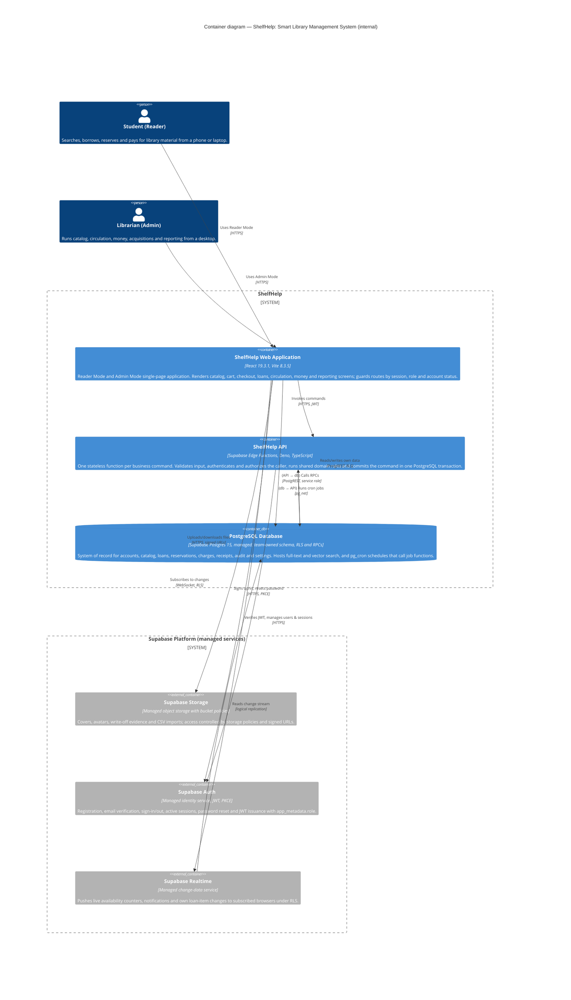
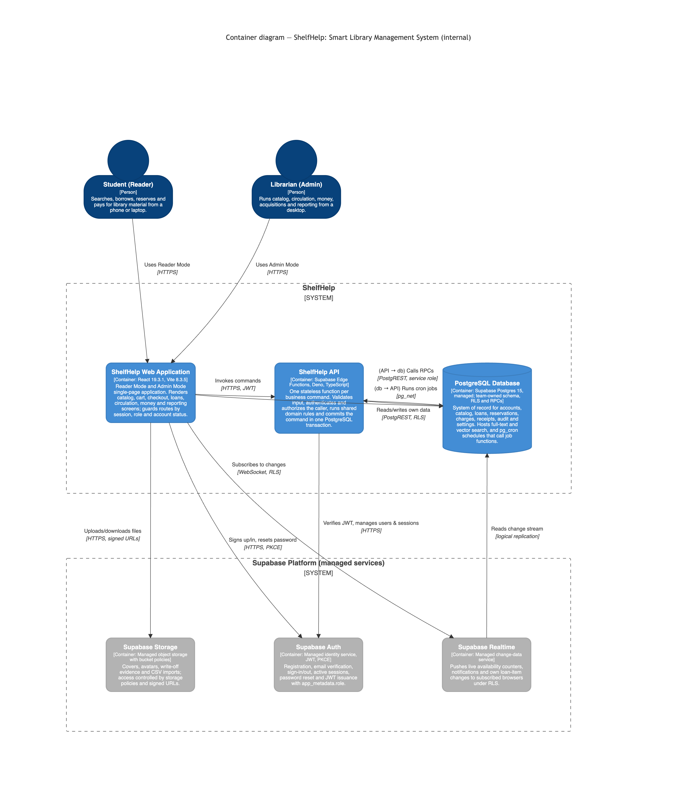
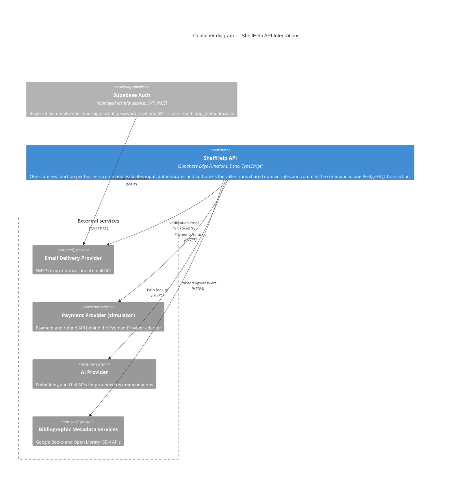
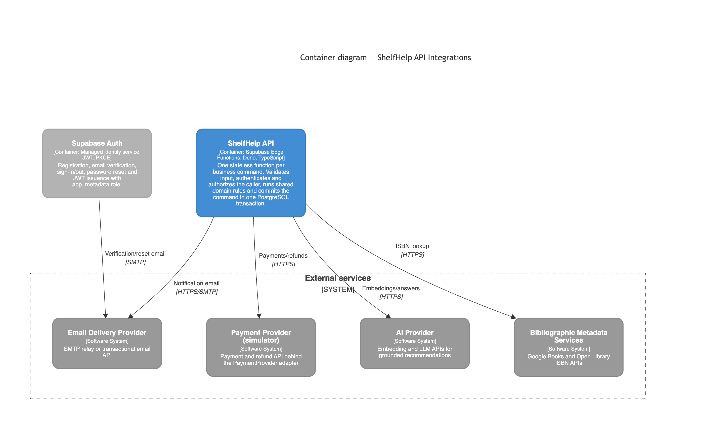

# ShelfHelp: Smart Library Management System
# PA4 Software Architecture — C4 Level 2 (Container Diagram)

**Version:** 1.8

---

## Revision History

| Date | Version | Description | Author |
| :--- | :--- | :--- | :--- |
| 24/Nov/2026 | 1.0 | Initial container view and written explanation | Nguyễn Anh Khôi |
| 24/Nov/2026 | 1.1 | Aligned the container boundary with team-owned business logic; trimmed duplicated detail | Nguyễn Anh Khôi |
| 24/Nov/2026 | 1.2 | Explicit container communication protocols, services provided, and component collaborations | Nguyễn Anh Khôi |
| 24/Nov/2026 | 1.3 | Aligned L2 container classification with L3, updated API-DB protocol to PostgREST HTTPS, and removed redundant technology relisting | Nguyễn Anh Khôi |
| 24/Nov/2026 | 1.4 | Stated the locked frontend versions (React 19.3.1, Vite 8.3.5) consistently with the Level 1 and deployment views | Nguyễn Anh Khôi |
| 24/Nov/2026 | 1.5 | Container diagram rendered as two panels (core containers; API outbound integrations) so the C4 layout stays readable | Nguyễn Anh Khôi |
| 27/Nov/2026 | 1.6 | Aligned Container view, API-to-Auth session relationship, authentication path, and traceability (UC-01–UC-32) with PA4 UC-02 and UC-32 | Nguyễn Anh Khôi |
| 28/Nov/2026 | 1.7 | Corrected `rpc_search_books` RPC name in §5.1 | Nguyễn Anh Khôi |
| 28/Nov/2026 | 1.8 | Removed inline implementation-status labels; the view now presents the PA1–PA5 target architecture uniformly, with status consolidated in §1.2 and §9 | Nguyễn Anh Khôi |

---

## Table of Contents

- [1. Introduction](#1-introduction)
- [2. Relationship to the Level 1 view](#2-relationship-to-the-level-1-view)
- [3. Container diagram](#3-container-diagram)
  - [3.1 Core containers and managed services](#31-core-containers-and-managed-services)
  - [3.2 ShelfHelp API outbound integrations](#32-shelfhelp-api-outbound-integrations)
- [4. Container catalogue](#4-container-catalogue)
- [5. Runtime interactions](#5-runtime-interactions)
- [6. Deployment and environments](#6-deployment-and-environments)
- [7. Traceability to PA1–PA4](#7-traceability-to-pa1pa4)
- [8. Quality and failure characteristics](#8-quality-and-failure-characteristics)
- [9. Implementation status](#9-implementation-status)
- [10. Scope and assumptions](#10-scope-and-assumptions)
- [11. Related views](#11-related-views)

---

## 1. Introduction

**Performed by:** Nguyễn Anh Khôi | **Reviewed by:** Nguyễn Minh Phú | **Edited by:** Nguyễn Anh Khôi

### 1.1 Purpose

This document is the **C4 Level 2 (Container) view** of ShelfHelp. It opens the single ShelfHelp system box from the System Context view into the runtime containers that execute the product, and shows the managed platform services that support them.

| View | Question answered | Document |
| :--- | :--- | :--- |
| **L1 — System Context** | Who uses ShelfHelp and which external systems does it depend on? | `System-Context.md` |
| **L2 — Container** | What separately running parts make up ShelfHelp, and how do they communicate? | **This document** |
| **L3 — Component** | What modules live inside the two core application containers? | `Component.md` |
| **Deployment** | How are the containers mapped to physical and cloud infrastructure nodes? | `Deployment.md` |

### 1.2 Scope

The view documents the containers behind every feature from PA1 through PA4: identity and membership, catalog and discovery, cart and checkout, desk circulation, inventory and write-offs, money and receipts, reservations, acquisitions, notifications, reporting, and the AI assistant. It also carries the forward design for PA5, so a container or relationship may appear here before the code that implements it exists. §9 lists what is implemented today and what the final release still adds.

### 1.3 References

| ID | Document | Use in this document |
| :--- | :--- | :--- |
| R1 | `System-Context.md` | Level 1 actors, external systems, and platform description |
| R2 | `SHELFHELP_FULLSPEC.md` | Technology stack, data model, functions, and RPCs |
| R3 | `DECISIONS.md` | Supabase and project-layout decisions |
| R4 | Use-Case-Diagrams.md | Actors and UC-01 to UC-32 |

---

## 2. Relationship to the Level 1 view

**Performed by:** Nguyễn Anh Khôi | **Reviewed by:** Nguyễn Minh Phú | **Edited by:** Nguyễn Anh Khôi

The Level 1 view treats ShelfHelp as one system and the Supabase Platform as one external dependency.
At Level 2 the boundary follows **business logic ownership**:

- The **ShelfHelp** boundary contains the React Web Application, the Edge Function API, and the
  PostgreSQL database. The team writes and reviews all code, schema, RLS policies, triggers, and
  transactional RPCs in these containers.
- **Supabase Auth, Storage, and Realtime** remain external managed services. The team configures them
  but does not own or operate their internals.
- The database server is managed by Supabase, but its schema and rules are team-owned, so it is shown
  with the application containers.

A *container* is a separately runnable or deployable unit that executes code or stores data. A shared
TypeScript library is not a container; it is compiled into the Web Application and the API.

---

## 3. Container diagram

**Performed by:** Nguyễn Anh Khôi | **Reviewed by:** Nguyễn Minh Phú | **Edited by:** Nguyễn Anh Khôi

The view is drawn as two panels. Panel 1 shows the containers inside ShelfHelp and the managed
services they call, with every internal and platform relationship. Panel 2 shows the edges that leave
ShelfHelp towards external systems: the API's outbound integrations and the verification and reset
email that Supabase Auth sends. Panel 1 omits those edges to keep the internal layout readable. Read
together, the two panels cover the same elements and relationships.

### 3.1 Core containers and managed services

Mermaid source — Panel 1

Panel 1 contains:

- **People:** Student (Reader) and Librarian (Admin), both using the Web Application over HTTPS.
- **Containers inside ShelfHelp:** the Web Application, the ShelfHelp API, and the PostgreSQL database.
- **Managed platform services:** Supabase Storage, Supabase Auth, and Supabase Realtime, in reading order.
- **Relationships:** both people to the Web Application; the Web Application to the API (commands), to
  the database (reads and own profile/cart writes under RLS), to Storage, Auth, and Realtime; the API
  to the database in both directions (transactional RPCs, and `pg_cron` job triggers via `pg_net`); the
  API to Auth; and Realtime reading the database change stream.

### 3.2 ShelfHelp API outbound integrations

Mermaid source — Panel 2

Panel 2 contains every edge from ShelfHelp to an external system:

| Relationship | Protocol | Purpose |
| :--- | :--- | :--- |
| Supabase Auth → Email Delivery Provider | SMTP | Verification and password-reset email. |
| ShelfHelp API → Email Delivery Provider | HTTPS/SMTP | Notification email dispatched from the application email outbox. |
| ShelfHelp API → Payment Provider (simulator) | HTTPS | Simulated payments and refunds behind the `PaymentProvider` adapter. |
| ShelfHelp API → AI Provider | HTTPS | Query embeddings and grounded answer generation. |
| ShelfHelp API → Bibliographic Metadata Services | HTTPS | ISBN metadata lookup during cataloguing and import. |

Source: `mermaid/container-part1.mmd` and
`mermaid/container-part2.mmd`.

---

## 4. Container catalogue

**Performed by:** Nguyễn Anh Khôi | **Reviewed by:** Nguyễn Minh Phú | **Edited by:** Nguyễn Anh Khôi

### 4.1 ShelfHelp Web Application

| Property | Value |
| :--- | :--- |
| **Type** | Browser single-page application (client-side container) |
| **Technology** | React 19.3.1, Vite 8.3.5 (see System-Context §3.2) |
| **Deployed to** | Static host and global CDN (served over HTTPS) |
| **Source** | src/frontend/ |

**Responsibilities and services provided:**
- Renders the responsive single-page user interface for both **Reader Mode** (students: catalog discovery, borrowing cart, checkout, active loans, reservations, fines/payments, grounded AI assistant) and **Admin Mode** (staff: circulation desk handover and returns, copy management, reservation queues, financial ledger, write-off slips, report exports).
- Enforces client-side route guards based on session state, role (`student` vs `admin`), and account status (`active`, `pending_verification`, `restricted`, `inactive`).
- Executes browser-native camera barcode scanning and implementation-selected utilities for barcode rendering, CSV, Excel, PDF, and image handling as those features are added.

**Communication with other containers:**
- **ShelfHelp API:** Invokes serverless Edge Functions via **HTTPS POST** bearing the caller's JWT bearer token in the `Authorization` header to execute transactional business commands.
- **PostgreSQL Database:** Reads catalog, loan history, charges, and user profile data directly via **PostgREST over HTTPS** using the Supabase anonymous key and caller's JWT, strictly filtered by PostgreSQL Row Level Security (RLS). Personal cart items, own notification read timestamps (`notifications.read_at`), and profile contact fields are written directly under own-row RLS policies and column-level grants.
- **Supabase Auth:** Handles OTP verification, sign-in/out, and password reset via **HTTPS POST** (PKCE flow). Student registration is validated and initiated through the `register-student` Edge Function using the Auth Admin API; direct public sign-up is disabled. Persists only the revocable refresh token in `localStorage` when *"Keep me signed in"* is selected (or `sessionStorage` otherwise), never storing the password (`UC-02`). Active-session listing and revocation (`UC-32`) route through **ShelfHelp API**.
- **Supabase Storage:** Uploads avatars and evidence images and downloads public cover assets via **HTTPS** using signed URLs or public endpoints.
- **Supabase Realtime:** Subscribes to live book availability counters, personal notifications, and loan-item status changes via persistent **WebSocket (WSS)** connections under RLS filtering.

---

### 4.2 ShelfHelp API

| Property | Value |
| :--- | :--- |
| **Type** | Stateless serverless API container |
| **Technology** | Supabase Edge Functions, Deno runtime, TypeScript |
| **Deployed to** | Supabase Edge Runtime (serverless globally distributed functions) |
| **Source** | src/supabase/functions/ |

**Responsibilities and services provided:**
- Provides a centralized serverless backend hosting one dedicated function per business command (for example checkout, handover, return, counter payment, cancellation) and one function per scheduled cron task.
- Validates request payloads with shared implementation-domain validation and strict type guards.
- Authenticates callers using JWT tokens, reloads `profiles.status` (and session validity where immediate revocation is required), and enforces authorization policies (role verification, account suspension, debt holds, membership entitlement, and sign-in lockout protection).
- Applies domain rules using `@shelfhelp/shared` (borrowing entitlements, gating checks and input validations) and orchestrates single-transaction execution via PostgreSQL RPCs, which enforce transactional formulas and invariants.
- Isolates third-party service communication behind pluggable integration adapters with standard fallback mechanisms.

**Communication with other containers:**
- **ShelfHelp Web Application:** Receives command requests via **HTTPS POST** with JWT authentication; returns standardized JSON responses or error envelopes (`{ error: { reason, message, details } }`).
- **PostgreSQL Database:** Invokes database stored procedures via **PostgREST HTTPS** using the privileged database `service_role` key to execute atomic transactional RPCs (for example `rpc_confirm_handover_for_admin`, `rpc_process_return_with_evidence_for_admin`), commit audit logs atomically, and query real-time profile states.
- **Supabase Auth:** Calls the GoTrue Admin API via **HTTPS** (`service_role`) to create verified user accounts, manage user security metadata, and list or revoke user sessions (`list-sessions`, `revoke-session`, `revoke-other-sessions`) plus `set-account-inactive`, because `auth.sessions` is not exposed through PostgREST.
- **PostgreSQL Database (`pg_cron`):** Receives background job trigger invocations from PostgreSQL via **HTTPS** using the `pg_net` extension with an internal authorization secret header (`x-job-secret`).
- **External Services:** Communicates with external providers (**Email Provider** via HTTPS/SMTP, **Payment Provider** simulator via HTTPS, **AI Provider** via HTTPS, and **Bibliographic Metadata Services** via HTTPS).

---

### 4.3 PostgreSQL Database

| Property | Value |
| :--- | :--- |
| **Type** | Relational database and policy enforcement container |
| **Technology** | PostgreSQL 15 (Supabase managed), `pg_trgm`, `unaccent`, `pgvector`, `pg_cron`, `pg_net` |
| **Deployed to** | Supabase Managed Cloud Infrastructure |
| **Source** | src/supabase/migrations/, src/supabase/tests/ |

**Responsibilities and services provided:**
- Central system of record for all persistent application data: profiles, accounts, books, copies, copy events, loans, reservations, charges, receipts, audit logs, write-off slips, acquisitions, and system settings.
- Enforces data integrity through declarative constraints (`CHECK`, `FOREIGN KEY`, `UNIQUE`), PostgreSQL triggers, and immutable ledger rules (preventing UPDATE/DELETE on audit, receipts, and inventory history).
- Enforces deny-by-default Row Level Security (RLS) on all tables for PostgREST client queries.
- Executes complex transactional business logic, row locking, and atomic audit logging via security definer stored procedures (RPCs). All mutation RPCs have `EXECUTE` privileges revoked from `PUBLIC`, `anon`, and `authenticated`, granted exclusively to `service_role`.
- Powers diacritic-insensitive Vietnamese catalog text search (`unaccent`, `tsvector`, `pg_trgm`) and vector similarity search for the AI assistant (`pgvector` HNSW indexes).
- Drives background schedule execution via `pg_cron`.

**Communication with other containers:**
- **ShelfHelp Web Application:** Exposes read endpoints directly to the browser via **PostgREST over HTTPS**, enforcing RLS on every table query.
- **ShelfHelp API:** Accepts database queries and stored procedure invocations from Edge Functions via **PostgREST HTTPS** authenticated with the `service_role` key.
- **Supabase Realtime:** Streams table mutation events (inserts/updates on `books`, `notifications`, `loan_items`) via **PostgreSQL logical replication**.
- **ShelfHelp API (pg_cron triggers):** Dispatches scheduled job execution signals to Edge Function job handlers via **HTTPS** requests initiated by the `pg_net` extension.

---

### 4.4 Managed platform services

| Container | Responsibilities & services provided | Technology | Communication with other containers |
| :--- | :--- | :--- | :--- |
| **Supabase Auth** | Manages user registration, email OTP verification, password recovery, server-side sign-in throttling, active session records (`auth.sessions`), refresh-token revocation, session token issuance, and JWT rotation with embedded `app_metadata.role`. | GoTrue identity server, JWT, PKCE | Receives **HTTPS** requests from **Web Application** (sign-up/in) and **ShelfHelp API** (admin user and session operations); dispatches verification/reset emails to **Email Delivery Provider** via **SMTP**. |
| **Supabase Storage** | Stores binary files across dedicated buckets (`covers`, `avatars`, `evidence`, `imports`); enforces file size limits (including 10 MiB for evidence photos), MIME type filtering, and access security. | Supabase Object Storage (S3-compatible) | Accepts direct file uploads and downloads from **Web Application** via **HTTPS**; validates permissions against bucket storage policies and generates signed URLs for private assets. |
| **Supabase Realtime** | Listens to database replication stream and broadcasts live table changes to active client subscriptions. | Elixir Phoenix Channels / WebSocket | Ingests table modification events from **PostgreSQL Database** via **logical replication**; pushes live updates to **Web Application** via persistent **WebSocket (WSS)** connections under RLS filtering. |

### 4.5 External systems

The email provider, payment simulator, AI provider, and bibliographic services sit outside ShelfHelp and are reached only through adapters in the API. Their role is shown by the diagram arrows; the
Level 1 view describes their integration and failure behaviour in
§3.7.

Static hosting, Cloudflare Turnstile, Sentry, and CI are supporting services rather than business systems; they are listed in the Level 1 technology stack.

---

## 5. Runtime interactions

**Performed by:** Nguyễn Anh Khôi | **Reviewed by:** Nguyễn Minh Phú | **Edited by:** Nguyễn Anh Khôi

### 5.1 Read path

1. The SPA obtains or refreshes a session through Supabase Auth.
2. The SPA queries PostgREST with the user's JWT. PostgreSQL applies RLS: students see active books,
   public reviews, membership plans, and their own rows; staff see the rows their screens need.
3. Complex catalog search runs through the `rpc_search_books` RPC.
4. Realtime pushes availability counters, notifications, and the caller's own loan changes.

### 5.2 Command path

1. The SPA validates a form with the shared schema and invokes an Edge Function with the JWT.
2. The function validates the body, authenticates the caller, reloads the profile, and applies gating.
3. The command executes as one PostgreSQL RPC/transaction through the service role.
4. The function returns the result or the standard error envelope, and the SPA maps the reason to a
   user-facing message.

The underlying principles are summarized in Key principles and detailed in the API component view.

### 5.3 Authentication and session path

1. Registration calls `register-student`, which creates the Auth user and the `profiles` row.
2. Supabase Auth sends the verification email through the email provider.
3. On sign-in (`UC-02`), failed attempts are throttled server-side (five consecutive failures per identifier within 15 minutes triggers a 10-minute lockout returning HTTP 429 with `Retry-After`). On success, the SPA stores only the refresh token (`localStorage` if *"Keep me signed in"* is checked, `sessionStorage` otherwise — never the password) and loads the caller's profile so role and status select the Reader or Admin shell.
4. Every command reloads `profiles.status`, so a deactivated or restricted account is refused even with an old token.
5. In Active Sessions (`UC-32`), the SPA calls `list-sessions`, `revoke-session`, or `revoke-other-sessions` on **ShelfHelp API** with the caller's JWT. The API derives identity from the JWT, queries or revokes the caller's own sessions via the Supabase Auth Admin API (`service_role`), logs the revocation in `audit_logs`, and never returns raw tokens. The current session ends only through normal sign-out (`UC-02`).

### 5.4 Scheduled job path

1. `pg_cron` fires a schedule in UTC.
2. A SQL job runs directly, or `pg_net` calls a job Edge Function with a secret header.
3. The job uses the same domain rules and transactional RPCs as user commands, and records its outcome
   in `job_runs`.

### 5.5 File path

1. The SPA uploads covers, avatars, evidence, or CSV files directly to Supabase Storage under the
   caller's identity.
2. Storage policies check the bucket, role, and avatar ownership; private reads use signed URLs.
3. Seven-day import cleanup runs as a scheduled job.

### 5.6 Assistant path

1. `chat-send` embeds the query and retrieves candidate books from the `pgvector` index.
2. The LLM answers using only those candidates; the server drops any recommended book id outside the
   retrieved set.
3. If the provider fails, the assistant returns keyword results and the retrieved list.

---

## 6. Deployment and environments

**Performed by:** Nguyễn Anh Khôi | **Reviewed by:** Nguyễn Minh Phú | **Edited by:** Nguyễn Anh Khôi

| Environment | Frontend | Backend | Data |
| :--- | :--- | :--- | :--- |
| **Local** | Vite dev server | Supabase local stack in Docker | Local PostgreSQL with migrations and seed |
| **CI** | Build and Playwright against the local stack | Functions served locally; pgTAP and integration tests | Ephemeral local database |
| **Dev / staging** | Preview deployment of the SPA | Supabase project with migrations applied by CI | Separate Supabase project |
| **Production** | Static host and CDN over HTTPS | Supabase project | Managed PostgreSQL with backups |

Schema changes move only through migrations applied by CI. The SPA release is a static asset build; the API release deploys the changed functions.

---

## 7. Traceability to PA1–PA4

**Performed by:** Nguyễn Anh Khôi | **Reviewed by:** Nguyễn Minh Phú | **Edited by:** Nguyễn Anh Khôi

| Feature group | Features | Use cases | Containers involved |
| :--- | :--- | :--- | :--- |
| **Accounts, identity, profile** | FEAT-01, FEAT-02 | UC-01–UC-04, UC-31, UC-32 | Web App, API, Database, Auth, Email |
| **Membership and entitlements** | FEAT-03 | UC-05 | Web App, API, Database, Payment |
| **Catalog, search, barcode, wishlist** | FEAT-04–FEAT-07 | UC-06–UC-08 | Web App, Database, Storage |
| **Cart, checkout, payment** | FEAT-08, FEAT-09 | UC-09, UC-10 | Web App, API, Database, Payment, Email |
| **Loans, renewals, reviews, fines, loss** | FEAT-10–FEAT-14 | UC-11, UC-12, UC-15, UC-18 | Web App, API, Database, Payment, Email |
| **Reservations and strikes** | FEAT-16, FEAT-17 | UC-14, UC-29 | Web App, API, Database, Email |
| **Suggestions and acquisitions** | FEAT-18–FEAT-20 | UC-16, UC-24, UC-25 | Web App, API, Database, Storage, Email, ISBN |
| **Desk circulation and inventory** | FEAT-21–FEAT-23 | UC-19–UC-22, UC-26 | Web App, API, Database, Storage |
| **Receipts, ledger, reversals** | FEAT-24 | UC-13, UC-23 | Web App, API, Database, Payment |
| **Analytics and reporting** | FEAT-25 | UC-27 | Web App, Database (`get_dashboard_kpis`, `get_rankings`) |
| **AI research assistant** | FEAT-26 | UC-17 | Web App, API, Database (`pgvector`), AI Provider |
| **Notifications and reminders** | FEAT-15 | UC-28, UC-30 | Web App, API, Database, Email |

All feature groups and all 32 active use cases use the Web Application and PostgreSQL; groups with a business write or privileged Auth session query add the API, and groups that touch a third party add the corresponding external system.

---

## 8. Quality and failure characteristics

**Performed by:** Nguyễn Anh Khôi | **Reviewed by:** Nguyễn Minh Phú | **Edited by:** Nguyễn Anh Khôi

| Attribute | Design response |
| :--- | :--- |
| **Integrity** | Transactional RPCs protect business mutations; checkout uses `FOR UPDATE SKIP LOCKED` and a fixed lock order; reversals are append-only and idempotent. |
| **Security** | TLS, PKCE, short-lived JWT, RLS on every table, service-role key confined to functions, bucket policies per storage bucket, data minimisation to the AI provider. |
| **Availability** | Static SPA on a CDN; stateless functions; the database is the only stateful dependency. |
| **Performance** | PostgREST for simple reads, indexed RPCs for complex reads, `FOR UPDATE SKIP LOCKED` for checkout, browser-side import/export. |
| **Recoverability** | Idempotency keys stop duplicate effects, the email outbox retries, and job outcomes are recorded so a failed run is visible and repeatable. |
| **Observability** | Sentry for browser and function errors, `audit_logs` and `job_runs` for business and schedule history, plus Supabase platform logs. |

If the Supabase project is unavailable, reads, writes, auth, and storage fail; the SPA remains loadable from the CDN but cannot serve data. This is accepted for a course-scale system.

---

## 9. Implementation status

**Performed by:** Nguyễn Anh Khôi | **Reviewed by:** Nguyễn Minh Phú | **Edited by:** Nguyễn Anh Khôi

This section is the single place where implementation status is recorded, so the views above can describe the target architecture without interruption. Status refers to repository code through migration `0018` at the time of writing.

| Container or service | Built | Still to build |
| :--- | :--- | :--- |
| **Web Application** | Catalog, cart, checkout, loans, reservations, fines, admin circulation and queues, admin catalog and inventory, admin ledger | Assistant, suggestion and acquisition screens, student-account controls, dashboard KPIs and report exports, TanStack Query adoption, route-level code-splitting |
| **ShelfHelp API** | Command handlers for the implemented families, auth guard, HTTP/CORS helpers, direct RPC execution, direct ISBN lookup | Cron job handlers, general integration adapters, job tracking, session-management commands, receipt reversal, membership purchase, `chat-send` |
| **PostgreSQL Database** | Profiles, catalog, copies, loans, reservations, charges, payments, receipts, write-off slips, inventory history; RLS, constraints, triggers, mutation RPCs restricted to `service_role`; text search | `audit_logs`, `copy_events`, `memberships`, `email_outbox`, `suggestions`, `batches`, `chats`, `job_runs`, `settings`; HNSW-backed vector retrieval |
| **Supabase Auth** | Registration, OTP verification, sign-in/out, password reset, JWT with `app_metadata.role`, session records | Server-enforced sign-in lockout, selectable session persistence, session listing and revocation endpoints |
| **Supabase Storage** | Bucket configuration for covers, avatars, evidence and imports; direct upload and download | Scheduled import cleanup; avatar ownership policies |
| **Supabase Realtime** | Publication and subscription for book-detail `copies` changes | Notification and loan-item subscriptions |
| **Scheduled work** | `pg_cron` and `pg_net` extensions enabled | Cron schedules and the `job-*` handlers |
| **External integrations** | ISBN lookup against Google Books and Open Library; local simulated payment | Email outbox dispatch, payment provider interface, AI provider integration |

---

## 10. Scope and assumptions

**Performed by:** Nguyễn Anh Khôi | **Reviewed by:** Nguyễn Minh Phú | **Edited by:** Nguyễn Anh Khôi

**Out of scope:** deployment topology inside Supabase, network diagrams, vendor internals, and class/module structure. The deployment view is `Deployment.md`.

**Assumptions:** one library branch, one staff role, institutional email, a catalog at or below roughly
50,000 titles, simulated payments with no card data, best-effort email with an in-app durable record, and Supabase as the managed backend.

---

## 11. Related views

**Performed by:** Nguyễn Anh Khôi | **Reviewed by:** Nguyễn Minh Phú | **Edited by:** Nguyễn Anh Khôi

- **Up:** System Context (C4 Level 1)
- **Down:** Component Diagrams (C4 Level 3)
- **Deployment:** Deployment View (C4 Level 4)
- **Source:** `mermaid/container-part1.mmd`, `mermaid/container-part2.mmd`
