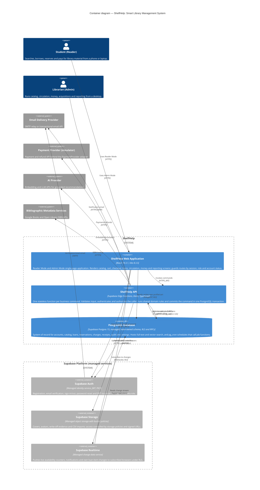

# ShelfHelp: Smart Library Management System

## PA4 Software Architecture — C4 Level 2 (Container Diagram)

### Revision history

| Date | Version | Description | Author |
| :--- | :--- | :--- | :--- |
| 24/Nov/2026 | 1.0 | Initial container view and written explanation | Nguyễn Anh Khôi |
| 24/Nov/2026 | 1.1 | Aligned the container boundary with team-owned business logic; trimmed duplicated detail | Nguyễn Anh Khôi |
| 24/Nov/2026 | 1.2 | Explicit container communication protocols, services provided, and component collaborations | Nguyễn Anh Khôi |
| 24/Nov/2026 | 1.3 | Aligned L2 container classification with L3, updated API-DB protocol to PostgREST HTTPS, and removed redundant technology relisting | Nguyễn Anh Khôi |
| 24/Nov/2026 | 1.4 | Stated the locked frontend versions (React 19.3.1, Vite 8.3.5) consistently with the Level 1 and deployment views | Nguyễn Anh Khôi |

### Table of contents

- [1. Introduction](#1-introduction)
- [2. Relationship to the Level 1 view](#2-relationship-to-the-level-1-view)
- [3. Container diagram](#3-container-diagram)
- [4. Container catalogue](#4-container-catalogue)
- [5. Runtime interactions](#5-runtime-interactions)
- [6. Deployment and environments](#6-deployment-and-environments)
- [7. Traceability to PA1–PA4](#7-traceability-to-pa1pa4)
- [8. Quality and failure characteristics](#8-quality-and-failure-characteristics)
- [9. Scope and assumptions](#9-scope-and-assumptions)
- [10. Related views](#10-related-views)

---

## 1. Introduction

This document is the **C4 Level 2 (Container) view** of ShelfHelp. It opens the single ShelfHelp system
box from the [System Context view](../system-context/System-Context.md) into the runtime containers
that execute the product, and shows the managed platform services that support them.

| View | Question answered | Document |
| :--- | :--- | :--- |
| **L1 — System Context** | Who uses ShelfHelp and which external systems does it depend on? | [System-Context.md](../system-context/System-Context.md) |
| **L2 — Container** | What separately running parts make up ShelfHelp, and how do they communicate? | **This document** |
| **L3 — Component** | What modules live inside the two core application containers? | [Component.md](../component/Component.md) |
| **Deployment** | How are the containers mapped to physical and cloud infrastructure nodes? | [Deployment.md](../../deployment/Deployment.md) |

### 1.1 Scope

The view covers the whole product scope from PA1–PA4: identity and membership, catalog and discovery,
cart and checkout, desk circulation, inventory and write-offs, money and receipts, reservations,
acquisitions, notifications, reporting, and the AI assistant. Features planned for PA5 use the same
containers and do not change this view.

### 1.2 References

| ID | Document | Use in this document |
| :--- | :--- | :--- |
| R1 | [`System-Context.md`](../system-context/System-Context.md) | Level 1 actors, external systems, and platform description |
| R2 | [`SHELFHELP_FULLSPEC.md`](../../../../../src/speckit/specs/SHELFHELP_FULLSPEC.md) | Technology stack, data model, functions, and RPCs |
| R3 | [`DECISIONS.md`](../../../../DECISIONS.md) | Supabase and project-layout decisions |
| R4 | [`Use-Case-Diagrams.md`](../../../PA3/use-case-diagrams/Use-Case-Diagrams.md) | Actors and UC-01 to UC-31 |

---

## 2. Relationship to the Level 1 view

The Level 1 view treats ShelfHelp as one system and the Supabase Platform as one external dependency.
At Level 2 the boundary follows **business logic ownership**:

- The **ShelfHelp** boundary contains the React Web Application, the Edge Function API, and the
  PostgreSQL database. The team writes and reviews all code, schema, RLS policies, triggers, and
  transactional RPCs in these containers.
- **Supabase Auth, Storage, and Realtime** remain external managed services. The team configures them
  but does not own or operate their internals.
- The database server is managed by Supabase, but its schema and rules are team-owned, so it is shown
  with the application containers.

A *container* is a separately runnable or deployable unit that executes code or stores data. A shared
TypeScript library is not a container; it is compiled into the Web Application and the API.

---

## 3. Container diagram

The source is also stored as [`mermaid/container.mmd`](mermaid/container.mmd).

---

## 4. Container catalogue

### 4.1 ShelfHelp Web Application

| Property | Value |
| :--- | :--- |
| **Type** | Browser single-page application (client-side container) |
| **Technology** | React 19.3.1, Vite 8.3.5 (see [System-Context §3.2](../system-context/System-Context.md#32-frontend)) |
| **Deployed to** | Static host and global CDN (served over HTTPS) |
| **Source** | [`src/frontend/`](../../../../../src/frontend/) |

**Responsibilities and services provided:**
- Renders the responsive single-page user interface for both **Reader Mode** (students: catalog discovery, borrowing cart, checkout, active loans, reservations, fines/payments, grounded AI assistant) and **Admin Mode** (staff: circulation desk handover and returns, copy management, reservation queues, financial ledger, write-off slips, report exports).
- Enforces client-side route guards based on session state, role (`student` vs `admin`), and account status (`active`, `pending_verification`, `restricted`, `inactive`).
- Executes client-side auxiliary utilities including camera barcode scanning (`@zxing/browser`), barcode label rendering (`JsBarcode`), client-side CSV parsing (`PapaParse`), Excel reporting (`ExcelJS`), and client-side PDF receipt generation (`pdfmake`).

**Communication with other containers:**
- **ShelfHelp API:** Invokes serverless Edge Functions via **HTTPS POST** bearing the caller's JWT bearer token in the `Authorization` header to execute transactional business commands.
- **PostgreSQL Database:** Reads catalog, loan history, charges, and user profile data directly via **PostgREST over HTTPS** using the Supabase anonymous key and caller's JWT, strictly filtered by PostgreSQL Row Level Security (RLS). Personal cart items and profile contact fields are written directly under own-row RLS policies and column-level grants.
- **Supabase Auth:** Initiates self-registration, OTP verification, sign-in/out, and password reset via **HTTPS POST** (PKCE flow).
- **Supabase Storage:** Uploads avatars and evidence images and downloads public cover assets via **HTTPS** using signed URLs or public endpoints.
- **Supabase Realtime:** Subscribes to live book availability counters, personal notifications, and loan-item status changes via persistent **WebSocket (WSS)** connections under RLS filtering.

---

### 4.2 ShelfHelp API

| Property | Value |
| :--- | :--- |
| **Type** | Stateless serverless API container |
| **Technology** | Supabase Edge Functions, Deno runtime, TypeScript |
| **Deployed to** | Supabase Edge Runtime (serverless globally distributed functions) |
| **Source** | [`src/supabase/functions/`](../../../../../src/supabase/functions/) |

**Responsibilities and services provided:**
- Provides a centralized serverless backend hosting one dedicated function per business command (e.g. checkout, handover, return, counter payment, cancellation) and one function per scheduled cron task.
- Validates request payloads against strict Zod schemas shared with the frontend.
- Authenticates callers using JWT tokens and reloads `profiles.status` to enforce authorization policies (role verification, account suspension, debt holds, membership entitlement).
- Applies domain rules using `@shelfhelp/shared` (borrowing entitlements, gating checks, and input validations) and orchestrates single-transaction execution via PostgreSQL RPCs (which enforce transactional formulas and invariants).
- Isolates third-party service communication behind pluggable integration adapters with standard fallback mechanisms.

**Communication with other containers:**
- **ShelfHelp Web Application:** Receives command requests via **HTTPS POST** with JWT authentication; returns standardized JSON responses or error envelopes (`{ error: { reason, message, details } }`).
- **PostgreSQL Database:** Invokes database stored procedures via **PostgREST HTTPS** using the privileged database `service_role` key to execute atomic transactional RPCs (e.g. `rpc_confirm_handover`, `rpc_process_return`), commit audit logs atomically, and query real-time profile states.
- **Supabase Auth:** Calls the GoTrue Admin API via **HTTPS** to create verified user accounts or manage user security metadata.
- **PostgreSQL Database (`pg_cron`):** Receives background job trigger invocations from PostgreSQL via **HTTPS** using the `pg_net` extension with an internal authorization secret header (`x-job-secret`).
- **External Services:** Communicates with external providers (**Email Provider** via HTTPS/SMTP, **Payment Provider** simulator via HTTPS, **AI Provider** via HTTPS, and **Bibliographic Metadata Services** via HTTPS).

---

### 4.3 PostgreSQL Database

| Property | Value |
| :--- | :--- |
| **Type** | Relational database and policy enforcement container |
| **Technology** | PostgreSQL 15 (Supabase managed), `pg_trgm`, `unaccent`, `pgvector`, `pg_cron`, `pg_net` |
| **Deployed to** | Supabase Managed Cloud Infrastructure |
| **Source** | [`src/supabase/migrations/`](../../../../../src/supabase/migrations/), [`src/supabase/tests/`](../../../../../src/supabase/tests/) |

**Responsibilities and services provided:**
- Central system of record for all persistent application data: profiles, accounts, books, copies, copy events, loans, reservations, charges, receipts, audit logs, write-off slips, acquisitions, and system settings.
- Enforces data integrity through declarative constraints (`CHECK`, `FOREIGN KEY`, `UNIQUE`), PostgreSQL triggers, and immutable ledger rules (preventing UPDATE/DELETE on audit, receipts, and inventory history).
- Enforces deny-by-default Row Level Security (RLS) on all tables for PostgREST client queries.
- Executes complex transactional business logic, row locking, and atomic audit logging via security definer stored procedures (RPCs). All mutation RPCs have `EXECUTE` privileges revoked from `PUBLIC`, `anon`, and `authenticated`, granted exclusively to `service_role`.
- Powers diacritic-insensitive Vietnamese catalog text search (`unaccent`, `tsvector`, `pg_trgm`) and vector similarity search for the AI assistant (`pgvector` HNSW indexes).
- Drives background schedule execution via `pg_cron`.

**Communication with other containers:**
- **ShelfHelp Web Application:** Exposes read endpoints directly to the browser via **PostgREST over HTTPS**, enforcing RLS on every table query.
- **ShelfHelp API:** Accepts database queries and stored procedure invocations from Edge Functions via **PostgREST HTTPS** authenticated with the `service_role` key.
- **Supabase Realtime:** Streams table mutation events (inserts/updates on `books`, `notifications`, `loan_items`) via **PostgreSQL logical replication**.
- **ShelfHelp API (pg_cron triggers):** Dispatches scheduled job execution signals to Edge Function job handlers via **HTTPS** requests initiated by the `pg_net` extension.

---

### 4.4 Managed platform services

| Container | Responsibilities & services provided | Technology | Communication with other containers |
| :--- | :--- | :--- | :--- |
| **Supabase Auth** | Manages user registration, email OTP verification, password recovery, session token issuance, and JWT rotation with embedded `app_metadata.role`. | GoTrue identity server, JWT, PKCE | Receives **HTTPS** requests from **Web Application** (sign-up/in) and **ShelfHelp API** (admin user operations); dispatches verification/reset emails to **Email Delivery Provider** via **SMTP**. |
| **Supabase Storage** | Stores binary files across dedicated buckets (`covers`, `avatars`, `evidence`, `imports`); enforces file size limits, MIME type filtering, and access security. | Supabase Object Storage (S3-compatible) | Accepts direct file uploads and downloads from **Web Application** via **HTTPS**; validates permissions against bucket storage policies and generates signed URLs for private assets. |
| **Supabase Realtime** | Listens to database replication stream and broadcasts live table changes to active client subscriptions. | Elixir Phoenix Channels / WebSocket | Ingests table modification events from **PostgreSQL Database** via **logical replication**; pushes live updates to **Web Application** via persistent **WebSocket (WSS)** connections under RLS filtering. |

### 4.5 External systems

The email provider, payment simulator, AI provider, and bibliographic services sit outside ShelfHelp
and are reached only through adapters in the API. Their role is shown by the diagram arrows; the
Level 1 view describes their integration and failure behaviour in
[§3.7](../system-context/System-Context.md#37-external-apis-and-service-integrations).

Static hosting, Cloudflare Turnstile, Sentry, and CI are supporting services rather than business
systems; they are listed in the Level 1 technology stack.

---

## 5. Runtime interactions

### 5.1 Read path

1. The SPA obtains or refreshes a session through Supabase Auth.
2. The SPA queries PostgREST with the user's JWT. PostgreSQL applies RLS: students see active books,
   public reviews, membership plans, and their own rows; staff see the rows their screens need.
3. Complex catalog search runs through the `search_books` RPC.
4. Realtime pushes availability counters, notifications, and the caller's own loan changes.

### 5.2 Command path

1. The SPA validates a form with the shared schema and invokes an Edge Function with the JWT.
2. The function validates the body, authenticates the caller, reloads the profile, and applies gating.
3. The command executes as one PostgreSQL RPC/transaction through the service role.
4. The function returns the result or the standard error envelope, and the SPA maps the reason to a
   user-facing message.

The underlying principles are summarized in [Key principles](../system-context/System-Context.md#23-key-principles)
and detailed in the [API component view](../component/Component.md#9-shelfhelp-api--interactions-and-design-notes).

### 5.3 Authentication path

1. Registration calls `register-student`, which creates the Auth user and the `profiles` row.
2. Supabase Auth sends the verification email through the email provider.
3. The SPA verifies the OTP, receives a JWT, and loads the caller's profile; the role and status select
   the Reader or Admin shell.
4. Every command reloads the profile, so a deactivated or restricted account is refused even with an
   old token.

### 5.4 Scheduled job path

1. `pg_cron` fires a schedule in UTC.
2. A SQL job runs directly, or `pg_net` calls a job Edge Function with a secret header.
3. The job uses the same domain rules and transactional RPCs as user commands, and records its outcome
   in `job_runs`.

### 5.5 File path

1. The SPA uploads covers, avatars, evidence, or CSV files directly to Supabase Storage under the
   caller's identity.
2. Storage policies check the bucket, role, and avatar ownership; private reads use signed URLs.
3. Import CSVs are deleted after seven days.

### 5.6 Assistant path

1. `chat-send` embeds the query and retrieves candidate books from the `pgvector` index.
2. The LLM answers using only those candidates; the server drops any recommended book id outside the
   retrieved set.
3. If the provider fails, the assistant returns keyword results and the retrieved list.

---

## 6. Deployment and environments

| Environment | Frontend | Backend | Data |
| :--- | :--- | :--- | :--- |
| **Local** | Vite dev server | Supabase local stack in Docker | Local PostgreSQL with migrations and seed |
| **CI** | Build and Playwright against the local stack | Functions served locally; pgTAP and integration tests | Ephemeral local database |
| **Dev / staging** | Preview deployment of the SPA | Supabase project with migrations applied by CI | Separate Supabase project |
| **Production** | Static host and CDN over HTTPS | Supabase project | Managed PostgreSQL with backups |

Schema changes move only through migrations applied by CI. The SPA release is a static asset build;
the API release deploys the changed functions.

---

## 7. Traceability to PA1–PA4

| Feature group | Features | Use cases | Containers involved |
| :--- | :--- | :--- | :--- |
| **Accounts, identity, profile** | FEAT-01, FEAT-02 | UC-01–UC-04, UC-31 | Web App, API, Database, Auth, Email |
| **Membership and entitlements** | FEAT-03 | UC-05 | Web App, API, Database, Payment |
| **Catalog, search, barcode, wishlist** | FEAT-04–FEAT-07 | UC-06–UC-08 | Web App, Database, Storage |
| **Cart, checkout, payment** | FEAT-08, FEAT-09 | UC-09, UC-10 | Web App, API, Database, Payment, Email |
| **Loans, renewals, reviews, fines, loss** | FEAT-10–FEAT-14 | UC-11, UC-12, UC-15, UC-18 | Web App, API, Database, Payment, Email |
| **Reservations and strikes** | FEAT-16, FEAT-17 | UC-14, UC-29 | Web App, API, Database, Email |
| **Suggestions and acquisitions** | FEAT-18–FEAT-20 | UC-16, UC-24, UC-25 | Web App, API, Database, Storage, Email, ISBN |
| **Desk circulation and inventory** | FEAT-21–FEAT-23 | UC-19–UC-22, UC-26 | Web App, API, Database, Storage |
| **Receipts, ledger, reversals** | FEAT-24 | UC-13, UC-23 | Web App, API, Database, Payment |
| **Analytics and reporting** | FEAT-25 | UC-27 | Web App, Database (`get_dashboard_kpis`, `get_rankings`) |
| **AI research assistant** | FEAT-26 | UC-17 | Web App, API, Database (`pgvector`), AI Provider |
| **Notifications and reminders** | FEAT-15 | UC-28, UC-30 | Web App, API, Database, Email |

All feature groups and all 31 use cases use the Web Application and PostgreSQL; groups with a business
write add the API, and groups that touch a third party add the corresponding external system.

---

## 8. Quality and failure characteristics

| Attribute | Design response |
| :--- | :--- |
| **Integrity** | One transaction per command; fixed lock order; unique indexes for active loans, holds, and reversals; immutable ledgers. |
| **Security** | TLS, PKCE, short-lived JWT, RLS on every table, service-role key confined to functions, bucket policies per storage bucket, data minimisation to the AI provider. |
| **Availability** | Static SPA on a CDN; stateless functions; the database is the only stateful dependency. |
| **Performance** | PostgREST for simple reads, indexed RPCs for complex reads, `FOR UPDATE SKIP LOCKED` for checkout, browser-side import/export. |
| **Recoverability** | Idempotency keys make retries safe; the email outbox retries; jobs record outcomes; migrations are reproducible. |
| **Observability** | Sentry, PostgreSQL logs, append-only `audit_logs` and `inventory_transactions`, `job_runs` for scheduled work. |

If the Supabase project is unavailable, reads, writes, auth, and storage fail; the SPA remains
loadable from the CDN but cannot serve data. This is accepted for a course-scale system.

---

## 9. Scope and assumptions

**Out of scope:** deployment topology inside Supabase, network diagrams, vendor internals, and
class/module structure.

**Assumptions:** one library branch, one staff role, institutional email, a catalog at or below roughly
50,000 titles, simulated payments with no card data, best-effort email with an in-app durable record,
and Supabase as the managed backend.

---

## 10. Related views

- **Up:** [System Context (C4 Level 1)](../system-context/System-Context.md)
- **Down:** [Component Diagrams (C4 Level 3)](../component/Component.md)
- **Deployment:** [Deployment View (C4 Level 4)](../../deployment/Deployment.md)
- **Source:** [`mermaid/container.mmd`](mermaid/container.mmd)
