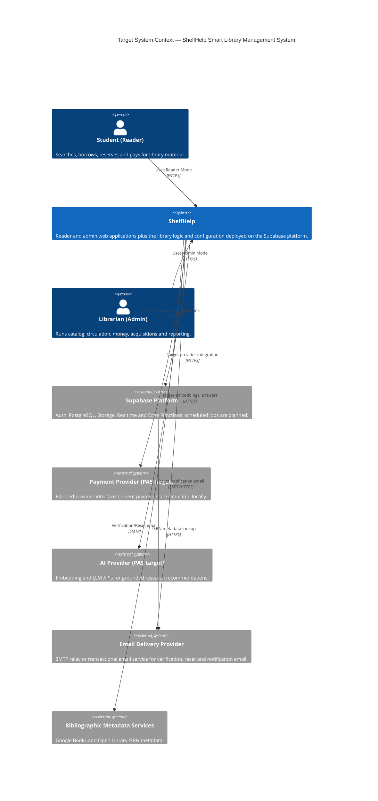

# ShelfHelp: Smart Library Management System
# PA4 Software Architecture — Technology Stack and System Context (C4 Level 1)

**Version:** 2.0

---

## Revision History

| Date | Version | Description | Author |
| :--- | :--- | :--- | :--- |
| 23/Nov/2026 | 1.0 | Initial system context and technology stack | Nguyễn Anh Khôi |
| 23/Nov/2026 | 1.1 | Modelled Supabase as an external platform dependency; separated the email provider | Nguyễn Anh Khôi |
| 24/Nov/2026 | 1.2 | Added cross-links to the Level 2 and Level 3 views; included Realtime in the platform description | Nguyễn Anh Khôi |
| 24/Nov/2026 | 1.3 | Aligned context relationships and trimmed duplicated traceability and external-system detail | Nguyễn Anh Khôi |
| 24/Nov/2026 | 1.4 | Clarified client direct write scope, documented RPC EXECUTE restrictions, and trimmed redundant technology stack detail | Nguyễn Anh Khôi |
| 24/Nov/2026 | 1.5 | Restated the frontend versions as the installed React 19.3.1 / Vite 8.3.5, aligning with the deployment view | Nguyễn Anh Khôi |
| 24/Nov/2026 | 1.6 | Applied the locked React 19.3.1 / Vite 8.3.5 notation consistently in §3.1 and §3.2 | Nguyễn Anh Khôi |
| 24/Nov/2026 | 1.7 | System Context diagram presented as a rendered image, matching the other C4 views | Nguyễn Anh Khôi |
| 27/Nov/2026 | 1.8 | Aligned references, actor use-case coverage (UC-01–UC-32), and §3.5 authentication/session rules with PA4 UC-02 and UC-32 changes | Nguyễn Anh Khôi |
| 28/Nov/2026 | 1.9 | Corrected `rpc_search_books` RPC name in §3.3, marked `public.notifications` as implemented in §2.4, and qualified idempotency scope to checkout/payment mutations | Nguyễn Anh Khôi |
| 28/Nov/2026 | 2.0 | Clarified §3.2 — reader/admin code-splitting is a PA5 target; routes are currently separate trees but share one bundle | Nguyễn Anh Khôi |

---

## Table of Contents

- [1. Introduction](#1-introduction)
- [2. Architecture overview](#2-architecture-overview)
- [3. Technology stack](#3-technology-stack)
- [4. C4 Level 1 — System Context](#4-c4-level-1--system-context)

---

## 1. Introduction

**Performed by:** Nguyễn Anh Khôi | **Reviewed by:** Lê Minh Thuận | **Edited by:** Nguyễn Anh Khôi

### 1.1 Purpose

This document records the software architecture of ShelfHelp, the university library management system. It delivers the two PA4 requirements:

1. **Technology stack** — the frontend, backend, database, authentication, storage, and external services used by the system.
2. **C4 Model Level 1** — a System Context diagram in Mermaid, with a written explanation of the system, its users, and its external dependencies.

The Level 2 and Level 3 views are in [Container.md](../container/Container.md) and [Component.md](../component/Component.md); the deployment view is in [Deployment.md](../../deployment/Deployment.md).

### 1.2 Scope

The view covers the two actors and five external dependencies that make up the ShelfHelp system boundary from PA1 through PA4. Features still planned for PA5 add no new external system, so the diagram is unchanged when they are built.

### 1.3 References

| ID | Document | Use in this document |
| :--- | :--- | :--- |
| R1 | [`SHELFHELP_FULLSPEC.md`](../../../../../src/speckit/specs/SHELFHELP_FULLSPEC.md) | Authoritative requirements specification |
| R2 | [`docs/DECISIONS.md`](../../../../DECISIONS.md) | Recorded architectural decisions |
| R3 | [`Vision Document`](../../vision-document/Vision-Document.md) | Stakeholders, quality targets, and feature catalogue (`FEAT-01`–`FEAT-26`, v2.1) |
| R4 | [`Use-Case Diagrams`](../../use-case/Use-Case-Diagrams.md) | Actors and the 32 active use cases (`UC-01` to `UC-32`) |
| R5 | [`PA4 Use-Case Specifications`](../../use-case/) & [`PA3 Specs`](../../../PA3/use-case-specifications/) | Revised `UC-02` and new `UC-32` in PA4; unchanged `UC-01`, `UC-03`–`UC-31` in PA3 |
| R6 | [`Project Plan`](../../../PA3/project-plan/Project-Plan.md) | Phase plan and Build 2 scope |

---

## 2. Architecture overview

**Performed by:** Nguyễn Anh Khôi | **Reviewed by:** Lê Minh Thuận | **Edited by:** Nguyễn Anh Khôi

### 2.1 Architectural style

ShelfHelp is a React single-page application backed by the **Supabase platform**. The browser reads through PostgREST under Row Level Security (RLS); implemented circulation and reader business mutations use Edge Functions and PostgreSQL RPCs. Direct client writes include own `cart_items`, permitted profile fields, and own `notifications.read_at` under RLS and grants. There is no custom long-running backend server. Migrations enable `pg_cron` and `pg_net`, but scheduled job handlers and schedules for fines, expiry, email and embeddings remain targets; the existing `send-reminders` function is invoked by an admin, not a cron job.

**Reading the views:** The C4 diagrams show the intended product architecture, including explicitly marked PA5 targets; arrows to planned components are not evidence of current runtime integration. The implementation status below reflects the repository through migrations `0018`, not a claim about a particular deployed environment.

The inline Mermaid diagrams and linked `.mmd` files are authoritative. Existing `.png` exports are historical and have not been regenerated for this reconciliation.

The team owns the application code, database schema, Edge Functions, and policies, but does not operate the Supabase infrastructure. The platform is therefore modelled as an external dependency at C4 Level 1 (see §4), and its managed services are shown explicitly in the [Level 2](../container/Container.md) view. This style keeps the deployable simple for a five-person team while still providing transactional integrity, server-side authorization, and a single source of truth for data.

### 2.2 System capabilities

The intended system capabilities below cover the 32 active use cases and 26 features in the vision catalogue. They are product scope, not a claim that every capability is currently implemented; see §2.4.

| Area | Capabilities |
| :--- | :--- |
| **Identity and membership** | Self-registration and email verification, sign-in/out with failed-attempt lockout and optional persistent sessions, credential recovery, active-session inventory and remote revocation, profile and avatar, two membership tiers with entitlement snapshots |
| **Catalog and discovery** | Book and copy maintenance, diacritic-insensitive search and filters, browsing, ISBN barcode lookup, book detail, reviews, wishlist |
| **Borrowing and fulfilment** | Cart, atomic checkout, copy holds, 48-hour pickup window, online or counter payment, handover, return, renewal, lost-book resolution |
| **Reservations and acquisitions** | FIFO reservation queues with automatic promotion and strikes, student suggestions, acquisition batches, shipment receipt |
| **Money and inventory** | Charges and payments, immutable receipts and reversals, copy status history, write-off slips with evidence |
| **Administration and insight** | Student account management, reservation queues, reminders, notification centre, dashboards and report exports, grounded AI recommendations |

### 2.3 Key principles

| Principle | Meaning |
| :--- | :--- |
| **Server-authoritative business writes** | Protected circulation and payment mutations use Edge Functions and RPCs restricted to `service_role`; permitted own-row cart/profile writes and notification read-state updates are separate RLS-controlled exceptions. |
| **One command, one transaction** | Checkout, handover, return, payment, and renewal either commit completely or roll back completely. |
| **Domain logic** | Current rules are principally enforced by SQL RPCs and function-specific validation. `src/shared` provides types, reason codes, auth and catalog helpers; comprehensive shared domain rules and parity tests are targets. |
| **Defence in depth** | RLS filters rows, Edge Functions check role and account status, and database constraints and triggers enforce invariants. |

### 2.4 Delivery across PA1–PA4

| Phase | Added in this phase | Architectural elements exercised |
| :--- | :--- | :--- |
| **PA1** | Project proposal, actors, feature list | Problem scope and initial technology direction |
| **PA2** | Vision document, Spec Kit setup, requirement IDs | Feature catalogue, quality attributes, traceability |
| **PA3** | 31 use cases, UI prototypes, first FR (authentication) | React auth screens, `register-student` function, `profiles`/`books`/`copies` schema, RLS, auth triggers |
| **PA4** | Architecture baseline, circulation and reader loan/fine slice, `UC-02` and `UC-32` specifications | Implemented: `handover-items`, `return-loan`, `record-counter-payment`, `cancel-reservation`, `checkout-cart`, `complete-simulated-payment`, catalog/import/write-off/inventory handlers, circulation/queue tables and RPCs, reader loan/fine/reservation flows, and admin circulation/queues/ledger screens; `public.notifications` and `public.reservation_strike_events` are created in `0013`. Specified but **not yet implemented** (PA5): UC-02 lockout and UC-32 session endpoints |
| **PA5** *(planned)* | Final release | Remaining catalog and acquisition workflows, receipt operations, analytics, automated reminders, assistant, UC-02 failed-sign-in lockout/persistent-session hardening, UC-32 active-session endpoints (`list-sessions`, `revoke-session`, `revoke-other-sessions`), and scheduled job functions; also reconciliation of several target tables (`memberships`, `email_outbox`, `suggestions`, `batches`, `chats`, `audit_logs`, `copy_events`, `job_runs`, and `settings`) |

In the PA4 circulation test slice, loan requests and items for handover testing are provided via deterministic database seeds (`src/supabase/seed.sql`) and direct staff counter operations. The `checkout-cart` and `complete-simulated-payment` handlers are also implemented in the codebase, while broader PA5 workflows and scheduled jobs remain target scope.

---

## 3. Technology stack

**Performed by:** Nguyễn Anh Khôi | **Reviewed by:** Lê Minh Thuận | **Edited by:** Nguyễn Anh Khôi

### 3.1 Stack at a glance

| Layer | Technology | Version / status | Role |
| :--- | :--- | :--- | :--- |
| **Frontend** | React + Vite; JavaScript/JSX UI, strict TypeScript in the shared package | React 19.3.1, Vite 8.3.5 | Reader and admin SPA |
| **Backend logic** | Supabase Edge Functions (Deno, TypeScript) | Deployed on Supabase | One function per business command; validation, authorization, one transaction |
| **Database** | Supabase PostgreSQL | 15 (managed) | Primary store, constraints, triggers, RLS, search, scheduling |
| **Authentication** | Supabase Auth | Managed service | Identity, verification, password reset, JWT with role claim |
| **Cloud storage** | Supabase Storage | Managed service | Covers, avatars, evidence photos, CSV imports |
| **Scheduling** | `pg_cron` + `pg_net` | Extensions enabled; jobs planned | Nightly jobs, reminders, expiry, email outbox, embeddings |
| **External APIs** | Email provider, payment simulator, embedding API, LLM API, Google Books, Open Library | See §3.7 | Email, payments, RAG, ISBN metadata |
| **Hosting** | Static host + CDN (Vercel) | Deployment | Serves the SPA over HTTPS |
| **CI/CD and testing** | GitHub Actions, Supabase CLI, Docker, Vitest, Playwright, pgTAP, MSW | Development | Build, migrations, quality gates |

Supabase is a single managed platform that provides the function runtime, PostgreSQL, Auth, Storage, and scheduled jobs. The team owns the schema, functions, and policies deployed there; the infrastructure is operated by Supabase, which is why it appears as an external system in §4.2.

### 3.2 Frontend

The frontend is a responsive **React 19.3.1 + Vite 8.3.5** application. Reader Mode is mobile-first; Admin Mode is desktop-first. Reader and admin routes are structured as separate route trees so admin code is kept out of student navigation; route-level `React.lazy` / `Suspense` code-splitting is planned for PA5 so that admin bundles are never downloaded by students.

- **Routing and access:** React Router is planned to add guarded role/account-status routes. Students opening `/admin/*` will receive a 403 page; staff will be redirected to `/admin`.
- **Data and forms:** TanStack Query is planned; forms currently use React controls and handler-specific validation, with selected shared helpers.
- **UI:** Hand-written CSS and native HTML controls are used; date and number formatting follows `Asia/Ho_Chi_Minh`. React Router and TanStack Query are planned additions.
- **Later implementation:** Barcode lookup, barcode labels, CSV/Excel/PDF exports, and image cropping will use implementation-appropriate browser APIs or libraries selected when those features are built.
- **Language note:** the UI is currently JavaScript/JSX; the shared domain and type contracts are strict TypeScript, following an incremental path toward an all-TypeScript frontend.

### 3.3 Backend

The backend logic is a set of **stateless Supabase Edge Functions** written in TypeScript on Deno. Business handlers validate and authorize requests and generally invoke a transactional PostgreSQL RPC; registration and ISBN lookup have different paths. Deployment status depends on the environment.

- **Commands:** implemented handlers include `register-student`, `checkout-cart`, `handover-items`, `return-loan`, `renew-loan`, `pay-reader-charges`, and `submit-book-review`; purchase membership, receipt reversal and `chat-send` remain targets.
- **Reads:** simple reads use PostgREST under RLS; catalog search uses `rpc_search_books`. Dashboard KPI RPCs remain targets.
- **Concurrency and idempotency:** checkout uses `FOR UPDATE SKIP LOCKED` and accepts an optional idempotency key; individual commands have their own semantics. There is no general retry/idempotency gateway.
- **Integrations:** `lookup-isbn` calls Google Books and Open Library directly with fallback. Payment is simulated in the application/database; generic payment, email and AI adapters remain targets.

### 3.4 Database

**Supabase PostgreSQL 15** is the system of record. Supabase operates the database server; the team owns the schema, migrations, RLS policies, and transactional RPCs.

- **Schema as code:** migrations under `src/supabase/migrations/`, applied by CI and not manual dashboard edits.
- **Integrity:** UUID keys, `timestamptz` in UTC, integer VND amounts, `CHECK` constraints for every status, and unique indexes preventing double holds, duplicate active loans, and repeated receipt reversals.
- **Immutability:** the implemented ledger and inventory rules are defined in migrations. `audit_logs`, `settings_history`, and `copy_events` are target tables, not evidence of implemented audit trails.
- **Search:** `unaccent`, `pg_trgm`, and text search support catalog search. The vector extension and embedding column exist; an HNSW-backed assistant remains a target.
- **Security:** RLS is enabled on every table; a table without a policy is unreadable. Students see their own rows; staff see what their screens need.

### 3.5 Authentication and authorization

- **Supabase Auth**, a managed service of the Supabase platform, handles email verification, sign-in/out, password reset, and session records (`auth.sessions`). Student registration is validated by the `register-student` Edge Function, which creates Auth users through the Admin API; direct public sign-up is disabled. The browser uses PKCE and auto-refreshes the session. Auth handles verification/reset email; application notification email is a target.
- **Persistent sessions and credential handling (`UC-02`):** The current form temporarily holds the entered password in React state. The Supabase client uses its default persistent session storage with auto-refresh; it does not implement a "Keep me signed in" choice or refresh-token-only storage. The selectable persistence and credential-handling behaviour specified by UC-02 remains a PA5 target.
- **PA5 target — server-enforced lockout and throttling (`UC-02`):** After five consecutive failed sign-in attempts for the same identifier (email or Student ID) within 15 minutes, the identifier will be locked server-side for 10 minutes (HTTP 429 with `Retry-After` and a generic message), paired with a per-IP/device rate limit. A successful sign-in or password reset clears the counter, and password recovery is never blocked. Today only client-side handling of a 429 response exists.
- **PA5 target — active-session inventory and revocation (`UC-32`):** Because `auth.sessions` is not exposed through PostgREST, Edge Functions (`list-sessions`, `revoke-session`, `revoke-other-sessions`) will call the Auth Admin API with `service_role`. Callers are identified strictly from their verified JWT, no raw tokens are returned, revocation is idempotent and audit-logged, and the current session ends only through normal sign-out. None of these functions exist in `src/supabase/functions/` yet.
- **Role and authorization:** Protected handlers using `_shared/auth.ts` verify the user and require both `app_metadata.role` and `profiles.role` to match, then check profile status. Allowed statuses vary by action: for example, restricted readers can pay charges and submit reviews. RLS and individual RPCs enforce additional action-specific rules.
- **Revocation and bots:** Protected handlers reload profile status; registration is a separate unauthenticated flow. Cloudflare Turnstile is planned.
- **Secrets:** only the Supabase URL and anon key reach the browser. The service-role key and provider keys exist only in Edge Function secrets and CI.

### 3.6 Cloud file storage

**Supabase Storage**, a managed service of the Supabase platform, holds binary assets.

| Bucket | Visibility | Write | Read | Limit |
| :--- | :--- | :--- | :--- | :--- |
| `covers` | Public read | Staff | Anyone | 1 MB; JPEG/PNG/WebP |
| `avatars` | Private | Owner (`{uid}/avatar.jpg`) | Owner and staff via signed URL | 300 KB; JPEG |
| `evidence` | Private | Staff | Staff via signed URL | 10 MiB; JPEG/PNG/WebP |
| `imports` | Private | Staff | Staff | 2 MB; CSV; seven-day cleanup is a target |

The local configuration defines these bucket settings; evidence and certain staff bucket policies are present in migrations. Avatar ownership policies and scheduled import cleanup require further implementation or environment verification.

### 3.7 External APIs and service integrations

The table describes the intended integrations and failure behaviour. Currently ISBN lookup is implemented directly; payment is simulated locally, and application email outbox, AI and monitoring integrations remain targets.

| Service | Purpose | Failure behaviour |
| :--- | :--- | :--- |
| SMTP / transactional email provider (Resend, Brevo, or SendGrid) | Delivery of verification, reset, and notification email | Retries through the outbox; the in-app notification remains |
| Payment provider (simulator) | Membership, Premium fee, fine, damage, and loss payments; refunds | Deterministic simulator behind `PaymentProvider`, which can be replaced by a real gateway |
| Embedding API | Vectors for books and queries (English/Vietnamese) | Assistant falls back to keyword retrieval |
| LLM API (for example Claude) | Query rewrite and grounded answer | Assistant shows the retrieved book list without synthesis |
| Google Books, Open Library | ISBN metadata during cataloguing and import | Manual entry fallback |
| Cloudflare Turnstile | CAPTCHA on authentication forms | User retries |
| Sentry | Error and performance monitoring | Captured silently without blocking user workflows |

### 3.8 Hosting, CI/CD, and testing

- **Hosting & Environments:** The SPA is deployed to a static host and global CDN over HTTPS; the backend is hosted on Supabase. Environments span local Docker stacks, automated CI, and cloud deployment (detailed in [Container view §6](../container/Container.md#6-deployment-and-environments)).
- **CI/CD:** GitHub Actions executes linting, type-checking, pgTAP database tests, Edge Function integration tests, and Playwright end-to-end tests.
- **Testing:** Vitest is planned for domain/UI tests; pgTAP covers database schema/RPC invariants and RLS, and Playwright covers critical user journeys.

---

## 4. C4 Level 1 — System Context

**Performed by:** Nguyễn Anh Khôi | **Reviewed by:** Lê Minh Thuận | **Edited by:** Nguyễn Anh Khôi

### 4.1 Purpose of the view

The System Context view shows ShelfHelp as a single system, the people who use it, and the external systems it depends on. In the diagram, the two people are shown as person shapes, ShelfHelp is the single system box, external systems are the grey boxes, and each arrow is a directed dependency labelled with its purpose and protocol. Ownership, not hosting, defines the boundary: the team's application, schema, Edge Functions, and policies are inside ShelfHelp even though they run on the Supabase platform. The platform is shown as one external system at this level and is decomposed in the Level 2 view.

### 4.2 System Context diagram

The diagram above is the **target** context. Application notification email and AI are planned; the payment simulator is local rather than an external HTTPS provider in the current implementation.

Both people reach ShelfHelp over HTTPS: the Student through Reader Mode, the Librarian through Admin
Mode. ShelfHelp itself is a single system box, while everything it depends on sits outside the boundary —
the Supabase Platform, which supplies database, Auth, Storage, Realtime and Edge Functions. Scheduled
jobs and application email, payment-provider and AI integrations are targets. ISBN lookup is implemented
directly. Supabase Auth handles verification and reset mail through its configured email service.

§4.3 describes the actors, §4.4 the external systems, and §4.5 explains each relationship in turn.

Source: [`mermaid/system-context.mmd`](mermaid/system-context.mmd).

### 4.3 People (actors)

| Actor | Description | Main goals | Use cases |
| :--- | :--- | :--- | :--- |
| **Student (Reader)** | University student using Reader Mode on a phone or laptop; may be a non-member or a Premium member. | Find and borrow books, manage loans, charges, and active sessions, reserve titles, suggest acquisitions, get AI recommendations | UC-01 to UC-18, UC-28, UC-32 |
| **Librarian (Admin)** | Library staff using Admin Mode on a desktop; holds the single `admin` role. | Maintain the catalog, run circulation, manage money, acquisitions, students, own active sessions, and reports | UC-02, UC-04, UC-13, UC-18, UC-19 to UC-32 |

Staff accounts cannot borrow; a staff member who is also a student uses a separate student account. The two roles do not form a generalisation hierarchy.

### 4.4 External systems

| External system | What it provides | Interaction with ShelfHelp |
| :--- | :--- | :--- |
| **Supabase Platform** | Managed backend: PostgreSQL, Auth, Storage, Realtime, Edge Functions runtime, scheduled jobs | The team's schema, functions, and policies are deployed there. The browser reads via PostgREST under RLS and authenticates through Supabase Auth; business writes run in Edge Functions and commit in one PostgreSQL transaction. Privileged session queries against `auth.sessions` via the Auth Admin API are the PA5 target for `UC-32` |
| **Email Delivery Provider** | Delivery of verification, reset, and notification email | Supabase Auth handles verification/reset; application email outbox is a target. |
| **Payment Provider (target)** | Proposed online payment and refunds | Current payments are simulated locally; a `PaymentProvider` interface is a target. |
| **AI Provider (target)** | Embeddings and grounded answer generation | Planned data minimisation and server-side validation of retrieved book IDs; no assistant integration exists today. |
| **Bibliographic Metadata Services** | ISBN metadata (title, authors, publisher, year, description) | Used only during cataloguing and import; failure falls back to manual entry |

**Supporting services.** Static hosting, Cloudflare Turnstile, Sentry, and the CI toolchain are operational dependencies rather than business systems. They are described in §3.7 and §3.8 instead of being drawn as external system boxes.

### 4.5 Explanation of the diagram

**The system.** ShelfHelp is one software system containing both Reader and Admin experiences and the server-side library logic. Users reach it over HTTPS; there is no native app and no public third-party API.

**The two actors.** The Student uses Reader Mode for personal goals: discovery, borrowing, payments, reservations, suggestions, notifications, and the assistant. The Librarian uses Admin Mode for operational goals: catalog accuracy, circulation, money, acquisitions, student management, and reporting. Both relationships represent browser traffic; the difference is the role and the authorized capabilities behind it.

**External dependencies.** The platform and providers are described in §4.4. The diagram includes target relationships, so not every arrow represents current runtime use.

### 4.6 Scope boundaries and assumptions

**Out of scope:** a real payment gateway, university student-information-system integration, procurement systems, e-books, native mobile apps, inter-library loan, multiple branches, offline mode, and self-hosted Supabase or other server infrastructure.

**Assumptions:** one library branch and one staff role; students have institutional email addresses; the catalog stays around or below 50,000 titles, where PostgreSQL search is sufficient; payment is simulated and no card data is processed; email is best-effort with an in-app notification as the durable record; Supabase remains the managed platform and hosting provider for the backend.

Feature and use-case traceability is maintained in the [Level 2 container view](../container/Container.md#7-traceability-to-pa1pa4) and the [Level 3 component view](../component/Component.md#11-traceability).
