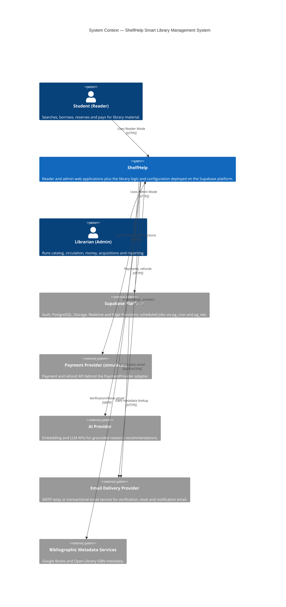
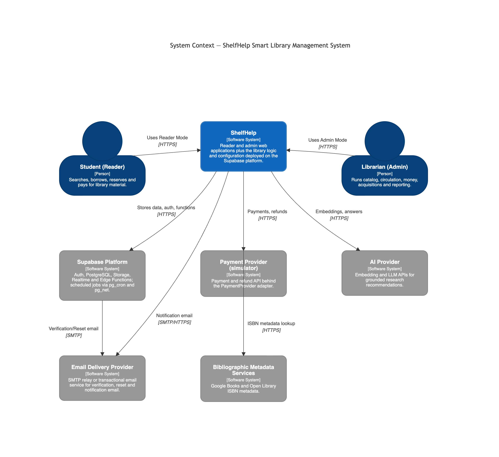

# ShelfHelp: Smart Library Management System
# PA4 Software Architecture — Technology Stack and System Context (C4 Level 1)

**Version:** 1.3

---

## Revision History

| Date | Version | Description | Author |
| :--- | :--- | :--- | :--- |
| 23/Nov/2026 | 1.0 | Initial draft: technology stack, System Context diagram, actors, external systems, and key principles | Nguyễn Anh Khôi |
| 24/Nov/2026 | 1.1 | Completed architecture sections: Supabase modelled as external platform, RPC EXECUTE restrictions, React 19.3.1 / Vite 8.3.5 versions locked, diagrams as rendered images | Nguyễn Anh Khôi |
| 27/Nov/2026 | 1.2 | PA4 alignment: UC-02 and UC-32 specifications integrated into §3.5 (sign-in lockout, persistent sessions, active-session revocation) and use-case traceability updated to UC-01–UC-32 | Nguyễn Anh Khôi |
| 28/Nov/2026 | 1.3 | PA4 submission polish: implementation status (§5) promoted to top-level heading with PA5-planned items and `PA4/src/` scope notes; Related views (§6) added; formatting standardized across all C4 views | Nguyễn Anh Khôi |

---

## Table of Contents

- [1. Introduction](#1-introduction)
- [2. Architecture overview](#2-architecture-overview)
- [3. Technology stack](#3-technology-stack)
- [4. C4 Level 1 — System Context](#4-c4-level-1--system-context)
- [5. Implementation status](#5-implementation-status)
- [6. Related views](#6-related-views)

---

## 1. Introduction

**Performed by:** Nguyễn Anh Khôi | **Reviewed by:** Lê Minh Thuận | **Edited by:** Nguyễn Anh Khôi

### 1.1 Purpose

This document records the software architecture of ShelfHelp, the university library management system. It delivers the two PA4 requirements:

1. **Technology stack** — the frontend, backend, database, authentication, storage, and external services used by the system.
2. **C4 Model Level 1** — a System Context diagram in Mermaid, with a written explanation of the system, its users, and its external dependencies.

The Level 2 and Level 3 views are in `Container.md` and `Component.md`; the deployment view is in `Deployment.md`.

### 1.2 Scope

The view documents the software architecture of the whole project, covering every feature from PA1 through PA4. It is a deliberately stable view: PA4 and PA5 capabilities use the same two actors and the same five external systems, so the context diagram does not change as the remaining features are built. The forward design for PA5 is included where it clarifies where the project is heading; §5 lists what is implemented today and what the final release still adds.

### 1.3 References

| ID | Document | Use in this document |
| :--- | :--- | :--- |
| R1 | `SHELFHELP_FULLSPEC.md` | Authoritative requirements specification |
| R2 | `DECISIONS.md` | Recorded architectural decisions |
| R3 | `Vision-Document.md` | Stakeholders, quality targets, and feature catalogue (`FEAT-01`–`FEAT-26`, v2.1) |
| R4 | `Use-Case-Diagrams.md` | Actors and the 32 active use cases (`UC-01` to `UC-32`) |
| R5 | `UC02.md`, `UC32.md` | Revised `UC-02` and new `UC-32` in PA4; unchanged `UC-01`, `UC-03`–`UC-31` in PA3 |
| R6 | `project-plan` | Phase plan and Build 2 scope |

---

## 2. Architecture overview

**Performed by:** Nguyễn Anh Khôi | **Reviewed by:** Lê Minh Thuận | **Edited by:** Nguyễn Anh Khôi

### 2.1 Architectural style

ShelfHelp is a React single-page application backed by the managed **Supabase platform**. The browser reads data through PostgREST under Row Level Security (RLS); core business writes run in server-side Supabase Edge Functions that execute single-transaction PostgreSQL RPCs. Direct client writes via PostgREST are restricted to personal user data under strict RLS: personal `cart_items` (own rows), `notifications` (`read_at` on own rows), and `profiles` contact fields (enforced via column-level grants and triggers to prevent clients from updating protected columns like `role` or `status`). There is no custom long-running backend server. Scheduled work (overdue fines, reminders, expiry, email delivery, embeddings) runs through `pg_cron` and Edge Functions.

The team owns the application code, database schema, Edge Functions, and policies, but does not operate the Supabase infrastructure. The platform is therefore modelled as an external dependency at C4 Level 1 (see §4), and its managed services are shown explicitly in the Level 2 view. This style keeps the deployable simple for a five-person team while still providing transactional integrity, server-side authorization, and a single source of truth for data.

### 2.2 System capabilities

The system provides the following capabilities in two modes over one shared backend. Together they cover all 32 active use cases and all 26 features in the vision catalogue.

| Area | Capabilities |
| :--- | :--- |
| **Identity and membership** | Self-registration and email verification, sign-in/out with failed-attempt lockout and optional persistent sessions, credential recovery, active-session inventory and remote revocation, profile and avatar, two membership tiers with entitlement snapshots |
| **Catalog and discovery** | Book and copy maintenance, diacritic-insensitive search and filters, browsing, ISBN barcode lookup, book detail, reviews, wishlist |
| **Borrowing and fulfilment** | Cart, atomic checkout, copy holds, 48-hour pickup window, online or counter payment, handover, return, renewal, lost-book resolution |
| **Reservations and acquisitions** | FIFO reservation queues with automatic promotion and strikes, student suggestions, acquisition batches, shipment receipt |
| **Money and inventory** | Charges and payments, immutable receipts and reversals, copy status history, write-off slips with evidence |
| **Administration and insight** | Student account management, reservation queues, reminders, notification centre, dashboards and report exports, grounded AI recommendations |

### 2.3 Key principles

| Principle | Meaning |
| :--- | :--- |
| **Server-authoritative writes** | Protected business tables have no client write policy. Loans, copies, payments, receipts, charges, memberships, and reservations are written only by Edge Functions. All transactional write RPCs are defined as `SECURITY DEFINER` with `EXECUTE` revoked from `PUBLIC`, `anon`, and `authenticated`, and granted exclusively to `service_role`. |
| **One command, one transaction** | Checkout, handover, return, payment, and renewal either commit completely or roll back completely. |
| **Shared domain logic** | Entitlements, gating, fines, reservation promotion, and loss handling live in `src/shared` and are reused by functions, the browser, and tests. |
| **Defence in depth** | RLS filters rows, Edge Functions check role and account status, and database constraints and triggers enforce invariants. |

### 2.4 Delivery across PA1–PA4

| Phase | Added in this phase | Architectural elements exercised |
| :--- | :--- | :--- |
| **PA1** | Project proposal, actors, feature list | Problem scope and initial technology direction |
| **PA2** | Vision document, Spec Kit setup, requirement IDs | Feature catalogue, quality attributes, traceability |
| **PA3** | 31 use cases, UI prototypes, first FR (authentication) | React auth screens, `register-student` function, `profiles`/`books`/`copies` schema, RLS, auth triggers |
| **PA4** | Architecture baseline, circulation and reader loan/fine slice, `UC-02` and `UC-32` specifications | `handover-items`, `return-loan`, `record-counter-payment`, `cancel-reservation`, `checkout-cart`, `complete-simulated-payment`, catalog/import/write-off/inventory handlers, circulation/queue tables and RPCs, reader loan/fine/reservation flows, and admin circulation/queues/ledger screens; `public.notifications` and `public.reservation_strike_events` are created in `0013`, together with the `UC-02` and `UC-32` specifications |
| **PA5** | Final release | Remaining catalog and acquisition workflows, receipt operations, analytics, automated reminders, assistant, `UC-02` failed-sign-in lockout and persistent-session hardening, `UC-32` active-session endpoints (`list-sessions`, `revoke-session`, `revoke-other-sessions`), and scheduled job functions; also the remaining tables (`memberships`, `email_outbox`, `suggestions`, `batches`, `chats`, `audit_logs`, `copy_events`, `job_runs`, and `settings`) |

In the PA4 circulation test slice, loan requests and items for handover testing are provided via deterministic database seeds (`src/supabase/seed.sql`) and direct staff counter operations. §5 records which elements of this view are implemented.

---

## 3. Technology stack

**Performed by:** Nguyễn Anh Khôi | **Reviewed by:** Lê Minh Thuận | **Edited by:** Nguyễn Anh Khôi

### 3.1 Stack at a glance

| Layer | Technology | Version / status | Role |
| :--- | :--- | :--- | :--- |
| **Frontend** | React + Vite; JavaScript/JSX UI, strict TypeScript in the shared package | React 19.3.1, Vite 8.3.5 | Reader and admin SPA |
| **Backend logic** | Supabase Edge Functions (Deno, TypeScript) | Deployed on Supabase | One function per business command; validation, authorization, one transaction |
| **Database** | Supabase PostgreSQL | 15 (managed) | Primary store, constraints, triggers, RLS, search, scheduling |
| **Authentication** | Supabase Auth | Managed service | Identity, verification, password reset, JWT with role claim |
| **Cloud storage** | Supabase Storage | Managed service | Covers, avatars, evidence photos, CSV imports |
| **Scheduling** | `pg_cron` + `pg_net` | Extensions | Nightly jobs, reminders, expiry, email outbox, embeddings |
| **External APIs** | Email provider, payment simulator, embedding API, LLM API, Google Books, Open Library | See §3.7 | Email, payments, RAG, ISBN metadata |
| **Hosting** | Static host + CDN (Vercel) | Deployment | Serves the SPA over HTTPS |
| **CI/CD and testing** | GitHub Actions, Supabase CLI, Docker, Vitest, Playwright, pgTAP, MSW | Development | Build, migrations, quality gates |

Supabase is a single managed platform that provides the function runtime, PostgreSQL, Auth, Storage, and scheduled jobs. The team owns the schema, functions, and policies deployed there; the infrastructure is operated by Supabase, which is why it appears as an external system in §4.2.

### 3.2 Frontend

The frontend is a responsive **React 19.3.1 + Vite 8.3.5** application. Reader Mode is mobile-first; Admin Mode is desktop-first. Reader and admin routes are structured as separate route trees so admin code is kept out of student navigation; route-level `React.lazy` / `Suspense` code-splitting keeps admin bundles off student devices.

- **Routing and access:** Guarded role and account-status routes. Students opening `/admin/*` receive a 403 page; staff are redirected to `/admin`.
- **Data and forms:** TanStack Query owns server state; forms use React controls validated by the shared domain schemas.
- **UI:** Hand-written CSS and native HTML controls are used; date and number formatting follows `Asia/Ho_Chi_Minh`.
- **Client utilities:** Barcode lookup, barcode labels, CSV/Excel/PDF exports, and image cropping use implementation-appropriate browser APIs or libraries.
- **Language note:** the UI is currently JavaScript/JSX; the shared domain and type contracts are strict TypeScript, following an incremental path toward an all-TypeScript frontend.

### 3.3 Backend

The backend logic is a set of **stateless Supabase Edge Functions** written in TypeScript on Deno and deployed on the external Supabase platform. Each function validates the request, authenticates the caller, authorizes the action, runs the shared domain logic, and writes inside one PostgreSQL transaction.

- **Commands:** account, catalog, borrowing, money, circulation, write-off, acquisition, notifications, and assistant functions (for example `register-student`, `checkout-cart`, `handover-items`, `return-loan`, `purchase-membership`, `reverse-receipt`, `chat-send`).
- **Reads:** simple reads use PostgREST under RLS. Complex reads use SQL RPCs such as `rpc_search_books` and `get_dashboard_kpis`.
- **Concurrency and idempotency:** row-level locks in a fixed order; checkout uses `FOR UPDATE SKIP LOCKED`; checkout and payment mutations accept an idempotency key so retries do not duplicate effects.
- **Adapters:** `EmailProvider`, `PaymentProvider`, `Embedder`, `LlmClient`, and `IsbnLookup` isolate third-party services from business rules.

### 3.4 Database

**Supabase PostgreSQL 15** is the system of record. Supabase operates the database server; the team owns the schema, migrations, RLS policies, and transactional RPCs.

- **Schema as code:** migrations under `src/supabase/migrations/`, applied by CI and not manual dashboard edits.
- **Integrity:** UUID keys, `timestamptz` in UTC, integer VND amounts, `CHECK` constraints for every status, and unique indexes preventing double holds, duplicate active loans, and repeated receipt reversals.
- **Immutability:** `receipts`, `inventory_transactions`, `audit_logs`, `settings_history`, and `copy_events` reject updates and deletes.
- **Search:** `unaccent`, `pg_trgm`, full-text `tsvector` columns, and a `pgvector` HNSW index support Vietnamese search and RAG retrieval.
- **Security:** RLS is enabled on every table; a table without a policy is unreadable. Students see their own rows; staff see what their screens need.

### 3.5 Authentication and authorization

- **Supabase Auth**, a managed service of the Supabase platform, handles email verification, sign-in/out, password reset, and session records (`auth.sessions`). Student registration is validated by the `register-student` Edge Function, which creates Auth users through the Admin API; direct public sign-up is disabled. The browser uses PKCE and auto-refreshes the session. Verification, reset, and notification messages leave through the external email provider described in §3.7.
- **Persistent sessions and credential handling (`UC-02`):** The application never stores the user's password in browser storage, cookies, state, or logs. Selecting *"Keep me signed in"* persists only the revocable Supabase refresh token in `localStorage` (`persistSession: true`, `autoRefreshToken: true`), keeping the access token in memory; leaving it unchecked stores the token in `sessionStorage` so it clears when the tab closes. Sign-in uses standard `<form>` `autocomplete` attributes for browser password managers.
- **Server-enforced lockout and throttling (`UC-02`):** After five consecutive failed sign-in attempts for the same identifier (email or Student ID) within 15 minutes, the identifier is locked server-side for 10 minutes (HTTP 429 with `Retry-After` and a generic message), paired with a per-IP/device rate limit. A successful sign-in or password reset clears the counter, and password recovery is never blocked.
- **Active-session inventory and revocation (`UC-32`):** Because `auth.sessions` is not exposed through PostgREST, Edge Functions (`list-sessions`, `revoke-session`, `revoke-other-sessions`) call the Auth Admin API with `service_role`. Callers are identified strictly from their verified JWT, no raw tokens are returned, revocation is idempotent and audit-logged, and the current session ends only through normal sign-out.
- **Role and authorization:** `app_metadata.role` in the JWT is the source of truth (`student` or `admin`), and `profiles.role` is a display copy; both are written only by server code. RLS enforces row access, and Edge Functions additionally check role, account status (`active`, `restricted`, `inactive`), debt hold, membership entitlement, and reservation ban.
- **Revocation and bots:** every protected handler reloads `profiles.status`, so a deactivated admin is refused even with an old token; Cloudflare Turnstile protects register, login, and reset.
- **Secrets:** only the Supabase URL and anon key reach the browser. The service-role key and provider keys exist only in Edge Function secrets and CI.

### 3.6 Cloud file storage

**Supabase Storage**, a managed service of the Supabase platform, holds binary assets.

| Bucket | Visibility | Write | Read | Limit |
| :--- | :--- | :--- | :--- | :--- |
| `covers` | Public read | Staff | Anyone | 1 MB; JPEG/PNG/WebP |
| `avatars` | Private | Owner (`{uid}/avatar.jpg`) | Owner and staff via signed URL | 300 KB; JPEG |
| `evidence` | Private | Staff | Staff via signed URL | 10 MiB; JPEG/PNG/WebP |
| `imports` | Private | Staff | Staff; deleted after 7 days | 2 MB; CSV |

The local configuration defines these bucket settings; evidence and certain staff bucket policies are present in migrations. Avatar ownership policies and scheduled import cleanup require further implementation or environment verification.

### 3.7 External APIs and service integrations

| Service | Purpose | Failure behaviour |
| :--- | :--- | :--- |
| SMTP / transactional email provider (Resend, Brevo, or SendGrid) | Delivery of verification, reset, and notification email | Retries through the outbox; the in-app notification remains |
| Payment provider (simulator) | Membership, Premium fee, fine, damage, and loss payments; refunds | Deterministic simulator behind `PaymentProvider`, which can be replaced by a real gateway |
| Embedding API | Vectors for books and queries (English/Vietnamese) | Assistant falls back to keyword retrieval |
| LLM API (for example Claude) | Query rewrite and grounded answer | Assistant shows the retrieved book list without synthesis |
| Google Books, Open Library | ISBN metadata during cataloguing and import | Manual entry fallback |
| Cloudflare Turnstile | CAPTCHA on authentication forms | User retries |
| Sentry | Error and performance monitoring | Captured silently without blocking user workflows |

### 3.8 Hosting, CI/CD, and testing

- **Hosting & Environments:** The SPA is deployed to a static host and global CDN over HTTPS; the backend is hosted on Supabase. Environments span local Docker stacks, automated CI, and cloud deployment (detailed in Container view §6).
- **CI/CD:** GitHub Actions executes linting, type-checking, spec-matrix traceability, pgTAP database tests, Edge Function smoke tests, and Playwright end-to-end tests.
- **Testing:** Vitest is planned for domain/UI tests; pgTAP covers database schema/RPC invariants and RLS, and Playwright covers critical user journeys.

---

## 4. C4 Level 1 — System Context

**Performed by:** Nguyễn Anh Khôi | **Reviewed by:** Lê Minh Thuận | **Edited by:** Nguyễn Anh Khôi

### 4.1 Purpose of the view

The System Context view shows ShelfHelp as a single system, the people who use it, and the external systems it depends on. In the diagram, the two people are shown as person shapes, ShelfHelp is the single system box, external systems are the grey boxes, and each arrow is a directed dependency labelled with its purpose and protocol. Ownership, not hosting, defines the boundary: the team's application, schema, Edge Functions, and policies are inside ShelfHelp even though they run on the Supabase platform. The platform is shown as one external system at this level and is decomposed in the Level 2 view.

### 4.2 System Context diagram

Mermaid source

Both people reach ShelfHelp over HTTPS: the Student through Reader Mode, the Librarian through Admin
Mode. ShelfHelp itself is a single system box, while everything it depends on sits outside the boundary —
the Supabase Platform, which supplies database, Auth, Storage, Realtime and Edge Functions. Supabase Auth
handles verification and reset mail through its configured email service; the application dispatches its
own notification email, calls the payment provider on the server, and queries the AI provider for
grounded answers. §5 records which of these integrations are implemented.

§4.3 describes the actors, §4.4 the external systems, and §4.5 explains each relationship in turn.

Source: `mermaid/system-context.mmd`.

### 4.3 People (actors)

| Actor | Description | Main goals | Use cases |
| :--- | :--- | :--- | :--- |
| **Student (Reader)** | University student using Reader Mode on a phone or laptop; may be a non-member or a Premium member. | Find and borrow books, manage loans, charges, and active sessions, reserve titles, suggest acquisitions, get AI recommendations | UC-01 to UC-18, UC-28, UC-32 |
| **Librarian (Admin)** | Library staff using Admin Mode on a desktop; holds the single `admin` role. | Maintain the catalog, run circulation, manage money, acquisitions, students, own active sessions, and reports | UC-02, UC-04, UC-13, UC-18, UC-19 to UC-32 |

Staff accounts cannot borrow; a staff member who is also a student uses a separate student account. The two roles do not form a generalisation hierarchy.

### 4.4 External systems

| External system | What it provides | Interaction with ShelfHelp |
| :--- | :--- | :--- |
| **Supabase Platform** | Managed backend: PostgreSQL, Auth, Storage, Realtime, Edge Functions runtime, scheduled jobs | The team's schema, functions, and policies are deployed there. The browser reads via PostgREST under RLS and authenticates through Supabase Auth; business writes run in Edge Functions and commit in one PostgreSQL transaction. Privileged session queries against `auth.sessions` via the Auth Admin API back `UC-32` |
| **Email Delivery Provider** | Delivery of verification, reset, and notification email | Supabase Auth sends verification and reset mail; the application dispatches notification email from its outbox. |
| **Payment Provider (simulator)** | Online payment and refunds | Payments and refunds run through the `PaymentProvider` interface; the pilot uses a simulator, so no card data is processed. |
| **AI Provider** | Embeddings and grounded answer generation | Embedding and LLM calls with data minimisation and server-side validation of retrieved book IDs. |
| **Bibliographic Metadata Services** | ISBN metadata (title, authors, publisher, year, description) | Used only during cataloguing and import; failure falls back to manual entry |

**Supporting services.** Static hosting, Cloudflare Turnstile, Sentry, and the CI toolchain are operational dependencies rather than business systems. They are described in §3.7 and §3.8 instead of being drawn as external system boxes.

### 4.5 Explanation of the diagram

**The system.** ShelfHelp is one software system containing both Reader and Admin experiences and the server-side library logic. Users reach it over HTTPS; there is no native app and no public third-party API.

**The two actors.** The Student uses Reader Mode for personal goals: discovery, borrowing, payments, reservations, suggestions, notifications, and the assistant. The Librarian uses Admin Mode for operational goals: catalog accuracy, circulation, money, acquisitions, student management, and reporting. Both relationships represent browser traffic; the difference is the role and the authorized capabilities behind it.

**External dependencies.** The platform and providers are described in §4.4. The context diagram shows the end-state dependency set, which is stable across PA4 and PA5; §5 records which integrations are implemented.

### 4.6 Scope boundaries and assumptions

**Out of scope:** a real payment gateway, university student-information-system integration, procurement systems, e-books, native mobile apps, inter-library loan, multiple branches, offline mode, and self-hosted Supabase or other server infrastructure.

**Assumptions:** one library branch and one staff role; students have institutional email addresses; the catalog stays around or below 50,000 titles, where PostgreSQL search is sufficient; payment is simulated and no card data is processed; email is best-effort with an in-app notification as the durable record; Supabase remains the managed platform and hosting provider for the backend.

Feature and use-case traceability is maintained in the Level 2 container view and the Level 3 component view.

---

## 5. Implementation status

**Performed by:** Nguyễn Anh Khôi | **Reviewed by:** Lê Minh Thuận | **Edited by:** Nguyễn Anh Khôi

This section is the single place where implementation status is recorded, so the views above can describe the target architecture without interruption. Status refers to repository code in `src/` (and `PA4/src/`) through migration `0018` at the time of writing; the code remains the authority. Tools, dependencies, and features listed under **Still to build (Planned for PA5)** are not yet included in `PA4/src/`.

| Element | Built (in `PA4/src/`) | Still to build (Planned for PA5) |
| :--- | :--- | :--- |
| **Web Application shell** | React 19.3.1 + Vite 8.3.5 SPA, role/status route guards, `supabase-js` data access | TanStack Query (`@tanstack/react-query`) server-state layer, React Router, route-level `React.lazy` / `Suspense` code-splitting |
| **Identity and sessions** | Registration and OTP verification, sign-in/out, password reset, JWT with `app_metadata.role`, session records | Server-enforced sign-in lockout, selectable session persistence, `list-sessions`/`revoke-session`/`revoke-other-sessions` |
| **Catalog and circulation** | Books, copies, search, import, write-off, inventory history, handover, return, renewal, counter payment | Report exports (CSV/Excel/PDF) and dashboard KPI cards |
| **Reservations and fines** | Reservation queues and cancellation, reader charges and payment, reviews | Automated strike expiry and reminder schedules |
| **Acquisitions and assistant** | — | Suggestions, batches, shipment receipt, `chat-send` and HNSW vector retrieval |
| **Scheduled work** | `pg_cron` and `pg_net` extensions enabled | Cron schedules and the `job-*` handlers for fines, expiry, reminders, email outbox and embeddings |
| **External integrations** | ISBN lookup against Google Books and Open Library; local simulated payment | Notification email outbox, `_shared/adapters/` (`EmailProvider`, `PaymentProvider`, `Embedder`, `LlmClient`, `IsbnLookup`), AI provider integration |
| **Audit, testing, and operations** | PostgreSQL logs, inventory history, pgTAP (`src/supabase/tests/`), Playwright E2E (`src/e2e/`) | `audit_logs`, `copy_events`, `job_runs`, Vitest and MSW unit/integration tests, Sentry, Cloudflare Turnstile |

---

## 6. Related views

**Performed by:** Nguyễn Anh Khôi | **Reviewed by:** Lê Minh Thuận | **Edited by:** Nguyễn Anh Khôi

- **Level 1 — System Context:** **This document** (`System-Context.md`)
- **Level 2 — Container View:** `Container.md`
- **Level 3 — Component View:** `Component.md`
- **Level 4 — Deployment View:** `Deployment.md`
- **Source diagrams:** `mermaid/system-context.mmd`
